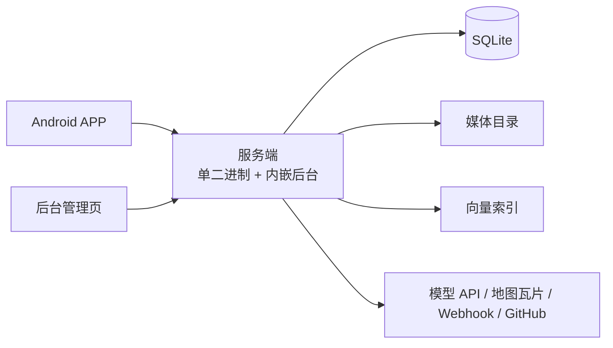

# Love Life

> 两个人的私人生活记录：随手记下此刻，按时间回看，在地图上标出一起去过的地方，还能用自然语言问 AI「这个月记了几条」

[](https://go.dev)
[](https://vuejs.org)
[](https://developer.android.com)
[](https://github.com/bookandmusic/love-life/pkgs/container/love-life)
[](LICENSE)

服务端是一个静态二进制（内嵌后台页面）+ 一个数据目录，整套服务跑在自己的机器上：业务数据只存在自己的服务器，出站只有你配置的模型 API、地图瓦片、通知 Webhook 与更新检查。

## 特性

- **随手记录** - 文字 / 照片 / 视频 / 录音 / 心情 / 地点，单条动态最多 9 个媒体
- **时光与互动** - 倒序信息流、点赞、评论（最长 500 字），滚到接近底部自动加载更多
- **相册整理** - 手动相册 + 按月时间轴；一个媒体只属于一个相册
- **纪念日** - 阳历 / 农历（含闰月），提前 0–90 天提醒双方
- **足迹地图** - 地图 / 列表双视图，发动态带地点自动落点，同名点位复用
- **AI 助手** - 用自然语言问自己的记录，结果画成列表 / 宫格 / 统计 / 时间轴 / 地图等卡片；写操作先出确认卡，15 分钟内点确认才执行
- **回收站** - 内容删除先进回收站，7–365 天内可恢复，每天 0 点按保留期永久清理
- **应用内更新** - 更新包由服务端中转，关闭弹窗转后台下载、中断自动续传

## 技术架构



### 服务端

- **语言 / 运行时**: Go 1.25 + net/http，单个静态二进制（`CGO_ENABLED=0`）
- **存储**: SQLite（modernc，纯 Go）+ 本地媒体目录；向量索引是派生数据，可重建
- **AI**: 四种供应商协议适配（openai-chat / openai-responses / anthropic / gemini），SSE 流式、工具循环、提案卡
- **对外**: 只监听 HTTP（TLS 交给反代）；外部接入走 PAT 认证的 MCP 通道

### 后台

- **核心框架**: Vue 3.5 + Vite + naive-ui + Pinia
- **部署形态**: 随服务端二进制一起发布（`go:embed`），不单独部署

### APP

- **核心框架**: Kotlin + Jetpack Compose（原生，单 Activity）
- **最低版本**: Android 8.0（API 26）
- **数据层**: OkHttp + kotlinx.serialization，多通道选路与断点续传

## 快速开始

前置：一台能跑 Docker 的机器（amd64 / arm64 均可），已装 Docker 与 Docker Compose v2。

新建一个目录，把下面两个文件放进去。

`docker-compose.yml`：

```yaml
services:
  love-life:
    image: ghcr.io/bookandmusic/love-life:latest
    ports:
      - "8080:8080"
    environment:
      TZ: Asia/Shanghai
      ADMIN_USER: ${ADMIN_USER:?请设置 ADMIN_USER}
      ADMIN_PASS: ${ADMIN_PASS:?请设置 ADMIN_PASS}
      # MEDIA_MAX_MB: "500"
    volumes:
      - ./data:/data
    restart: unless-stopped
```

`.env`（首次启动必须给管理员账号；库中已有管理员后这两个值被忽略）：

```bash
ADMIN_USER=admin
ADMIN_PASS=换成你的强口令
```

启动：

```bash
docker compose pull     # 拉预构建的多架构镜像
docker compose up -d    # 启动
```

打开 `http://<服务器地址>:8080` 进后台 → 「空间管理 → 空间信息」填空间名称与在一起日期 → 「空间管理 → 情侣成员」建两个人的账号 → 手机 APP 用成员账号登录。

| 方式 | 说明 |
|------|------|
| 后台 | 浏览器打开 `http://<服务器地址>:8080`，管理员账号登录 |
| APP | 从 Releases 下载 APK 安装，用成员账号登录 |

> 镜像跟 `latest`：每次发布都会更新，`docker compose pull` 拿到的是最新发布版；要钉版本就把 `image:` 的 tag 换成具体版本号。

## 配置

环境变量写进 compose 同目录的 `.env`（compose 自动读取），或直接作为容器环境变量传入。

| 变量 | 容器内默认 | 说明 |
|:--|:--|:--|
| `ADMIN_USER` / `ADMIN_PASS` | 无（缺失 compose 报错） | 仅用于首次创建管理员；库中已有管理员时忽略 |
| `LISTEN` | `:8080` | 监听地址 |
| `DATA_DIR` | `/data`（裸二进制为 `./data`） | 数据目录：SQLite、媒体、密钥、向量 |
| `TZ` | `Asia/Shanghai` | 时区；纪念日、农历换算与每日 0 点清理都按它算 |
| `MEDIA_MAX_MB` | `500` | 单个媒体文件大小上限（APP 侧固定按 500MB 校验） |
| `TRUSTED_PROXIES` | 空 | 受信反代的 IP/CIDR，逗号分隔；前置反代后必须填，否则登录限速把所有请求算成同一个来源 |

数据目录（`./data`）内容：

```
./data/
├── love-life.db          # SQLite（WAL）
├── jwt_secret            # 令牌签名、媒体与瓦片 HMAC
├── crypto_key            # 供应商 Key、代理密码等静态加密（务必与库一起备份）
├── media/{年}/{月}/       # 原文件
├── thumbs/{年}/{月}/      # 缩略图 / 视频首帧 / 音频波形
├── avatars/{年}/{月}/     # 头像
├── vectors/              # 向量库与维度记录（派生数据，可重建）
└── updates/              # 已缓存的 APP 更新包
```

## 运维

| 项 | 做法 |
|:--|:--|
| 备份 | 停机后整目录拷 `./data`；`crypto_key` 必须与 `love-life.db` 一起备份——缺它，库里的供应商 Key、绿联凭据、代理密码永久解不开 |
| 恢复 | 把数据目录拷回原位再启动，不需要额外命令 |
| 升级 | `docker compose pull && docker compose up -d`；钉了版本就改 tag 再拉 |
| 看日志 | `docker compose logs -f`；后台「日志 → 服务日志」可在线跟随与暂停 |
| 回收站 | 删除先进回收站，每天 0 点按保留期（7–365 天，默认 30）永久删除；恢复与永久删除都留审计 |

## 手机 APP

- 从 [Releases](https://github.com/bookandmusic/love-life/releases) 下载 `love-life-<版本>-app-universal-release.apk` 安装
- 支持 Android 8.0（API 26）及以上
- APP 的服务地址在发布时确定，装好的包默认连发布时指定的那台服务器
- 服务端可在后台「集成 → 远程访问」登记备用地址与绿联通道，APP 启动时探活并按权重选路，主地址不可用会切到备用

## MCP 调用

服务端对外提供 MCP（Model Context Protocol）通道，AI 客户端可以直接查询记录、发动态、建相册等。

**签发访问令牌**：后台「AI 配置 → 访问令牌」新建，填名称、绑定成员（小五或小六）、选档位；`llp_` 开头的明文只在创建时显示一次。

| 档位 | 可用能力 |
|:--|:--|
| `readonly` | 只读：查动态、相册、媒体、纪念日、地点、单条记录、空间统计 |
| `readwrite` | 只读 + 写入：发动态、评论、建相册、加相册成员、建纪念日、加地点、点赞 |

**连接**：只支持 Streamable HTTP 的 POST，地址为 `https://<你的域名>/api/v1/mcp`，请求头带 `Authorization: Bearer llp_...`。以 Claude Code / Cursor 这类客户端为例：

```json
{
  "mcpServers": {
    "love-life": {
      "type": "http",
      "url": "https://<你的域名>/api/v1/mcp",
      "headers": { "Authorization": "Bearer llp_xxx" }
    }
  }
}
```

**约束**：

- 不支持 SSE 长连接与会话 ID，客户端请选 HTTP（Streamable HTTP）传输
- 删除类工具不对任何令牌开放
- 写入经外部通道直接生效，没有 APP 内的提案确认，确认动作由客户端负责
- 每次调用都会记进后台「日志 → 审计日志」，可按 PAT 过滤

## 安全

- 首次登录后立刻改管理员口令；`ADMIN_USER` / `ADMIN_PASS` 只在库里没有管理员时生效
- 公网部署务必前置 HTTPS，并把 `TRUSTED_PROXIES` 设为反代地址，否则登录失败限速与审计里的来源 IP 都不准
- 数据目录里的 `crypto_key` 等同全部密钥材料，别提交进仓库、别放公共位置
- 模型 API Key、地图 Key、绿联凭据只在后台填写，接口不回显明文；访问令牌明文只在创建时显示一次

## 贡献

欢迎贡献代码、报告问题或提出建议！有问题请开 [Issue](https://github.com/bookandmusic/love-life/issues)。

## 许可证

[MIT License](LICENSE)

## Star History

[](https://star-history.com/#bookandmusic/love-life&Date)

---

Made with love for couples.