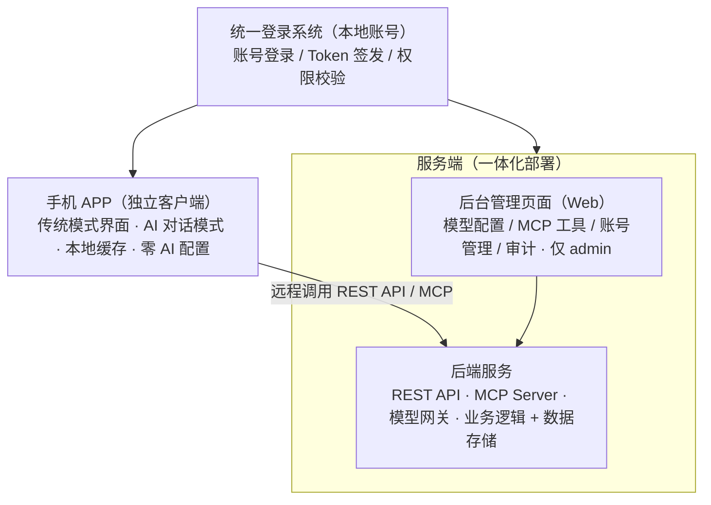
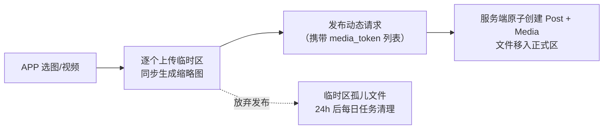
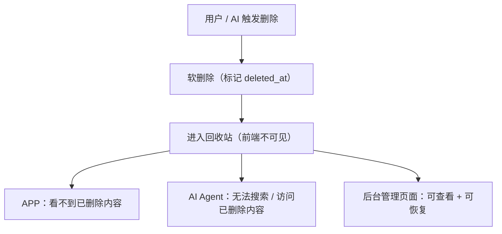
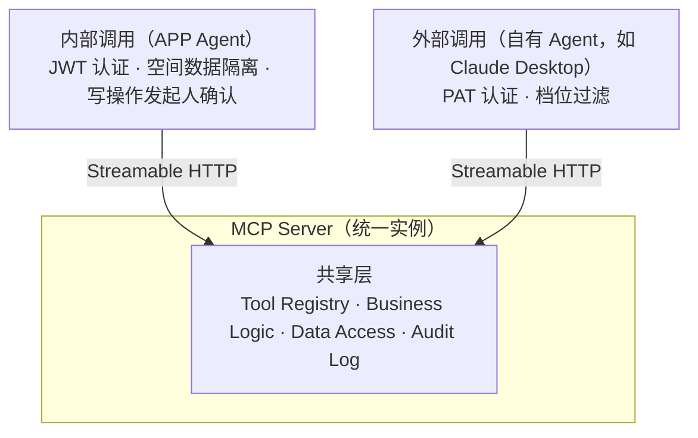
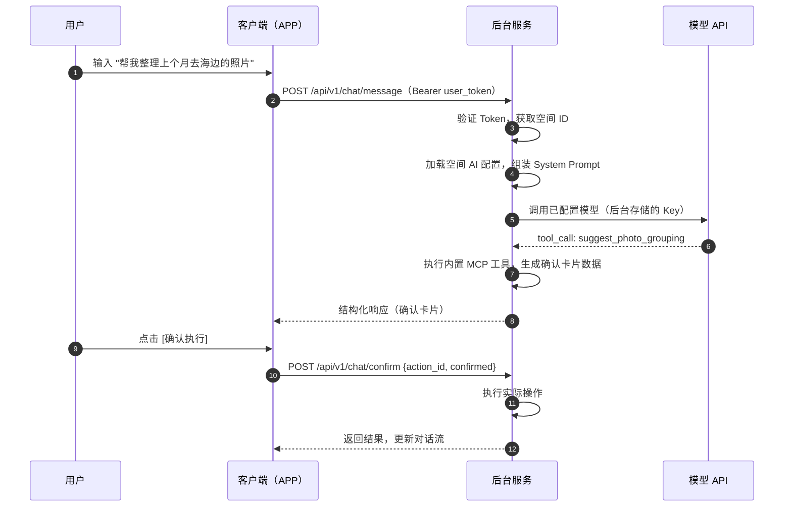
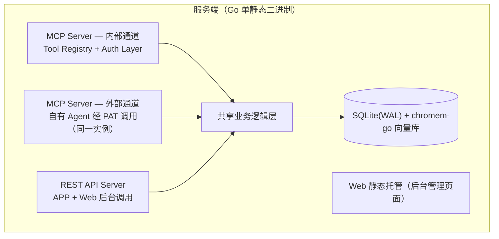

# 情侣生活记录 APP — 技术设计文档

> 配套文档：产品需求见 [REQUIREMENTS.md](REQUIREMENTS.md)。
> 本文档描述架构、认证、接口、存储与部署等实现设计；页面结构与产品规则一律在需求文档。

## 目录

1. [架构总览](#1-架构总览)
2. [客户端技术职责](#2-客户端技术职责)
3. [统一登录与认证](#3-统一登录与认证)
4. [后端服务架构](#4-后端服务架构)
5. [回收站机制](#5-回收站机制)
6. [MCP 工具接口清单](#6-mcp-工具接口清单)
7. [MCP 统一调用机制](#7-mcp-统一调用机制)
8. [对外 MCP 服务能力](#8-对外-mcp-服务能力)
9. [后台管理页面](#9-后台管理页面)
10. [部署架构与技术栈](#10-部署架构与技术栈)
11. [部署与网络](#11-部署与网络)
12. [数据模型](#12-数据模型)
13. [删除交互统一规范](#13-删除交互统一规范)
14. [媒体另存到本机](#14-媒体另存到本机)
15. [响应式框架与浮层定位](#15-响应式框架与浮层定位)
16. [媒体查看器：三类媒体与播放](#16-媒体查看器三类媒体与播放)

---

## 1. 架构总览

统一登录系统为所有端提供认证：APP 远程调用服务端；Web 后台与后端同机/同集群部署，本地/内网调用。

---

## 2. 客户端技术职责

### 2.1 两类客户端对比

| 维度 | 手机 APP | Web 端（服务端一体部署） |
|:---|:---|:---|
| **部署位置** | 用户手机，独立安装 | 服务端服务器，与后端同机/同集群 |
| **定位** | 个人日常使用主力终端 | 后台管理（系统配置 + 审计监控） |
| **包含内容** | 传统模式 + AI 对话模式 | 后台管理页面（Web 前台已取消，未来需要时另立需求） |
| **登录要求** | 需登录，登录页配置服务端地址 | 共用同一登录认证，仅接受 admin 角色 |
| **AI 能力** | AI 对话模式（全屏 Agent） | 仅模型/工具配置，无对话入口 |
| **与服务端关系** | 远程调用 REST API / MCP | 本地/内网调用，同进程或同集群 |
| **更新方式** | 自签名 APK 直接分发手动安装（无版本管理设施），Android only | 服务端统一部署更新 |

### 2.2 手机 APP 职责

| 职责 | 说明 |
|:---|:---|
| 渲染两套界面 | 传统模式 + AI 对话窗口 |
| 调用后台接口 | REST API（手动）+ MCP（AI 代理操作） |
| 本地缓存 | 对话历史缓存、图片缩略图等（对话历史以服务端为权威存储，本地仅缓存加速） |
| 用户认证 | Token 管理、自动刷新 |
| **不做的事** | 不存 API Key / 不配模型 / 不注册工具 / 不调第三方模型 |

> 客户端代码中**没有任何模型相关配置**，只有一个后台服务的 base URL。

---

## 3. 统一登录与认证

| 维度 | 方案 |
|:---|:---|
| 人（两端） | JWT + Refresh Token，APP / Web 后台通用 |
| 外部 Agent | 个人访问令牌 PAT（生成/吊销/档位见第 8 章；PAT 绑定签发用户，数据以该用户身份隔离） |
| 账号来源 | 部署时环境变量内置 admin；admin 创建 girl/boy；密码重置由 admin 在后台操作 |
| 权限校验 | admin 拥有系统配置权（模型/MCP/回收站/审计）；情侣用户专注内容操作 |
| 未登录状态 | 所有页面重定向至登录页，无公开匿名访问；后台登录入口仅接受 admin 角色 |

---

## 4. 后端服务架构

### 4.1 模型网关

| 功能 | 说明 |
|:---|:---|
| 多模型适配 | 按**协议**适配：OpenAI Chat Completions / OpenAI Responses / Anthropic / Gemini；兼容生态（DeepSeek/Kimi/通义千问兼容模式/GLM/vLLM/Ollama 等）走 OpenAI Chat Completions |
| API Key 安全存储 | 加密存储在服务端，客户端永不接触 |
| 故障切换 | 供应商**有序链**：调用从列表第一个开始，失败依次向下切换（排序即切换策略；单 Key，不做多 Key 轮询） |
| 用量统计 | AI 调用量与 Token 消耗统计报表（后台仪表盘）；不做用量限流（2 用户自用无滥用对象，PAT 泄露兜底=吊销+审计） |
| 模型热切换 | 管理后台更换模型后实时生效，无需发版 |
| 多模态 | 支持 vision 模型，AI 对话可接收图片输入（发图配文案/挑片/整理相册） |

### 4.2 MCP Server（内部）

- **Tool Registry**（内置预定义，管理后台可启停，完整定义见第 6 章）
  - 动态：create_post / delete_post / search_posts / get_today_in_history
  - 相册：create_album / add_photos_to_album / remove_photos_from_album / suggest_photo_grouping / list_albums / delete_album
  - 地图：create_map_point / delete_map_point / search_locations / get_location_posts
  - 纪念日：create_anniversary / delete_anniversary / get_next_anniversary / configure_reminder
  - 互动：toggle_like / toggle_favorite / list_favorites / create_comment / delete_comment / list_comments
  - 空间与统计：get_space_summary / get_timeline_summary
- **安全层**
  - 用户身份校验（JWT）
  - 操作确认流程（发起人确认）
  - 操作审计日志记录
  - 已删除内容过滤（回收站数据对 AI 不可见）
- **与模型网关交互**
  - 接收用户消息 → 组装 System Prompt + Tools → 调用模型
  - 模型返回 tool_call → 执行业务逻辑 → 返回结果
  - 流式输出 → SSE 推送给客户端

### 4.3 AI 配置中心

全局配置（管理后台）：

- AI 供应商列表（协议类型 + 地址 + API Key，秘钥加密存储、只写不读）
- 供应商排序（有序故障切换链：从第一个开始，失败依次向下）
- 模型级参数：每个模型可设 Temperature / Max Tokens（不设置即调用时不传，用供应商默认值）
- 全局 System Prompt 模板（人设/行为边界主干）
- 输出风格库：内置风格（完全固化，不可删改）+ 自定义风格（后台增删改，名称 + 提示词片段）；设全局默认风格
- MCP 工具注册表（内置预定义，不可被客户端修改）

空间级配置（单空间部署，按空间隔离设计）：

- 自定义 System Prompt 片段（可选覆盖全局模板）
- AI 操作日志（该空间下所有 AI 执行记录）

用户级配置（每用户独立生效，在 APP 设置页配置，见需求文档 4.7）：

- 输出风格偏好（文艺 / 幽默 / 简洁）——仅对该用户发起的 AI 会话生效
- 隐私策略（对话记录保留时长）

### 4.4 配置管理入口

| 入口 | 说明 |
|:---|:---|
| 管理后台 | admin 配置全局模型、工具、安全策略 |
| 用户设置页 | 仅暴露风格偏好、隐私开关等用户体验项 |
| 客户端 | 零配置，只传用户 Token，后台自动加载对应空间配置 |

### 4.5 媒体访问鉴权

图片 / 视频 / 音频等媒体资源统一通过后端媒体接口访问：

| 决策项 | 方案 |
|:---|:---|
| 访问方式 | 后端按需签发**短期签名 URL**（默认 15 分钟有效），客户端 `` / `<video>` 标签直接渲染 |
| 签名校验 | 服务端校验签名与过期时间，过期返回 401，客户端重新请求换取新 URL |
| 客户端一致 | APP / Web 后台均使用签名 URL，无需各自注入凭证 |
| 扩展性 | 媒体走后端统一接口 + 签名 URL，客户端无直连存储的耦合 |

### 4.6 通知分发器

| 决策项 | 方案 |
|:---|:---|
| 事件源 | 业务写入瞬间（动态/评论/点赞/收藏/足迹）+ 删除对方发布内容时（仅站内）+ cron 每日纪念日检查（事件类型以需求文档 4.8 为准） |
| 站内通知 | 写入通知表，APP 打开时同步显示红点；通知中心列表始终全量收录，不设站内通知开关（见需求文档 4.8） |
| 外部渠道 | 空间级（admin 后台配置）的**通用 API Webhook** 出站调用：请求方式 / 服务地址 / 请求头 / 请求体模板（{{title}}、{{content}}、{{time}}、{{type}} 占位符）；每个渠道按事件订阅过滤（纪念日/新动态/评论/点赞/收藏/足迹/相册上新），站内通知始终全量；外部推送按事件触发、不区分操作者（与站内「自建静默」仅约束站内一致，需求 8.1），操作者信息随事件内容提供——快照 `operator` 记真实发起人用户名（AI 代操作同口径），文案同为真实用户名；AI 代操作另带 `via:"ai"` 标记来源，推送正文以「（AI）」后缀区分（Bark / Server酱 / Qmsg / 企业微信为预设模板，可套用后修改） |
| 设计动机 | 规避 Android 后台存活限制（国产 ROM 杀后台）；服务端常驻进程无此问题，实时性优于一切端上方案 |
| 边界 | 出站第三方依赖仅限：模型 API、通知 Webhook 调用；地图瓦片走自建代理服务（XYZ 地址可配置，见 4.7），逆地理用本地离线数据，无地图第三方依赖；核心数据（内容/媒体/对话/审计）全部留在自部署服务器 |

> 通知通道仅两条：站内（通知中心红点）+ 外部 Webhook 推送，与需求「站内+外部同发」一致；不做 APP 本地定时通知（需精确闹钟权限、杀进程后不可靠，离线边缘场景不值得）。

### 4.7 地图服务

| 决策项 | 方案 |
|:---|:---|
| 瓦片来源 | **服务端瓦片代理**：APP 统一请求 `GET /api/v1/map/tile?z=&x=&y=`，后端按配置转发；支持两类源——①公开 XYZ 瓦片（URL 模板含 `{z}/{x}/{y}` 占位，admin 可配）；②天地图（admin 配置 tk 密钥，加密存储，密钥永不下发 APP）。新增瓦片源 APP 零改动 |
| 配置管理 | `map_sources` 多行表（type=public\|tianditu / url_template / tianditu_key 加密 / tianditu_layer / enabled，部分唯一索引保证至多一个使用中）；admin `GET/POST /api/v1/admin/map-config`、`DELETE /{id}`、`PUT /{id}/enable`（启用校验：public 需模板非空、tianditu 需已配密钥；使用中的源不可删除；不提供编辑）；APP `GET /api/v1/map/config` 仅下发使用中源的 provider 与 tile_api（public 附 url_template） |
| 城市判定 | **写时判定落库**：创建点位时以坐标做 point-in-polygon（`server/internal/geo` 内置地级市边界多边形，DataV.GeoAtlas 简化数据、射线法零外部依赖），未命中回退「名称·」前缀，再未命中留空（留空不进城市列表）；`GET /api/v1/map/points/cities` 按 city 分组计数，不做独立 MCP 工具与「城市点亮」视觉 UI |
| 点位生成 | 双来源进同一点位池：动态携带地点时服务端自动创建/同名复用点位（判定键 = 地点名，坐标以先创建者为准；不做邻近合并）；手动创建（REST + create_map_point） |
| 地理编码（geocode） | `GET /api/v1/geocode?q=<地名>` 返回候选列表 `{name, city, lat, lng, display}`；包含匹配，无第三方 POI 依赖（mock 与真实后端同源内置同一离线表：`tools/mock/fixtures.mjs` GEOCODE_PLACES / `server/internal/geo/places.go`） |
| 定位与选点 | APP 内置定位；添加地点 = 表单（名称 + geocode 候选回填 / 地图选点取得经纬度 / 手动输经纬度）；无第三方 POI 搜索 |
| 转发请求头 | 两类源均设 `Accept: image/png,image/*;q=0.8,*/*;q=0.5`；public 源 UA=`love-life-server/0.1 (…; self-hosted)`（避免 OSM 等按 Go 默认 UA 黑名单 403）；天地图源 UA=浏览器 UA（实测其 WAF 对非浏览器 UA 一律 418「疑似攻击」，即使 Referer 在 key 白名单内）。**Referer 统一透传入站页面真实值**：天地图浏览器端 tk 在控制台绑定域名白名单，仅白名单内页面的 Referer 放行（不在白名单 418、完全无 Referer 403 code 301012）；缺时回退 public→项目仓库页、天地图→`https://map.tianditu.gov.cn/`（实测 2026-09，实现见 `api/mapconfig.go applyUpstreamHeaders`） |
| 瓦片鉴权 | `GET /api/v1/map/tile` 允许 token 经 query 传递（`auth.AllowTokenQuery`）：img 标签无法携带 header。取舍：瓦片为只读非敏感数据，泄漏面仅为读瓦片，长期 JWT 进反代访问日志可接受；后续可与媒体签名 URL 统一为短时签名参数（届时移除 query token） |

### 4.8 媒体上传管线

| 决策项 | 方案 |
|:---|:---|
| 上传时序 | 两段式：发布动态前逐个上传至临时区（`media/tmp/{uuid}`，返回 media_token）；发布请求携带 token 列表，服务端原子创建 Post + Media 并将文件移入正式区。单文件失败重试不影响其他文件 |
| 孤儿清理 | 临时区文件 24h 未被发布引用，由每日定时任务删除 |
| 缩略图 | 上传时同步生成：图片等比缩放（最长边 1080px）；视频不抽帧，使用统一播放占位图 + 时长角标——零外部依赖，保持单二进制自包含（不引入 ffmpeg） |
| EXIF | 读取拍摄时间作为 taken_at（缺失回退上传时间），供时间轴与那年今日排序；GPS 坐标忽略（选地点为手动地图点选，不自动建点）；EXIF 原样保留（自部署无外泄面，签名 URL 仅短时有效） |
| 格式与大小 | 照片 jpg/png/webp；视频 mp4/mov/webm；HEIC 首版不支持（上传时明确拒绝并提示）；单文件默认软限 500MB（可配置） |
| 存储布局 | 数据目录内 `media/{yyyy}/{mm}/{uuid}.{ext}` 主文件 + `thumbs/` 平行缩略图，与自包含数据目录一致（见 11.1） |
| 物理删除 | 回收站永久清除时同步删除主文件与缩略图（回收站规则见第 5 章） |

---

## 5. 回收站机制

### 5.1 删除与恢复流程

### 5.2 自动清理规则

- 后台管理页面可配置回收站保留期限：默认 30 天，可配置范围 7 ~ 365 天
- 定时任务：每日凌晨执行
- 逻辑：`deleted_at + 保留期限 < 当前时间` → 永久删除

### 5.3 安全约束

| 约束 | 说明 |
|:---|:---|
| 用户不可手动清空回收站 | 防止情绪化操作或误触 |
| AI 不可调用永久删除工具 | MCP 工具清单中不存在 purge_recycle_bin |
| 仅管理员可恢复 | 通过后台管理页面操作 |
| 仅系统可永久删除 | 定时任务自动执行，无人工入口 |
| 恢复操作需审计 | 记录谁在什么时间恢复了什么内容 |

### 5.4 对 MCP 工具清单的影响

| 原工具 | 调整 | 说明 |
|:---|:---|:---|
| update_post | 移除 | 不再支持编辑动态 |
| update_anniversary | 移除 | 不再支持编辑纪念日 |
| delete_post | 保留 | 改为软删除，进入回收站 |
| delete_album | 保留 | 改为软删除，进入回收站（仅手动相册，月度相册规则见需求文档 §4.5） |
| delete_anniversary | 保留 | 改为软删除，进入回收站 |
| delete_comment | 保留 | 评论软删除，进入回收站 |
| purge_recycle_bin | 不存在 | AI 和用户均不可手动永久删除 |
| restore_from_recycle_bin | 不对 AI 开放 | 仅后台管理页面可用 |

---

## 6. MCP 工具接口清单

### 6.1 动态与评论

| Tool Name | Description | Input Schema |
|:---|:---|:---|
| create_post | 创建一条新动态 | {content, media_urls?, location?, mood?, related_anniversary_id?} |
| delete_post | 删除动态（进入回收站） | {post_id} |
| search_posts | 语义搜索历史动态 | {query, date_range?, media_type?} |
| get_today_in_history | 获取那年今日内容 | {years_back?} |
| create_comment | 发表评论 | {post_id, content} |
| delete_comment | 删除评论（软删除，进入回收站） | {comment_id} |
| list_comments | 列出某条动态下的评论（分页） | {post_id, page?, page_size?} |

### 6.2 相册相关

| Tool Name | Description | Input Schema |
|:---|:---|:---|
| create_album | 创建专门相册（已注册，写工具；相册只做组织视图，不含上传媒体） | {name, description?} |
| add_photos_to_album | 将照片加入相册（已注册，写工具；media_ids 必须来自动态媒体池，不接受上传附件 token） | {album_id, media_ids[]} |
| remove_photos_from_album | 从相册移除照片（不影响照片本身） | {album_id, photo_ids[]} |
| suggest_photo_grouping | AI 推荐照片分组 | {date_range?, location?} |
| list_albums | 列出所有相册（支持时间轴/集合视图，图片分页） | {view_type: "timeline" \| "collection", page?, page_size?} |
| delete_album | 删除手动相册（进入回收站） | {album_id} |

> 相册工具操作的照片均来自动态媒体池（照片仅随动态上传，无独立上传通道）。
>
> 删除说明：媒体仅随动态存在，**删除照片 = 删除其所属动态**（反查 post_id 走 delete_post）；不再提供独立 delete_photo 工具（已从注册表移除，工具总数 26）。

### 6.3 地图相关

| Tool Name | Description | Input Schema |
|:---|:---|:---|
| create_map_point | 创建地图点位（足迹） | {name, latitude, longitude, visit_date?, description?} |
| delete_map_point | 删除地图点位（进入回收站） | {point_id} |
| search_locations | 按地点名称搜索足迹 | {query} |
| get_location_posts | 获取某地点下所有动态 | {location_id} |

### 6.4 纪念日相关

| Tool Name | Description | Input Schema |
|:---|:---|:---|
| create_anniversary | 创建纪念日 | {name, date, type: 'solar'|'lunar', is_leap?, remind_days_before?}——date 统一 YYYY-MM-DD；solar=公历，lunar=农历日期（is_leap=true 表闰月；倒计时/next 由服务端推算，不传/不存"本次公历"） |
| delete_anniversary | 删除纪念日（进入回收站） | {anniversary_id} |
| get_next_anniversary | 获取下一个纪念日信息 | {} |
| configure_reminder | 配置纪念日提醒（提前天数；提醒站内+外部同发） | {anniversary_id, days_before} |

> 注：`get_next_anniversary` 工具输出含 `next_solar_date`——服务端按 §12 约定复用同一离线算法（`internal/lunar`）**即时换算，不落库**（AD4 审核 2026-09-05 要求的输出增强）。

### 6.5 空间与数据

| Tool Name | Description | Input Schema |
|:---|:---|:---|
| get_space_summary | 空间概览（在一起天数、动态数、相册数、足迹数、纪念日数等聚合统计） | {} |
| get_timeline_summary | 时间线统计（按月/年统计动态数量分布） | {year?, month?} |

### 6.6 互动关系

| Tool Name | Description | Input Schema |
|:---|:---|:---|
| toggle_like | 点赞/取消点赞动态（可撤销关系数据，不进回收站） | {post_id} |
| toggle_favorite | 收藏/取消收藏动态（可撤销关系数据，不进回收站；首版收藏对象仅动态，不含照片） | {post_id} |
| list_favorites | 列出我收藏的动态（分页） | {page?, page_size?} |

> 工具清单共 26 个，全部为业务数据操作（实体增删/组织/查询/统计）；系统配置、模型、账号、审计、回收站不设工具。回忆摘要生成（get_memory_digest）已移除——属 AI 内容生成而非数据管理。toggle_point_visibility 已移除——地图点位砍掉「显示/隐藏」开关，仅保留查看与删除。delete_photo 已移除——媒体仅随动态存在（见 §6.2），删除照片统一走 delete_post。get_visited_cities 已移除——「去了哪些城市」不做独立工具与城市点亮 UI，由 `GET /api/v1/map/points/cities` 列表自然提供。评论工具归入 §6.1（评论为挂在动态上的轻量内容实体：双方可删、软删进回收站）；§6.6 仅保留可撤销、不进回收站的赞/藏关系。

### 6.7 实现要点

- **安全与确认机制**：写操作由发起人在客户端确认后生效。删除操作统一走软删除流程进入回收站。
- **操作审计**：所有工具调用均记录审计日志，包含工具名、参数摘要、执行结果、触发来源（用户/AI）。

---

## 7. MCP 统一调用机制

### 7.1 调用方总览

MCP Server 是**单一服务实例**，同时服务于两类调用方：

- **内部调用（APP Agent）**：认证用用户 JWT Token；权限基于情侣空间的数据隔离；写操作由发起人在客户端确认；传输为 Streamable HTTP（远程，内部通道与外部一致）
- **外部调用（自有 Agent）**：认证用个人访问令牌 PAT；按令牌档位过滤工具（只读 / 读写）
- **共享层**：同一套工具定义、业务逻辑、数据访问层与审计日志（区分调用来源）

### 7.2 REST API vs MCP Tools

| 维度 | REST API | MCP Tools |
|:---|:---|:---|
| 调用方 | 传统模式前端（APP）+ 后台管理页面 | AI Agent（内部 + 外部） |
| 协议 | HTTP/JSON | JSON-RPC over Streamable HTTP |
| 粒度 | 细粒度 CRUD | 语义化高层操作 |
| 认证 | JWT + Refresh Token | JWT（内部）/ PAT（外部） |
| 错误处理 | HTTP Status Code | MCP Error Result |
| 幂等性 | Server 端保证（写接口支持幂等键） | Server 端保证（tool_call 幂等键） |

> **关键点**：MCP Tools 不是 REST API 的简单包装，而是**面向 AI 意图的高层抽象**。例如 suggest_photo_grouping 这个工具在 REST API 中可能不存在，它是专门为 AI 整理相册场景设计的复合操作。

### 7.3 端到端调用时序

> 全程客户端**不接触任何模型凭证**，不直接调用第三方 API。

---

## 8. 对外 MCP 服务能力

### 8.1 概述

后台服务除了为自有 APP 提供内部 MCP 能力外，还**对外暴露 MCP 服务**，允许自己的 Agent（如 Claude Desktop 等桌面 AI 助手）通过标准 MCP 协议访问情侣空间的数据与功能。面向个人自用，不设第三方接入审批流程。

### 8.2 服务架构

- **认证与授权**
  - 个人访问令牌 PAT（后台手动生成/吊销）
  - PAT 仅绑定情侣用户（girl/boy；admin 仅后台操作，不签发 PAT），数据以该用户身份隔离（如 list_favorites 返回绑定用户的收藏）
  - 权限档位（只读 / 读写）
- **工具暴露**
  - 与内部 MCP 工具共享同一套工具定义
  - 按令牌档位过滤可用工具
  - 删除类工具不对任何令牌开放（仅 APP 内使用）
- **速率与用量**
  - 不设令牌限流：2 用户自用无滥用对象；外部工具执行不产生服务端模型费用（模型运行在 Agent 侧），PAT 泄露的兜底手段为吊销 + 审计日志
- **数据安全**
  - 操作审计（记录外部调用，来源标记为对应令牌）
  - 数据访问日志
- **工具自描述**
  - 工具 Schema 与说明随 MCP 协议自动下发（tools/list），无需单独维护接入文档与 SDK

### 8.3 工具权限分级

| 档位 | 可用工具 | 说明 |
|:---|:---|:---|
| 只读 | search_posts, get_today_in_history, suggest_photo_grouping, search_locations, get_location_posts, list_albums, list_comments, list_favorites, get_next_anniversary, get_space_summary, get_timeline_summary | 查询与推荐类，无副作用 |
| 读写 | 只读全部 + create_post, create_album, add_photos_to_album, remove_photos_from_album, create_anniversary, configure_reminder, create_map_point, toggle_like, toggle_favorite, create_comment | 可写入，不可删除 |
| 不对令牌开放 | delete_post, delete_comment, delete_album, delete_anniversary, delete_map_point | 仅 APP 内部使用 |

### 8.4 接入流程

1. 在后台管理页面生成 PAT，设置绑定用户（girl/boy）并选择权限档位（只读 / 读写）
2. 在自己的 Agent（如 Claude Desktop）中配置 MCP Server 地址 + PAT
3. Agent 通过 MCP 协议调用工具
4. 所有调用记录在审计日志中（来源标记为对应令牌）

### 8.5 协议支持

| 传输方式 | 说明 |
|:---|:---|
| Streamable HTTP | 唯一传输（规范推荐）：HTTP POST + SSE 流式响应，支持会话与断线恢复 |

> 注：MCP 旧版 HTTP+SSE 传输已被官方废弃，新实现一律使用 Streamable HTTP；不引入 WebSocket——全部通信为客户端发起的单向流式响应，SSE 足够。

- 端点：`POST /api/v1/mcp`，鉴权用 `Authorization: Bearer <PAT>`（与内部通道的 JWT 相互独立）
- 方法：`initialize` / `tools/list` / `tools/call` / `ping`；通知类消息（无 `id`）按 JSON-RPC 约定不返回响应体
- 工具可见范围按 PAT 档位过滤，删除类工具不对任何令牌开放（§8.3）；后台停用的工具在两个通道同时不可见、不可调用
- 审计按令牌维度记录（`actor_type=pat`、`actor_id=令牌 ID`），`tools/call` 记人类可读参数与调用耗时

---

## 9. 后台管理页面

登录：统一登录系统，**仅 admin 角色可登录**。

导航（扁平 6 项，按管理对象分组）：仪表盘 / 空间管理 / AI 配置 / 外部集成 / 回收站 / 审计日志。AI 配置为单页 4 个 tab、外部集成为单页 2 个 tab，嵌套路由 `/ai/*`、`/integrations/*` 可直达；旧路径（`/settings/*`、`/users`、`/members` 及更早的 `/models`、`/map-config` 等兜底链）全部 redirect 到新路径（完整 redirect 表见 `admin/src/router/index.ts` 兜底段）。整页 flex 视口锁定，页面不滚动，各数据容器内部滚动。

- **仪表盘**（全站唯一监控入口）
  - 内容统计（单空间部署口径）
  - AI 调用量 / Token 消耗 / 平均延迟：ai-usage 时序每点含 `avgLatencyMs`，页面按调用量加权汇总展示
  - 异常告警
  - 最近活动（后台操作/内容事件流水）
- **空间管理**（独立页；空间信息 + 成员 + 数据保留三类同页，管理对象均为本空间）
  - 空间信息：名称 / 个性签名 / 在一起日期；在一起统计并入信息卡
  - 情侣账户一次性同时创建：双方（用户名/昵称/密码）一次提交，任一情侣角色已存在则拒绝；不提供单独添加与删除
  - 建立后仅可修改昵称、重置密码；用户名 / 角色不可变更（登录身份与数据归属）
  - admin 账号只读展示，由部署环境管理，后台不提供增改
  - 数据保留：回收站保留期限（7~365 天，默认 30；超期内容由系统定时任务自动永久删除）+ AI 对话记录默认保留时长（空间级默认值，用户可在 APP 自行调整）；回收站页的期限提示只读展示，读自同一数据源
  - 接口：GET/POST /api/v1/admin/users、POST /admin/users/couple（原子创建）、PUT /admin/users/{id}（仅昵称）、POST /admin/users/{id}/reset-password、GET/PUT /space（空间信息）、GET/PUT /admin/security（保留策略，部分更新：两项保留设置各自独立保存，请求体可只含本次变更字段——`recycleRetentionDays` / `chatRetention`，服务端须按字段合并，不得整体覆盖）
- **AI 配置（4 tabs）**
  - **接入与模型（/ai/providers）**
    - AI 供应商管理：添加/编辑/删除/排序；供应商 = 协议类型（OpenAI Chat Completions / OpenAI Responses / Anthropic / Gemini）+ 服务地址 + API Key（加密存储，只写不读）
    - 获取模型列表：服务端持地址+秘钥调供应商 models 接口；模型参数挂**模型级**（每条 = {id, temperature|null, max_tokens|null}，不设置即调用时不传），从列表勾选默认模型（可手动添加兜底）
    - 供应商排序即故障切换链：调用从列表第一个开始，失败依次向下
    - 接口：GET/POST /api/v1/admin/model-providers、PUT/DELETE /{id}、PUT /{id}/key、PUT /order、POST /fetch-models（仅 admin）
  - **提示词与风格（/ai/prompts）**
    - System Prompt 模板管理：全局模板编辑（人设/行为边界主干）；空间级模板覆盖（可选）
    - 输出风格库：内置风格（完全固化，不可删改）+ 自定义风格（后台增删改，名称 + 提示词语气片段）；设全局默认风格
    - 拼装规则：最终 System Prompt = 全局模板主干 + 当前生效风格提示词片段（切风格只换语气，不动主干）；APP 未选风格时用全局默认
    - 接口：GET/PUT /admin/system-prompt、GET/POST /admin/styles、PUT/DELETE /admin/styles/{id}、PUT /admin/styles/default、GET /api/v1/styles（APP 端并集 + 默认标记）（仅 admin，/styles 只读除外）
  - **MCP 工具（/ai/tools）**
    - 内置工具列表：名称 / 描述 / 参数 Schema；启用 / 停用开关
  - **访问令牌（/ai/tokens）**
    - 个人访问令牌（PAT）管理：生成 / 吊销；权限档位（只读 / 读写）；PAT 唯一用途是外部 Agent 的 MCP 通道凭证，归 AI 域
- **外部集成（2 tabs）**（出站第三方依赖中除模型 API 外的两类）
  - **通知渠道（/integrations/webhooks）**（功能范围见需求 §8.3）
    - 空间级外部推送渠道：渠道配置（请求方式 GET/POST / 服务地址 / 请求头 / 请求体模板占位符）、按渠道订阅事件（7 类）、预设模板（Bark/Server酱/Qmsg/企业微信）、[发送测试]
    - 接口：GET/POST /api/v1/admin/webhooks、PUT/DELETE /{id}、POST /{id}/test（仅 admin）
  - **地图配置（/integrations/map）**
    - 瓦片源多卡片管理：卡片网格等高展示已保存源（类型限公开 XYZ 模板 / 天地图密钥认证两种，可添加多个），末尾固定「添加瓦片源」卡；卡片支持启用（全局至多一个使用中，启用校验配置完整）、删除（两步确认，使用中的源不可删），**不提供编辑**——配置有误删除后重加；密钥加密只存服务端；接口 GET/POST /admin/map-config、DELETE /{id}、PUT /{id}/enable
    - 后台操作反馈统一走全局 toast（AppToast 顶部轻提示：成功/失败/信息，自动消失），不使用原生 alert/confirm/prompt 与页面内联提示（避免布局跳动）；危险操作确认用应用内 ConfirmDialog
    - 非破坏性确认（如回收站恢复）的确认按钮不用危险色，取非危险档位；口径与 §13 各界面口径的非破坏性约定一致
- **回收站管理**
  - 查看已删除内容列表：按删除时间排序；按类型筛选（动态/评论/照片/相册/纪念日/地图点位）；显示删除时间、删除者（用户/AI）；保留期限提示只读展示，读自空间管理·数据保留
  - 恢复操作：单条恢复（二次确认）；批量恢复（二次确认）
  - 恢复操作审计日志：操作人 / 时间 / 恢复内容摘要；不可删除，永久保留
- **审计日志**（纯日志页；模型响应延迟与用量报表归仪表盘）
  - AI 操作日志 / 外部 MCP 调用日志（PAT 来源）：操作者筛选（user/ai/pat）+ CSV 导出 + 单条耗时列

---

## 10. 部署架构与技术栈

### 10.1 分层与职责

| 层级 | 职责 | 是否持有模型凭证 |
|:---|:---|:---|
| 手机 APP | 纯展示 + 纯交互，零 AI 配置 | 否 |
| Web 后台（服务端部署） | 系统配置 + 审计监控 | 否（仅管理界面，凭证在后端加密存储） |
| 后端服务 | 模型网关 + MCP Server + 业务逻辑 + 数据安全 | 是（加密存储） |
| 对外 MCP 通道 | 自有 Agent 接入（PAT 认证），与内部 MCP 同实例 | 是（服务端托管） |

### 10.2 部署架构

REST API Server 与 MCP Server 常驻**同一 Go 进程**：单二进制即最终形态（共享内存与连接池），不提供独立部署选项；代码按 REST / MCP 分模块组织仅为工程习惯，不为进程拆分做额外设计。

### 10.3 技术决策清单

| 决策项 | 最终方案 |
|:---|:---|
| 客户端分类 | 两类：手机 APP + Web 后台（服务端一体部署） |
| 手机 APP | 独立客户端，远程调用服务端，双模式界面 |
| Web 端 | 与后端服务同部署，仅后台管理页面；Web 前台已取消，未来需要时另立需求 |
| 后台管理页面 | 系统配置 + 审计监控，需管理员登录 |
| 登录系统 | 部署时内置 admin（环境变量），角色 admin/girl/boy，admin 有系统配置权 |
| 后端服务 | REST API + MCP Server + 模型网关 + 业务逻辑 |
| MCP Server | 统一实例，同时服务内部 Agent（APP）和外部 Agent（PAT） |
| 对外 MCP | 同一实例的外部通道：PAT 认证，只读/读写两档，删除类不开放 |
| 数据存储 | SQLite(WAL) + chromem-go 向量库 + 本地媒体文件（全部位于自包含数据目录，见 11.1） |
| 认证方式 | JWT + Refresh Token（人，两端统一）+ 个人访问令牌 PAT（外部 Agent） |
| 安全机制 | 发起人确认 + 操作审计 + 隐私策略 |
| 回收站 | 软删除 + 后台可配保留期限 + 仅系统自动永久删除 |
| 对话历史 | 服务端权威存储，按保留时长自动清理；客户端仅缓存加速 |
| 外部通知 | 通用 API Webhook：请求方式/服务地址/请求头/请求体模板（占位符）；按事件订阅推送；Bark/Server酱/Qmsg/企微为预设模板 |
| 技术栈 | Go 单静态二进制（REST + MCP Streamable HTTP + Web 静态托管）+ SQLite(WAL) + chromem-go 向量库 + Tauri v2 APP（Vue 3，Android only）+ Vue 3（后台管理页面）；发布产物 = 服务端二进制 + Android APK + Docker 镜像，运行状态自包含于单一数据目录 |
| 部署与网络 | 局域网 / 公网域名+HTTPS 双通道访问，客户端双地址自动优选；TLS/反代、进程管理、备份由部署者自选；登录接口内置限速防爆破（见第 11 章） |
| 地图服务 | 服务端瓦片代理：公开 XYZ 模板可配 + 天地图密钥可配（加密存储不下发）；城市列表由点位统计提供（见 4.7） |
| AI 多模态 | 首版支持对话发图（vision 模型）；语音输入（STT）列路线图 |

---

## 11. 部署与网络

### 11.1 部署形态与产物

- 官方发布产物：**服务端单静态二进制**（内嵌 Web 后台静态资源）、**Android APK**、**Docker 镜像**；APK 直接分发手动安装，服务端不内置托管入口（原「Web 前台 APP 下载直链」随 Web 前台取消）
- 运行方式由部署者自选：裸机直跑（systemd 等）或 Docker / 容器编排均可，本文档不指定特定方案
- 最低运行要求：一个监听端口 + 一个可写数据目录；全部运行状态（SQLite、向量库、媒体文件、配置）自包含于该数据目录，便于用任意工具做快照与迁移
- 环境变量：至少包含 admin 初始账号（用户名/密码）、数据目录路径、监听地址

### 11.2 网络访问（双通道）

- **在家：局域网直连**——APP / Web 后台直接访问内网地址或主机名
- **在外：域名 + HTTPS 公网访问**
- APP 支持配置**内网 / 公网双服务地址**，自动探测连通性并优选内网；Web 后台随部署地址访问，无需双地址
- TLS 终止与反向代理（Caddy / Nginx / 云 LB 等）由部署者自定，服务端本身只监听 HTTP 端口
- 应用内置安全基线（非部署可选项）：
  - 公网通道必须经 HTTPS 反代暴露，明文访问仅限内网场景
  - 登录与令牌签发接口内置限速与失败锁定，防在线爆破
  - 媒体访问一律走短期签名 URL（见 4.5 媒体访问鉴权）
  - `/api/*` 启用 CORS（Allow-Origin \*）：APP/Tauri WebView 的 origin 与服务端不同域，浏览器直连为必需路径；认证走 Authorization 头无 Cookie，放开 Origin 不引入 CSRF 面
- **明文传输说明**：Android APP 在仅内网 HTTP 部署场景需在 APP 内允许明文传输；公网通道一律经 HTTPS 反代。iOS PWA 兜底已随 Web 前台取消，如需 iOS 端未来另立需求（PWA 或 iOS APP）

### 11.3 备份与迁移

- 平台定位**不内置备份/导出/导入功能**；备份与迁移 = 部署者直接拷贝自包含数据目录（rsync、网盘同步、磁盘快照等，方式自选）
- 数据目录自包含：部署者可用任意工具（rsync、网盘同步、磁盘快照等）自行备份，方式自选
- 建议部署者定期备份数据目录——回忆类数据不可再生

---

## 12. 数据模型

> 单一权威源：实体、字段与关系以本章为准。回收站不是独立实体——各内容实体统一 `deleted_at` 软删标记 + 后台视图（规则见第 5 章）；仅系统定时任务可永久清除。
>
> **时间口径**：库内时间列（`created_at` / `deleted_at` 等）一律存 **UTC**（`datetime('now')`，形如 `YYYY-MM-DD HH:MM:SS`）；
> **用户可见的「日期」按部署者本地时区判定**（进程 TZ，可用环境变量 `TZ=Asia/Shanghai` 覆盖；实现见 `server/internal/store/timeutil.go`）。
> 适用范围：那年今日的同月同日匹配、月度相册的月份归属、另存文件名日期、仪表盘「今天/昨天」。
> 例外：EXIF `taken_at` 是相机墙钟时间、无时区信息，原样存用、不参与换算。

### 12.1 账号与配置

| 实体 | 关键字段 | 说明 |
|:---|:---|:---|
| User | id, username, password_hash, role(admin/girl/boy), nickname, avatar_media_id?, birthday, ai_style, chat_retention_days | 用户级 AI 偏好（输出风格、对话保留天数）内嵌本表，按用户生效；admin 由部署环境变量内置 |
| Space | id, name, signature, love_start_date | 单行表（单空间部署）；`GET /space` 额外返回即时聚合字段 members / days_together / next_anniversary / anniversary_count / album_count（APP 首页「全新部署空态」判定用：无动态 + 无纪念日 + 无相册；用计数而非 `next_anniversary.name`，否则「纪念日存在但日期全部无效」会被误判成空态） |
| WebhookChannel | id, name, method(GET/POST), url, headers_json, body_template, events_json | 空间级外部通知渠道（admin 后台配置，无用户归属）；events_json = 订阅的事件类型（7 类） |
| ModelProvider | id, api_type(openai-chat/openai-responses/anthropic/gemini), name, base_url, api_key_encrypted, sort_order | admin 域；Key 加密存储，客户端永不接触；sort_order = 故障切换链顺序 |
| ProviderModel | provider_id, model_id, temperature?, max_tokens? | 供应商下模型条目，参数挂模型级（可空 = 调用不传）；default_model 为 Provider 上的指针字段，存模型 ID 字符串（供应商内 UNIQUE，删除供应商时模型条目级联） |
| OutputStyle | id, name, prompt, builtin, sort_order? | 输出风格库：内置固化 + 后台自定义；全局默认风格为单行配置（default_style_id，存 AppSetting） |
| AppSetting | key, value | admin 域全局单值配置（如 default_style_id、system_prompt），键值存储，客户端永不接触 |

### 12.2 内容

| 实体 | 关键字段 | 说明 |
|:---|:---|:---|
| Post | id, author_id, content, mood?, point_id?, location_name?(快照), related_anniversary_id?, created_at, deleted_at | 地点 = 外键 + 名称快照：点位被删/合并后时间轴仍显示快照名；无标题字段（REQUIREMENTS §4.5 发布表单不采集标题） |
| Media | id, post_id, kind(photo/video/audio), file_path, thumb_path, width, height, size, duration?, taken_at?, author_id?, album_id?, created_at, deleted_at | 媒体不再独立存在，随动态发布（post_id 必填）；历史独立媒体只读兼容（不可新建、独立媒体接口 410）；kind 含 audio（mp3/m4a/wav，无缩略图、duration 必填）；taken_at 取 EXIF 拍摄时间，供时间轴与那年今日排序 |
| Comment | id, post_id, author_id, content, created_at, deleted_at | 记录内容，软删进回收站 |
| Like | (post_id, user_id), created_at | 可撤销关系数据，复合主键，不进回收站 |
| Favorite | (post_id, user_id), created_at | 同上；首版收藏对象仅动态 |
| Album | id, type(manual/monthly), name, description?, month_key?, is_hidden, cover_media_id?, created_at, deleted_at | 手动相册=用户建册后从时间轴选入（一文件一相册）；月度相册=纯逻辑展示概念（不落 album_items，详情按 month_key 虚拟查询该月未归属媒体），不可删除只可隐藏；封面默认取首图；列表行标签按 type 渲染（月度相册/手动相册） |
| AlbumItem | (album_id, media_id), added_by, added_at + UNIQUE(media_id)（一文件一相册） | 相册是照片池之上的组织视图；手动相册全相册唯一 |
| MapPoint | id, name, lat, lng, visit_date?, description?, source(post/manual), created_at, deleted_at | 同名地点复用同一点位（判定键 = 地点名），坐标以先创建者为准；城市统计/点位列表按点位本身统计；无合并链，无可见性开关（toggle_point_visibility 已移除，仅查看与删除） |
| Anniversary | id, name, date, type(solar/lunar), is_leap?, remind_days_before(默认 1), created_at, deleted_at | `date` 一律 `YYYY-MM-DD`，`type` 决定语义——solar=公历（每年按公历重复）；lunar=农历日期（如 1996-05-15=农历1996年五月十五，按农历月/日每年重复）；**不存 lunar_month/lunar_day 冗余字段**，闰月语义由 `is_leap` 标记承载（true=闰月，缺省=平月）；倒计时/排序/下一次公历由服务端推算（mock 与后端使用同一离线算法，客户端仅展示服务端值，表单预览可用客户端换算）；提醒配置为内嵌单值字段（每纪念日仅一个提前天数）；**列表/表单按 iOS 风格**：列表行主标题(17px semibold)+副行（农历两行：`年 · 农历X月X日` 与 `下个公历 YYYY-MM-DD`），农历月/日选择器全部用汉字与农历日历写法（正月…腊月；初一…初十、二十、廿一…廿九、三十）；农历换算离线算法（1900–2100 社区表驱动，全量校准真实化见 docs/TODO.md A2） |

### 12.3 通知与 AI

| 实体 | 关键字段 | 说明 |
|:---|:---|:---|
| Notification | id, recipient_id, event_type, target_type?, target_id?, snapshot_json?, is_read, read_at, created_at | 事件类型 8+1 类（见需求 §4.8，含 media_deleted）；内容删除事件带文案快照、无跳转；目标已被删时点击提示「内容已删除」 |
| ChatMessage | id, user_id, role(user/assistant), content, card_id?, media, created_at | media=消息携带的客户端媒体引用 JSON（[{name,type,size,data_url}]，仅本会话展示+历史回显，不落媒体资源，零垃圾）；实际媒体仅在确认执行时经 media_token 落库为 Post 媒体。按用户保留时长定时清理（预设 7/30/90 天/永久，默认 30 天） |
| ConfirmAction | id, user_id, tool_name, params_json, status(pending/confirmed/cancelled/expired), expires_at, resolved_at, created_at | 确认卡片：单次有效（确认/取消即失效）；expires_at = 生成时间 + 15 分钟，超时置 expired，对话流内显示「已过期」不可再确认 |
| AuditLog | id, actor_type(user/ai/pat), actor_id, action, params_digest, result, created_at | 永久保留；覆盖全部 MCP 工具调用与回收站恢复操作 |

### 12.4 令牌

| 实体 | 关键字段 | 说明 |
|:---|:---|:---|
| PAT | id, token_hash, name, user_id, tier(readonly/readwrite), created_at, revoked_at | 仅存 hash；吊销 = 写入 revoked_at；无令牌限流（见 8.2） |

### 12.5 关系要点

- Post → MapPoint 外键 + location_name 快照（点位删除不影响动态显示）
- 同名地点复用点位（判定键 = 地点名）；无合并链
- Media 仅随 Post 存在（post_id 必填），删除动态即删除其媒体；Album/AlbumItem 仅为组织视图，删相册不动照片、移出相册不动媒体；AlbumItem UNIQUE(media_id) 全相册唯一
- 软删除统一 `deleted_at`；点赞/收藏例外（关系数据，撤销即物理失效）

## 13. 删除交互统一规范

> 背景（2026-09-10）：动态 / 相册 / 纪念日 / 足迹四处的删除入口此前各写一套——有的行内常驻垃圾桶图标、
> 有的只在详情页导航栏、有的进详情页才能删，「删除 / 移出」文案也不统一。前提是「两个人用、以展示为主、删除很少」，
> 常驻删除图标既是视觉噪音又易误触，故统一为一套手势 + 一套文案。

### 13.1 三条原则

1. **列表即入口**：删除不做常驻图标——列表 / 网格卡片长按 500ms 触发；详情页不再放任何删除入口
   （动态详情页整体移除，见 REQUIREMENTS §4.2）。
2. **一次确认**：统一走底部 `ConfirmSheet`（标题 + 后果说明 + [取消] [移入回收站]），没有二次确认，也没有直接删除。
3. **手势要教一次**：长按是隐形手势，每个列表页**首次进入**用 toast 提示一次（`localStorage` 标记
   `love-life-hint-longpress-del`，`utils/storage.ts#onceHint`），之后不再打扰。

长按与子元素动作不冲突：按钮 / 输入框 / 视频等交互元素上 `@pointerdown.stop`，且长按触发的 `click` 被吞掉
（`useLongPress` 在 `pressing` 期间 `preventDefault`），按住期间条目给 `pressing` 背景反馈。

### 13.2 各界面口径

| 界面 | 入口 | 确认动作 | 后果文案（`recycleMsg` 的 extra） |
|:---|:---|:---|:---|
| 动态（时间轴卡片） | 长按卡片 | 移入回收站 | 动态里的照片与评论会一并移入回收站。 |
| 评论（展开的评论行） | 长按评论行 | 移入回收站 | — |
| 相册（集合列表卡片） | 长按卡片 | 移入回收站 | 有内容时补「照片本身不受影响（回到未归属状态）。」 |
| 相册详情（照片格） | 长按照片 | 移出当前相册 | 只是移出相册，照片本身不会删除（仍在时间轴）。**非破坏性，确认按钮不用危险色** |
| 纪念日（卡片） | 长按卡片 | 移入回收站 | — |
| 足迹（列表行） | 长按列表行 | 移入回收站 | 动态里的地点名仍保留为快照。 |

- 统一收尾：`把「{名称}」移入回收站？{后果}恢复需管理员在后台操作。`；删除**对方发布**的内容再补一句
  「对方会收到站内通知。」（REQUIREMENTS §4.8，自删静默）。
- 成功提示：`已移入回收站` / `已移出相册`；删除后就地移除该条，不整表重载（避免闪烁与滚动位置丢失）。
- 文案单一来源 `app/src/utils/deleteCopy.ts`；手势 `app/src/composables/useLongPress.ts`（500ms、位移 >8px 取消、
  抬起 / 离开 / 取消均撤销）。短按语义不变：卡片进详情、足迹行居中该点位。

### 13.3 接口约定：删除一律 204

删除接口返回 **204 No Content**（mock `noContent()`；真实服务端 `w.WriteHeader(http.StatusNoContent)`，
见 `mapconfig.go` / `mappoints.go` / `providers.go` / `styles.go`）。客户端 `api()` 必须容忍 204 / 空响应体，
否则「删除其实成功了，但前端抛 `Unexpected end of JSON input`」——表现为报错 toast + 列表留着旧数据。
回归用例：`.verify/app-refresh-singleflight.mjs` 第 4 组（204 / 200 空体 / `errText` 兜底与透传）。

---

## 14. 媒体另存到本机

全屏查看器底栏的「保存」（照片 / 视频 / 音频同一入口）。需求口径见 REQUIREMENTS §4.2、§8.1。

### 14.1 边界

- **单条保存**：只保存当前这一条；无批量选择、无「保存全部」、无保存通知。
- **不是导出 / 备份**：平台定位不内置备份/导出/导入（见 §11.3）；「保存」只是把眼前这条另存到本机，与数据迁移无关。
  列表长按仍是删除入口（§13），不给下载留位置。
- 保存的是**原始文件**：服务端直发 `m.file_path`，不转码、不压缩、不剥 EXIF。

### 14.2 手机优先：系统「另存为」（Android SAF）

- 原生环境（Android APK / iOS / 桌面 Tauri）走 `dialog.save()`：Android 即 SAF `ACTION_CREATE_DOCUMENT` ——
  **零存储权限**（不需要 `READ/WRITE_EXTERNAL_STORAGE`）、用户自选去处（相册 / 下载 / 文件管理器）、重名自动加后缀。
- 选定路径后**按块流式写入**（`fs.open` → `write(chunk)` → `close`），大视频不进内存；`open` 不可用时退回 `writeFile` 一次性写。
- 取消另存为 → 静默结束，**不下载任何字节**（文件名探测只取 1 字节，见 14.3）。
- 前端经 `window.__TAURI__`（`tauri.conf.json` 的 `app.withGlobalTauri: true`）调用插件，APP 侧不引入额外 npm 依赖；
  Rust 侧注册 `tauri-plugin-dialog` / `tauri-plugin-fs`（`src-tauri/src/lib.rs`），权限 `dialog:allow-save` + `fs:allow-write-file`
  （`src-tauri/capabilities/default.json`）。

### 14.3 文件名：服务端为准，客户端同规则兜底

- `GET /api/v1/media/file/{id}?v=raw&download=1` 时服务端补 `Content-Disposition`：
  `{YYYY-MM-DD}_{照片|视频|录音}_{序号}.{ext}`；日期取 `taken_at` → 动态 `created_at` → 媒体入库时间，
  序号 = 该动态内媒体顺序（独立媒体兜底用 id）。
- 中文走 RFC 5987 `filename*=UTF-8''…`：跨域时 `<a download>` 的自定义名会被浏览器忽略，只有响应头算数。
- CORS 需 `Access-Control-Expose-Headers: Content-Disposition`（并允许 `Range` 请求头），否则前端读不到这个头。
- 客户端 `app/src/utils/saveMedia.ts` 的 `mediaFileName()` 与服务端同规则，作为探测失败时的兜底名。兜底口径（2026-09-11 定）：
  - **序号**：只有 `mode='post'` 的查看器（items 就是该动态的媒体）才传动态内下标；时间轴 / 相册模式的 items 是查看器自己的列表，下标**不能**冒充动态内序号 → 留空，兜底用媒体 id。绝不拿「查看器索引 + 1」当序号。
  - **扩展名**：优先取媒体 URL 上的 `?ext=`（服务端与 mock 都带，因此生产的 `mp4` 与开发样本的 `webm` 都能对上真实字节），没有才退回 `mediaKindExt()` 的词表。
- 词表（照片 / 视频 / 录音、兜底扩展名）只有一份：`app/src/utils/mediaKind.ts`。客户端组件与 `tools/mock/routes.mjs` 都 import 它（mock 已有 import app 侧 TS 的先例），避免三处手抄抄出「mock 给 webm、客户端兜底说 mp4」这类契约漂移。

### 14.4 签名与重签

媒体直链是 15 分钟 HMAC 签名（`server/internal/media/media.go`）。保存时若签名已过期（401 / 403），
客户端 `refreshMediaUrl(id)`（`POST /api/v1/media/reurl` 单条）换新签名后**重试一次**；仍失败 → 提示「保存失败，请检查网络后重试」。
页面停留期间的静默重签仍是 5 分钟一轮（AP3）。

### 14.5 Web / 无 Tauri 降级

1. 先探测 `GET …&download=1` + `Range: bytes=0-0`（只取 1 字节）：拿到 `Content-Disposition` → 说明服务端会给文件名，
   把带 `download=1` 的直链交给浏览器下载管理器（流式、可续传、文件名由服务端给）。
2. 探测失败（老服务端 / 跨域头缺失）→ `fetch` 取字节 → blob → `<a download>` 兜底，文件名用客户端规则。

### 14.6 真机待验清单（当前开发环境无法验证）

本仓库开发环境没有 Rust 工具链、没有 Android SDK，也无法安装 crates / npm 包：以下**只写了代码，未在设备上跑过**。

- [ ] Android 打包：`pnpm -C app tauri android init`（仓库当前无 `src-tauri/gen/`）→ 构建 APK。
- [ ] `dialog.save()` 在 Android 上返回的路径形态，以及 `fs` 能否直接写 `content://` URI。
      **首要待验项**：若不支持，改为先写应用目录再用系统「打开 / 分享」交给用户，或引入社区 MediaStore 插件。
- [ ] SAF 选择器里是否出现相册 / 下载目录；`fs:scope` 现给 `**`，真机若拒绝则按需收窄。
- [ ] 大文件（>100MB 视频）流式写入的内存与耗时；保存过程中切到后台的行为。
- [ ] 未登录 / 离线 / 服务端不可达时的提示；弱网下签名重签的表现。
- [ ] iOS（若后续打包）：`save()` 走「文件」App，`fs` 写入沙盒内路径。

### 14.7 验证

- 服务端：`server/internal/api/media_download_test.go` —— `download=1` 的文件名与 RFC 5987 形态、不带参数时不出 `Content-Disposition`、
  CORS 暴露头、`Range` → 206 + `Content-Range`、越界 → 416。
- mock：`GET /api/v1/media/file/{id}` 对齐服务端（按 kind 给真实小字节、`download=1` 头、Range），断言在 `.verify/mock-new-contract.mjs`。
- APP：`.verify/app-save-media.mjs` —— 文件名规则、服务端名解析、原生 / 浏览器两条分支、取消不下载、401 重签重试、错误文案；
  原生分支用桩覆盖（真机项见 14.6）。

## 15. 响应式框架与浮层定位

> 需求侧口径见 [REQUIREMENTS.md](REQUIREMENTS.md) §6.7；本章只讲实现契约，避免「每个浮层各写一套定位」。

### 15.1 框架令牌（`app/src/App.vue` 唯一定义）

| 令牌 | 手机 <768px | 平板 768–1279px | 桌面 ≥1280px | 用途 |
|:---|:---|:---|:---|:---|
| `--frame-max` | 480px | 100% | 832px | 外壳 / 独立整页的宽度上限 |
| `--frame-inset` | 0 | 0 | 16px | 卡片与视口的外距（上下左右同值） |
| `--frame-radius` | 0 | 0 | 18px | 卡片圆角 |
| `--frame-shadow` | none | none | 大阴影 | 卡片阴影 |
| `--col-max` | 480px | 100% | 720px | 内容列宽度（外壳内部的第二层） |

消费方只有两处：`MainView .main`（登录后的外壳）与 `App .page-col`（登录 / 通知 / 设置 / AI 对话 / 聊天等独立整页）。
**新页面一律套 `.page-col`**，不要再自己写宽度、高度、圆角与阴影——桌面档的卡片尺寸只允许有一个来源。
（`--sheet-max` 已删除：无任何引用。）

### 15.2 浮层定位约定

| 浮层 | 手机 / 平板 | 桌面 |
|:---|:---|:---|
| 底部弹层 `components/Sheet.vue`（`ConfirmSheet` 等全部实用弹层都走它） | 贴屏幕底、`min(420px, 100%)` 宽，遮罩铺满整屏 | 贴**面板下边缘**：弹窗 `width: min(var(--frame-max), calc(100% - 2 * var(--frame-inset)))`、四角 18；**着色遮罩只覆盖面板矩形**（`mask` 本身仍铺满视口，暗色由 `::before` 画、`pointer-events: none`，因此「点面板外空白也能关闭」的手感不变）；标题 / 正文 / 按钮限宽 520px 居中 |
| 全屏查看器 `MediaViewer .mv` | `inset: 0` 铺满 | 面板矩形：`top/bottom: var(--frame-inset)`、左右居中且同宽、`border-radius: var(--frame-radius)` |
| 相册「选择」页 `AlbumDetailView .pick-overlay` | `inset: 0` 铺满 | 同上，收进面板矩形 |
| toast `AppToast` | 视口水平居中 | 不用改：面板本身就居中，视口居中即面板居中 |

### 15.3 三个坑（都真实踩过，改浮层前先看这里）

1. **`box-sizing`**：`.sheet-card` 原来只写 `width`，默认 `content-box` → 加上 16px 内边距后弹窗比屏幕 / 面板**宽出 32px**（手机贴边溢出、桌面探出面板）。容器类元素设宽度时一并写 `box-sizing: border-box`。
2. **scoped 样式优先级**：各页 scoped 的 `height: 100%`（`.settings-page[data-v-x]` = 0,2,0）会压过全局 `.page-col`（0,1,0）→ 桌面档卡片被撑到贴住视口下边缘、只剩上外距（登录页「底部没有间距」）。桌面档规则用 `.page-col.page-col.page-col`（0,3,0）压过去。
3. **元素 `opacity` 会连带子元素**：弹层「取消」按钮原来写 `background: var(--muted-ink); opacity: .12` → 文字跟着一起变淡，读起来像禁用态。压背景请用 `var(--sk)`（半透明灰），不要用 `opacity`；`ConfirmSheet` 的后果说明文字同理改成正文色（muted 灰会被读成「不可用」）。

底栏 / 底栏类横向操作的排版同理：**按钮一行、提示文案一行**，不要并排——并排时窄屏会把提示压成窄条、文字换行，看着像错乱。参考 `MediaViewer .mv-bar`（`.mv-actions` + `.mv-note`，保存状态临时顶替提示行）。

### 15.4 验证

浏览器实测（真实 mock + Vite，比对 `.main` 与 `.page-col` 的 x / width / top / height / bottom / radius / shadow 七个字段）：
390×844、834×1112、1024×768、1280×800、1440×900、1920×1080 六档全部**逐字段一致**；
桌面档弹层 rect == 面板 rect（1440×900 下同为 `x304 / w832 / bottom884`）；桌面档大图查看器 rect == 面板 rect；手机档弹层贴屏幕底且不再溢出 32px。

> 环境注记：Vite dev server 偶发不感知外部写入（`Sheet.vue` 的样式改动在硬盘上、dev server 仍返回旧 CSS 模块），浏览器因此看不到新样式。`touch` 该文件即可触发失效；排查方式是直接 `curl` 该 SFC 的 `?vue&type=style` 子请求比对。

## 16. 媒体查看器：三类媒体与播放

> 需求口径见 [REQUIREMENTS.md](REQUIREMENTS.md) §4.2 / §4.5 与 §8.1「媒体查看器」。组件只有一个：`app/src/components/MediaViewer.vue`，时间轴 / 动态 / 相册三处共用。

### 16.1 三类分支

| kind | 呈现 | 交互 |
|:---|:---|:---|
| `photo` | `.mv-img`（原生尺寸 + `max-width/height: 100%`） | 双击 / 滚轮 / 捏合缩放，放大后可拖动，左右滑动切条 |
| `video` | `.mv-video`（`controls playsinline`）+ 居中 `.mv-play` 播放按钮 | 点按钮播放；播放中按钮隐去；点画面暂停 / 继续；播完复位 |
| `audio` | `.mv-audio` 卡片：封面 `.mv-audio-cover` + 「录音」+ 日期 / 时长 + `.mv-play.audio` + 原生 `<audio controls>` | 按钮播放 / 暂停；原生控制条负责进度、音量、倍速 |

顶部 `.mv-kind` 类型标识（图标 + 照片 / 视频 / 录音）与计数器同排，三种类型一眼可辨。

### 16.2 为什么「点了才播」而不是自动播放

带声音的 `autoplay` 会被浏览器拦截（未手势时实测 `paused: true, readyState: 0`，等于进了详情什么都不动），静音自动播放又要再做一层「点击取消静音」。
**点击就是用户手势**，可以直接出声，与 iOS 照片 App 的心智一致。

### 16.3 状态管理

- `playing`（按钮显隐 / 图标）、`failed`（兜底文案）、`mediaDuration`（`loadedmetadata` 取真实时长，回退到接口 `duration`）全部由播放器元素的事件驱动。
- `go()` 切条、`close()` 关闭都先 `pause()` 上一条（`stopMedia()`），避免「换了一张图，背景还在响」。
- `error` 事件 → `.mv-fail` 卡片：说明文件可能损坏或格式不受支持，并引导先「保存」到本机；此时播放按钮隐藏，底栏「保存」仍在。
- 底栏提示按类型换文案：照片「单击媒体可放大 / 左右滑动切换」，视频 / 音频「点击播放 / 左右滑动切换」。

### 16.4 mock 真实样本（本地能不能看到播放的前提）

`tools/mock/fixtures/` 存真实可播样本，`routes.mjs` 的 `MOCK_RAW` 按 kind 下发（文件缺失时退回内联占位字节，保证 mock 永远能起）：

| kind | 文件 | 形态 | 生成方式 |
|:---|:---|:---|:---|
| photo | `sample-photo.jpg` | 1200×800 JPEG，26.9KB | Pillow 画渐变 |
| video | `sample-video.webm` | 640×360 VP8，73.5KB | Chrome `MediaRecorder` 录 canvas 3s |
| audio | `sample-audio.wav` | 8kHz 单声道 3s WAV，48KB | python `wave` 正弦音 |

**视频为什么是 WebM**：开发机没有 ffmpeg，也没有外网（`pip` / `npm` 均不可达），只能在浏览器里录一段真视频。播放器代码路径与真实 H.264 / MP4 完全一致，**对外契约仍以服务端为准**（服务端下发 MP4）。
`fixtures.mjs` 的 `ext` 与样本字节对齐（photo→`jpg`、video→`webm`、audio→`wav`），另存文件名随之变化；客户端兜底命名读 URL 的 `?ext=`，所以两边的扩展名始终一致（口径见 §14.3）。

### 16.5 验证

- `.verify/mock-new-contract.mjs`：三类样本的 `Content-Type` + 真实容器头（JPEG `ffd8ff`、WebM `1a45dfa3`、WAV `RIFF..WAVE`）+ 体积 >4KB；另存文件名扩展名 `.jpg` / `.webm` / `.wav`；Range → 206 / 416。
- 浏览器实测（390×844 与 1440×900，真实 mock）：时间轴走到三类条目，标识分别为 照片 / 视频 / 录音；点播放按钮后视频 `paused=false currentTime 0.9s duration 2.9s videoWidth=640`、录音 `paused=false currentTime 0.18 duration 3`；切条后仍在播放的媒体数 1 → 0（上一条已停）；把 `src` 换成坏数据 → `.mv-fail` 出现且播放按钮隐藏。
