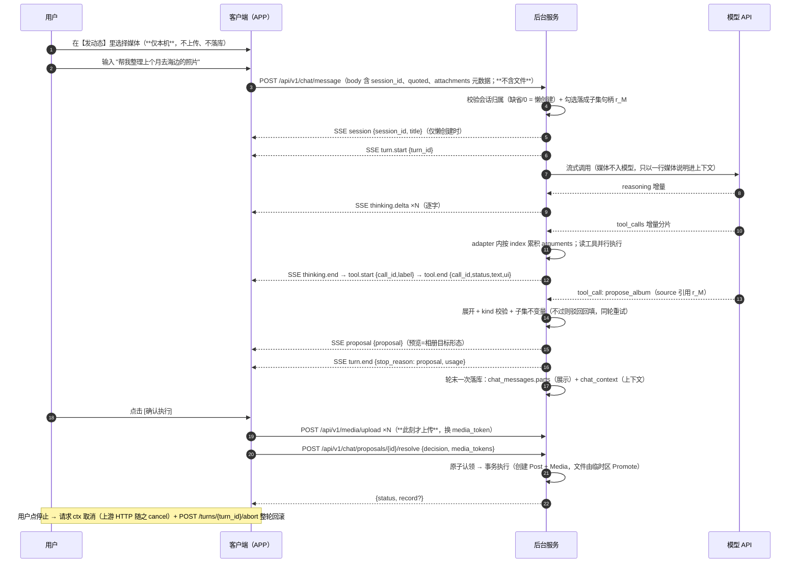

# AI 子系统技术设计

## 目录

1. [模型网关与配置中心](#1-模型网关与配置中心)
2. [工具契约](#2-工具契约)
3. [端到端协议：SSE 与消息结构](#3-端到端协议sse-与消息结构)
4. [Agent 调度与上下文](#4-agent-调度与上下文)
5. [图片处理与存储](#5-图片处理与存储)

---

## 1. 模型网关与配置中心

### 1.1 模型网关

| 功能 | 说明 |
|:---|:---|
| 多模型适配 | 按**协议**适配：OpenAI Chat Completions / OpenAI Responses / Anthropic / Gemini；兼容生态（DeepSeek/Kimi/通义千问兼容模式/GLM/vLLM/Ollama 等）走 OpenAI Chat Completions |
| API Key 安全存储 | 加密存储在服务端，客户端永不接触 |
| 流式传输 | 四协议各自的原生流式（openai-chat `stream:true` + `stream_options.include_usage`；openai-responses `response.*.delta` 事件；anthropic `content_block_delta`；gemini `alt=sse`），由 adapter 归一为同一增量形状后交给 Agent 层（「预算与并行」）。**流式请求不设请求总超时**：连接期用 `Transport.ResponseHeaderTimeout` 兜住，整体长度由整轮墙钟预算控制 |
| 故障切换 | **按类型各一条模型链**（Chat 链 / 嵌入链）：每条链由模型条目按链序组成，调用从链首开始、失败依次向下切换（排序即切换策略；单 Key，不做多 Key 轮询）。嵌入链只收 openai-chat 供应商的模型；链为空或链上全部失败即回落关键词检索（ARCHITECTURE「语义检索」）。**流式下切换窗口只到首个增量之前**——已开始下发增量后失败就直接以 `error` 事件收尾，不换模型续写（否则用户看到半句话被另一个模型接下去） |
| 用量统计 | AI 调用量与 Token 消耗统计（落 `ai_usage_logs`，报表在后台仪表盘）；usage 随流式末帧到达，归一后同一口径落库。不做用量限流（2 用户自用无滥用对象） |
| 模型热切换 | 管理后台更换模型后实时生效，无需发版 |
| **多模态** | **媒体文件一律不入模型**：不组装多模态 content、不做图片理解、不录入能力开关。模型只知道「本条消息附带 N 个媒体（文件名）」。需求口径见 PRODUCT「图片与「看图」边界」，服务端落地见「图片处理与存储」 |

### 1.2 内部通道结构

- **Tool Registry**（内置预定义，管理后台可启停，定义见「工具契约」）
- **安全层**：用户身份校验（JWT）· 操作确认流程（发起人确认）· 操作审计日志 · 已删除内容过滤（回收站数据对 AI 不可见）
- **与模型网关交互**：组装 System Prompt + Tools → 流式调用 → 接收 adapter 已归组好的完整 tool_call 并执行 → 结果回填 → 语义事件推送客户端

### 1.3 配置中心与 Prompt 拼装

**配置分两层**（后台接口清单见 ARCHITECTURE「后台管理页面实现」）：

| 层 | 内容 |
|:---|:---|
| 全局（admin） | 供应商（协议 / 地址 / Key）、**模型条目与两条链的顺序**（条目挂类型 `chat` / `embedding`，链序即重试顺序）、模型级参数（见下表）、全局 System Prompt 主干、输出风格库、工具启停。**没有「空间级」独立层**：单空间部署下空间即全局，入口与存储都只有这一份（PRODUCT「后台管理页面功能范围（admin）」） |
| 用户级 | 输出风格偏好（在 APP 设置页配置，仅对该用户发起的会话生效）。**无对话保留时长**：历史不自动过期 |

模型级参数面收敛为四项（`null` = 调用不传、用供应商默认）：

| 参数 | 语义 |
|:---|:---|
| `max_tokens` | 单次回答的输出上限。Anthropic / OpenAI-Responses 的 `max_tokens` 为必填字段，未设时用协议默认 4096 / 16384 |
| `thinking` | **思考档位** = off/low/medium/high，默认 off。**off = 该协议的最低档**，不是「不请求思考」：现役模型（Anthropic adaptive、Gemini 3.x）关不掉思考，省略参数只会让它停在自身默认档，反而违背「关」的意图——用户选「关」要的是省钱省时。开启会产生思考 token 计费（PRODUCT「后台管理页面功能范围（admin）」） |
| `thinking_levels` | 该模型**声明支持**的档位集合（逗号分隔、恒含 off）。档位取值是**模型**属性而非协议属性（如 Gemini 3 Pro 只接受 low/high，发 medium 即 400），故放在配置面声明；adapter 只做「已选档位 → 原生参数」的映射、**不解析模型名**（别名会让名称匹配落空，退化成 400 或静默失效）。写入时归一为固定顺序并校验 `thinking` 落在集合内；OpenAI Chat 协议无统一思考参数，其声明集只允许 off |
| `context_window` | 模型上下文窗口（token）。用于裁剪送入模型的历史：预算 = 窗口 − 输出预留（`max_tokens` 未设时预留 4096），下限 1024；不填则用兜底预算。见「上下文组装」 |

**不设 `temperature`**：理由见 ARCHITECTURE「明确不做与已否决项 · AI 能力」。

**最终 System Prompt = 全局模板主干 + 当前生效风格提示词片段 + 工具使用约定**

- 切风格只换语气，不动主干；APP 未选风格时用全局默认
- 工具使用约定由代码固定追加，**不可被后台自定义模板覆盖**：写工具必须出卡；媒体由系统在确认执行时转正，模型不传 `media_tokens` 也不向用户索要，媒体文件一律不入模型；用户已勾选时操作范围以勾选为准（句柄 `r_M`），类型不一致时引导用户改勾对应类型而不是自行映射；相对时间先换算 `from`/`to`；附当前日期
- **常驻空间事实**：在一起天数 / 今天日期 / 近 7 天动态数 / 下一个纪念日——每轮都成立的少量稳定事实进 prompt，省一次往返。完整概览走 `get_space_stats`（「统计与计数口径」），两者的 ModelText 不重复同一批数字

---

## 2. 工具契约

### 2.1 设计取向

- **按意图命名，不按 REST 端点镜像**：查询类合并为 `find_*`，写操作统一 `propose_*`（产出确认卡），空间聚合统计独立为 `get_space_stats`
- **稳定事实不做成工具**：每轮都要看的摘要进 system prompt，不占一次工具往返
- **幂等优先于 toggle**：`propose_reaction` 是「设为」语义，状态没变就不出卡
- **批量优先于搬运 id**：大列表用结果集句柄引用（「结果集句柄与点选优先」），不让模型在上下文里抄 id
- **规模受控**：16 个工具，逐个可启停，双重拦截（停用后从清单摘除且执行入口拦住）

### 2.2 工具清单（16 个：读 7 / 提案 8 / 删除 1）

| 工具 | 状态条 | 说明 | 参数 | 产出 | 通道 |
|:---|:---|:---|:---|:---|:---|
| find_posts | 搜索动态 | 查动态：query 语义/关键词，留空按时间倒序；那年今日并入（日期取今天） | {query?, from?, to?, media_type?, mood?, place?, author?, favorited?, on_this_day?, sort?, limit?, offset?} | ModelText + 记录列表 | 两通道 |
| find_albums | 查找相册 | 查相册（组织视图，不含媒体本体）；落结果集句柄可勾选 | {query?, from?, to?, limit?, offset?} | ModelText + 记录列表 | 两通道 |
| find_media | 查找媒体 | 查媒体本体；`album_id` 查某相册内媒体（已归档也能查，补上 `propose_album_members` 的 remove 路径）；`group_by` 按日期/地点分桶 | {unfiled?, album_id?, from?, to?, place?, media_type?, group_by?, limit?, offset?} | ModelText + 媒体网格 / 分组 | 两通道 |
| find_anniversaries | 查找纪念日 | 含农历换算后的下次公历日 | {upcoming_only?, limit?, offset?} | ModelText + 记录列表 | 两通道 |
| find_places | 查找地点 | 已记录足迹 + 离线地名候选 | {query?, visited_only?, limit?, offset?} | ModelText + 地点候选 | 两通道 |
| get_record | 查看详情 | 单条详情：动态/相册/纪念日/地点/评论/媒体 | {kind, id} | ModelText + 单条详情 | 两通道 |
| get_space_stats | 统计空间数据 | 空间聚合概览：无参一次全给，实时聚合不落库（口径「统计与计数口径」） | 无 | ModelText + 统计概览 | 两通道 |
| propose_post | 发布动态 | 正文/媒体/心情/地点至少一项 | {content?, mood?, place?} | Proposal | 内部出卡 / 外部执行 |
| propose_comment | 评论动态 | 最多 500 字 | {post_id, content} | Proposal | 内部出卡 / 外部执行 |
| propose_album | 新建相册 | 首批媒体用 `source` 引用结果集，或 `media_ids` 少量指定 | {name, description?, source?, media_ids?} | Proposal | 内部出卡 / 外部执行 |
| propose_album_members | 整理相册 | 一次确认完成增删 | {album_id, add_source?, add_media_ids?, remove_source?, remove_media_ids?} | Proposal | 内部出卡 / 外部执行 |
| propose_anniversary | 新建纪念日 | date 统一 YYYY-MM-DD；lunar 可 is_leap | {name, date, calendar?, is_leap?, remind_days_before?} | Proposal | 内部出卡 / 外部执行 |
| propose_reminder | 设置提醒 | 调整提前天数 | {anniversary_id, days_before} | Proposal | 内部出卡 / 外部执行 |
| propose_place | 记录地点 | 经纬度或地名二选一，地名由服务端离线解析 | {name, latitude?, longitude?, place_query?, visit_date?, description?} | Proposal | 内部出卡 / 外部执行 |
| propose_reaction | 点赞 / 收藏 | 幂等「设为」，状态已一致时不出卡 | {post_id, like?, favorite?} | Proposal | 内部出卡 / 外部执行 |
| propose_delete | 删除内容 | 移入回收站（post/comment/album/anniversary/place）；批量一张卡一次确认 | {kind, id} 或 {kind, ids[]} 或 {kind, source}（三者互斥） | Proposal | **仅 APP** |

系统配置、模型、账号、审计、回收站不设工具。相册媒体一律来自动态媒体池；纪念日的下次公历日由 `internal/lunar` 即时换算不落库。

### 2.3 返回值三分离

一个返回值不能同时喂模型和 UI。工具返回四个独立通道：

| 通道 | 去向 | 内容约束 |
|:---|:---|:---|
| `ModelText` | 进模型上下文 | 紧凑自然语言 + 必要的 id 与结果集句柄；长度上限 2000 rune，超出截断并注明 |
| `UserText` | 给用户的状态条 | 一行人话（「找到 3 条动态」），不可展开 |
| `UI` | 给界面 | 结构化结果块（缩略图 URL、网格、统计），**模型永远拿不到** |
| `Proposal` | 待确认预览 | 见「提案契约」 |

`UI` 块按 `Kind` 渲染：`record_list` / `media_grid` / `place_candidates` / `media_groups` / `record_detail` / `stats`。**新增渲染形态 = 新增一个 Kind，不改动既有工具**。

### 2.4 提案契约

- **预览即目标形态**：发动态的卡与发布前预览同形（正文 + 媒体网格 + 地点 + 心情），不是参数表；建相册的卡就是相册封面 + 成员缩略图网格
- **由工具自构造**：Proposal 在工具执行内构造并落 `preview_json`，**不从 params 反推**；出卡即落库，刷新/跨设备回显直接读。`preview_json` 内部结构固定为 `{intent, summary, preview: {kind, body}, warnings, attachments}`：外层 `intent` / `summary` / `warnings` / `attachments` 为跨类型共有字段，`preview.kind` 标明意图类型、`preview.body` 是该意图的目标形态数据（如发布动态的动态预览、删除的单条 `body` 或批量 `items` + `count`，见「批量删除契约」）——`/chat/history` 的卡片快照（「会话与历史回显」）只从这里读出，不另存一列
- **校验前置**：参数不合格、目标不存在、超出勾选范围一律**不出卡**（不出注定失败的卡），错误直接回给模型同轮改口
- **自包含**：`source` 句柄在出卡时就展开成具体 id 存进 `params_json`，不依赖结果集之后还在
- **单次有效 + 超时**：确认/取消即失效；`expires_at` = 生成时间 + 卡片有效期（见 PRODUCT「卡片体系」），超时置 `expired`
- **裁决事务化**：`resolve` 原子认领（pending 且未过期）→ 事务执行 → 回写结果；过期 410、已裁决 409、失败置 `failed` 并记原因

### 2.5 执行模式

| 模式 | 触发方 | 行为 |
|:---|:---|:---|
| `ModePropose` | APP AI 模式（内部通道） | 产出 Proposal + 确认卡，不执行；用户确认后在 `resolve` 事务内执行 |
| `ModeExecute` | 外部 Agent（PAT readwrite） | 直接执行并返回结果（确认责任在外部客户端，见 对外集成「工具权限分级与确认口径」） |

删除类工具 `AppOnly`：只存在于内部通道，任何令牌档位都不下发。

### 2.6 不收录的工具与理由（负向契约）

以下工具**不在工具集内**，且不得因为「看起来合理」而加回。每行的理由都指向仍然有效的规则（PRODUCT「数据操作规则（用户可见行为）」、ARCHITECTURE「安全约束」、本文「统计与计数口径」），本节是约束而不是变更记录。

| 不收录 | 理由 |
|:---|:---|
| `update_post` / `update_anniversary` | 记录内容字段不可编辑（PRODUCT「数据操作规则（用户可见行为）」），不存在任何更新工具；提醒天数属用户配置，经 `propose_reminder` 调整（PRODUCT「纪念日」） |
| `delete_photo` | 删除照片 = 删除其所属动态，走 `propose_delete(kind=post)` |
| `delete_post` / `delete_album` / `delete_comment` / `delete_anniversary` / `delete_point` | 合并进 `propose_delete`，按 kind 统一且支持批量 |
| `purge_recycle_bin` | AI 与用户均不可手动永久删除（ARCHITECTURE「安全约束」） |
| `restore_from_recycle_bin` | 恢复仅后台，不对 AI 开放 |
| `get_memory_digest` | 无对应产品语义 |
| `get_visited_cities` | 城市分组由 `get_space_stats` 提供 |
| `get_space_summary` / `get_timeline_summary` | 每轮都该看的稳定摘要归 system prompt 的常驻事实。**`get_space_stats` 不是两者的回归**：前者是「每轮都该看的摘要」，后者是「用户问起才查的完整概览」（含分布与分类计数），职责与调用时机都不同 |

### 2.7 结果集句柄与点选优先

读工具把命中的 id 存入 `chat_result_sets`（按会话归属），换回句柄 `r_N` 挂在 UI 块和 `ModelText` 上。批量提案用 `source={result_id, group?}` 引用，出卡时展开成具体 id。

用户勾选走另一条路：随下一条消息提交 `quoted`（`{result_id, group?, ids?}` 或 `{kind, id}`）。服务端校验归属——句柄必须属于本会话，单条 id 必须在本会话结果集里出现过。

**点选优先（勾选即操作范围）**：`quoted` 带具体 `ids` 时，服务端把交集落成一行**子集结果集**（kind 同父、ids = 勾选交集），换回新句柄 `r_M`，连同「本轮操作范围以勾选为准」一起进模型上下文；父句柄保留不动（下一轮仍可引用全集）。模型因此能精确引用用户勾的那几条。

**不变量**：本轮 `quoted` 非空时，**作用于既有记录的提案，其目标 id 集必须 ⊆ 同 kind 的勾选并集**——比较必须按 kind 分组，media id 与 post id 是两个自增空间，kind 不一致时比对无意义。`expandSource` 展开后与显式 `ids` 一并校验，超出即校验前置驳回、不出卡、把「用户勾选了 N 条{类型}（句柄 r_M），请引用 r_M」回填给模型，同轮重试用户无感。

- 覆盖：`propose_delete`（含批量）、`propose_album_members`（`add_*` / `remove_*` 各自）、`propose_album`（首批媒体）、`propose_comment` / `propose_reaction`（`post_id` 须等于勾选那条）
- 不受约束：`propose_post` / `propose_anniversary` / `propose_place`（新建内容）
- 勾选数超提案上限（批量删除的条数上限见 PRODUCT「引用与操作范围」）时直接驳回并提示分批，**不静默截断**
- 只带 `group` 不带 `ids` 的引用，该分组展开 id 计入勾选并集

**kind 不一致一律驳回，不做映射**：用户勾了 3 张照片说「把这几张删了」，正确行为是驳回并引导「删除照片需删除其所属动态，请先查询并勾选动态」，而不是映射成「删 3 条动态」。三个理由：① 传统模式没有「从相册删照片」这个操作（PRODUCT「相册（独立底部 tab）」），AI 侧发明它是新增语义而不是对齐；② 危险不对等——一条动态可能连带其他 20 张，用户勾 3 张却删了 3 条动态及其全部媒体，警告文案挡不住误确认；③ 映射本身又是一次「AI 自己选」，与点选优先的初衷相悖。口径：**勾选的类型决定能做什么**。

**未勾选时**不加此约束，也**不**强制「写提案的 id 必须来自本会话结果集」——后者会误伤「给刚发的那条点个赞」（新建记录 id 不在任何结果集里）与 `get_record` 链路；该路径靠存在性校验与确认卡预览兜底。

**句柄存活与上下文窗口是两件事**：句柄随会话一直存活（不随上下文裁剪消失），但旧一轮的 `ModelText` 可能已被裁出上下文——此时模型不主动记得 `r_1` 存在，而用户勾选旧结果卡的条目仍然有效（校验只看归属会话，且本轮会把勾选子集重新转述进上下文）。

### 2.8 批量删除契约

- 参数三选一互斥：`{kind, id}` 单条（既有客户端渲染不改）/ `{kind, ids[]}` 显式批量 / `{kind, source}` 引用结果集（出卡时展开为具体 ids）
- **结果集类型校验**：`expandSource` 必须校验结果集 `kind` 与调用方期望一致（相册类 = media，删除类 = 其 `kind`），不符即校验前置驳回。不校验的后果不是报错而是**错删对象**：删除 post 分支只校验「该 id 的动态存在」，传入一个 media id 只要 posts 表里恰好有同号就会被软删（两者都是自增整数，小库里几乎必然撞上）；相册路径则会在执行期才报「媒体不存在」（FK 强制 + 成员存在性校验），同样违反「不出注定失败的卡」
- 校验前置：三者恰有一个；`ids` 去重后为空或超批量上限（见 PRODUCT「引用与操作范围」）→ 拒绝不出卡；`source` 展开后为空 → 拒绝；任一条目不存在 → 整批拒绝
- 预览只增不改：`preview.body` 单条走既有 `text/date/thumb`，批量走 `items: [{id,text,date,thumb}]` + `count`。Warnings 批量必带「将删除 N 条{类型}，移入回收站，可在后台恢复」，`kind=post` 追加「动态的媒体会一并删除」
- 执行：事务内逐条软删除，**任一条失败整批回滚**并回写 `failed` + 原因，不留半删状态
- 通道与审计：仍 `AppOnly`；审计仍两条，`params` 摘要记 kind + 条数 + 前 3 个 id

### 2.9 统计与计数口径

**聚合统计（`get_space_stats`）**——统计归统计，不与任何具体业务数据交叉：

| 项 | 口径 |
|:---|:---|
| 参数 | 无。分布窗口固定：按年近 5 年 / 按月近 12 个月 / 城市 Top 10。不做 `scope`、`year`、`group_by`——一旦参数化就退化成业务查询 |
| 维度 | 动态（总数/今年/本月/按年/按月）；媒体（总数/照片视频录音分类/未归档）；相册（**手动相册数 / 已归档媒体数**——月度相册不是实体、不计入统计，见 PRODUCT「相册（独立底部 tab）」）；足迹（点位数/城市数/城市 Top 10）；纪念日（总数/下一个）；互动（点赞/收藏/评论） |
| 底层 | 全部实时聚合，**不新增表、不落库、不做快照与缓存**；复用 `store.TimelinePostCounts` 与 `store.PointCities`，新增的只有几条 COUNT |
| 已删内容 | 一律不计入：动态维度按 `posts.deleted_at IS NULL`；互动三计数（赞/收藏/评论）**必须连带判断所属动态是否已删**（`likes` / `favorites` 自身无 `deleted_at`，`comments` 的 `deleted_at` 只管评论自身）。否则同一张卡会出现「动态 N 条」与「互动 M 次」自相矛盾，也违反「安全层」的已删除内容过滤 |
| 结果集 | **不落句柄**、`Selectable=false`、不返回任何记录 id：统计不指向具体记录，因此不可被勾选引用、不可作 `propose_*` 的 `source`。模型要展开某一维度，自己调对应 `find_*` |
| 与提示词分工 | system prompt 的常驻事实保留在一起天数 / 今天 / 近 7 天动态数 / 下一个纪念日四项；`get_space_stats` 的 **ModelText 不重复这四项**，只给增量数字；**UI 块含全部维度**（含在一起天数，概览卡本该有）。同一份统计，喂模型的和给人看的各取所需 |
| UI 块 | `Kind: "stats"`，`Title: "我们的空间"`。`UIBlock` 新增三个 `omitempty` 字段（既有 Kind 与既有渲染不受影响）：`stats: [{label, value, hint?}]` 数字网格（`value` 由服务端拼好单位，客户端不做运算）、`series: [{title, points: [{label, count}]}]` 分布列表。**卡上只放两组 series：按年 + 城市 Top 10**，近 12 个月只进 ModelText（三组列表全上卡会顶满对话流）。不做图表 |
| 与后台仪表盘 | 仪表盘是 admin 的**监控面**（含 AI 调用量/Token/延迟/告警）；本工具是**对话内的内容概览**，不含任何运行指标。数据有重叠但受众与用途不同，不属重复建设 |

**计数与翻页（`find_*` 共同口径）**：

- `UIBlock.total`：命中总数真值；`more` = **真实余量**（`total - len(records)`）。`total` 未知时两者均省略
- `total` 来源：浏览与关键词路径用 SQL `COUNT(*)` 下推（与列表查询共用同一 WHERE）；`find_albums` / `find_anniversaries` 本就先全量过滤后计数，只需把真值同时填进 `total`；`find_places` 改为先数完再截断
- **语义检索路径不给 `total`**：向量检索返回的是按相关性截取的 id，无稳定总数。ModelText 写「语义匹配到 N 条（按相关性截取，非全部命中）」。宁可说不知道，不给假数
- `offset`：五个 `find_*` 各加 `offset`（缺省 0），`limit` 上限不变（media 100，其余 50）；不引入 cursor。ModelText 回显区间（「第 21–40 条，共 320 条」）让模型知道自己在翻页；翻页结果照常落新句柄。语义路径忽略 `offset` 并注明「语义检索不支持翻页，可去掉 query 或指定 sort=recent」

**详情清单截断**：`get_record` 的相册成员 / 动态媒体清单最多下发 50 条，ModelText 注明「共 N 条，已列前 50，完整清单用 `find_media(album_id=…)`」。详情块**不做可勾选**（详情是「看单条」不是「选一批」，勾选只留给 `find_*` 结果卡）；大相册的浏览与多选走 `find_media(album_id)`，它有句柄、可勾选、可翻页。

---

## 3. 端到端协议：SSE 与消息结构

### 3.1 时序与事件

**事件集**：`session` / `turn.start` / `thinking.delta` / `thinking.end` / `answer.delta` / `answer.end` / `tool.start` / `tool.end` / `proposal` / `turn.end` / `error`。

- `turn.end.stop_reason` 取 `answer` / `proposal` / `budget` / `error`（用户点停止走请求取消，不发 `turn.end`，见「停止与断连」）
- `thinking.delta` 与 `answer.delta` 都是**真增量**（逐字/逐块），客户端累加渲染
- 增量只走 SSE，**轮末才落一条完整消息**（落库与流式解耦，中途断连不产生半截行）
- 并行读工具的 `tool.start` / `tool.end` 会交错，客户端靠 `call_id` 归位。**服务端侧的口径**：并行批次的事件**只由主 goroutine 发出**——先按发起顺序发完该批全部 `tool.start`，`Wait()` 之后再按完成顺序发各自的 `tool.end`；工作 goroutine 内只执行工具、不写 SSE（`http.ResponseWriter` 不可并发使用）。因此 `tool.end` 之间会乱序，客户端务必按 `call_id` 归位
- **零带内信令**：不用 emoji 前缀、不用特殊标记在正文字符串里传状态，一切状态走事件与字段

### 3.2 接口清单

> 除 `/chat/*` 外均为 AI 专属；PAT 相关见 对外集成「对外 MCP 服务能力」。

| 端点 | 用途 |
|:---|:---|
| `POST /api/v1/chat/message` | 发消息，SSE 语义事件响应 |
| `GET /api/v1/chat/bootstrap` | 首屏：可用性 + 欢迎语 + chips（不调模型、不落库）。**chips 是空会话引导文案，只在无消息时渲染**（需求见 PRODUCT「输入与运行控制」） |
| `GET /api/v1/chat/status` | 轻量可用性轮询：只返回可用性与原因，不返回欢迎语与 chips。用于 AI 不可用/锁定态下的反复确认，避免每次拉整份 bootstrap |
| `GET /api/v1/chat/sessions` | 本人会话列表，按 updated_at 倒序 |
| `DELETE /api/v1/chat/sessions/{id}` | 硬删会话（事务内连消息、上下文、结果集同删）；`turn_id` 未终结或有未过期提案时拒绝（「会话与历史回显」） |
| `GET /api/v1/chat/history?session_id=N` | 按会话回显 parts（缺省/0 → 空列表） |
| `POST /api/v1/chat/proposals/{id}/resolve` | 裁决提案（`decision=approve\|cancel`） |
| `POST /api/v1/chat/turns/{turn_id}/abort` | 用户主动停止，整轮回滚 |
| `GET /api/v1/styles` | 输出风格列表（唯一对 APP 开放的 admin 域只读接口） |

### 3.3 消息 parts 契约

一条消息 = 一行，`parts` 是有序 JSON 数组；一轮助手消息的思考、工具步骤、正文、确认卡全在同一行（不再一行一块，也不再有辅助 role）。界面按 parts 顺序渲染，**界面只从 parts 取事实**。

| part | 字段 | 渲染 |
|:---|:---|:---|
| `text` | `{text}` | 回答正文，Markdown 渲染 |
| `thinking` | `{text, seconds}` | 折叠条「已思考 N 秒」，可展开 |
| `tool` | `{call_id, label, status, text?, ui?}` | 进行中逐行状态条；结束后聚合（「过程收起（客户端渲染口径）」） |
| `card` | `{action_id}` | 确认卡。只存指针，渲染与历史回显都读 `ConfirmAction.preview_json`（结构见「提案契约」） |
| `attachment` | `{name, mime, size, w?, h?}` | 【发动态】过程中回显待发布媒体；**只有本机元数据、没有 `ref`**（未确认时服务端还没有媒体行，见「图片处理与存储」）。缩略图由本机 blob 渲染，刷新后只剩文件名与数量 |
| `quote` | `{refs}` | 输入框上方引用条回显；`refs` 沿用「结果集句柄与点选优先」的 `quoted` 形状（`{result_id, group?, ids?}` 或 `{kind, id}`） |
| `interrupted` | `{}` | 「已中断」标记 |

**role 与 part 的约束**：user 消息允许 `text` / `attachment` / `quote`，断连时服务端另在其 `parts` 末尾追加 `interrupted`（该轮助手行按「轮末才落一条」可能尚未落库，标记只能挂在那条一定存在的用户消息上）；assistant 消息允许 `thinking` / `tool` / `card` / `text`。

**`thinking.seconds` 由服务端在轮末落库时写入**（thinking 起止的墙钟差）；客户端流式期间自行计时，刷新后以服务端值为准。

UI 块载荷（缩略图 URL、网格结构）**永不进模型上下文**——这是三分离（「返回值三分离」）的结构性保证。

### 3.4 过程收起（客户端渲染口径）

一轮进行中：思考区逐字展开、工具状态条逐个出现（`running` → `ok`）。
`turn.end` 到达后：思考区折叠为「已思考 N 秒」可展开条目；**多次工具调用聚合为一条「已完成 N 步」可展开摘要**，展开看到的是每步人话状态（「搜索动态 → 找到 3 条」），**不是原始参数与审计数据**（审计仍归后台）。界面最终只剩结果卡 + 回答正文 + 思考与步骤两条折叠条目。单步调用不聚合（一行比一条摘要更直接）。

### 3.5 会话与历史回显

- **懒创建**：无「新建空会话」接口。`session_id` 缺省/0 → 服务端建新会话（标题=首条用户消息前 20 字 + 超长省略号，纯媒体空文本回退「新的会话」），仅此时下发 `session` 事件；`>0` 时校验归属（越权/不存在 404）
- **模型上下文按会话隔离**（取自 `chat_context` 同一 session 的行，按 token 预算裁剪而不是按条数，见「上下文组装」）
- 会话的锁定时机（何时禁止切换/删除、待确认期间输入区是否可用）见 PRODUCT「卡片体系」；服务端侧的对应约束：`turn_id` 未终结时、或会话存在未过期 `pending` 提案时，一律拒绝 `DELETE /sessions/{id}`——否则待确认提案会被随会话硬删而静默丢弃（那是一张即将生效的写操作卡，丢卡即无声取消，见 ARCHITECTURE「数据模型」ConfirmAction）
- **裁决执行中同样拒绝删除**：确认/取消在**原子认领之后**才执行工具并写回执，此时卡片已不是 `pending`（上面的计数拦不住），也不再是一个 turn——若不额外登记，删会话能从「工具执行」与「回执落库」之间穿过，回执落进已删会话（`chat_messages.session_id` 刻意无外键，落库不报错，只会留下永不清理的孤儿行）。故裁决执行期间把该会话登记进**与 turn 同一份进程内活跃表**（合成 key 用 action_id），执行结束即注销。**不得**改用「把 `confirmed` 计入 `pending` 拦截」：进程中途崩溃会留下永久的 `confirmed` 行，会话就再也删不掉了（把竞态换成锁死）
- **历史回显**：`GET /chat/history` 直接下发 parts 由客户端按类型渲染；含 `card` part 时附 `card` 快照对象（`{action_id, intent, summary, preview, warnings, attachments, status, expires_in, result?}`，其中 `intent` / `summary` / `preview` / `warnings` / `attachments` 全部从 `preview_json` 读出（结构见「提案契约」）、永不反推）；状态归一 `confirmed→executed`、已过期的 `pending→expired`、`failed` 原样下发
- **历史不自动过期**：不设保留时长，也没有清理消息/会话的定时任务；删会话即硬删其全部消息（不进回收站）。因此不存在「消息被清掉、只剩空会话壳」的状态

### 3.6 停止与断连（两件事，不是一条）

| 情形 | 行为 |
|:---|:---|
| 用户点停止 | 客户端 `abort` 并 `POST /chat/turns/{turn_id}/abort`：**整轮回滚**（用户消息、已产生增量、未裁决提案置 `cancelled`），不留无下文的孤儿消息。**停止还要真停上游**——请求 ctx 取消会连带 cancel 上游 HTTP 请求（`http.NewRequestWithContext` 已具备），不再继续付 token |
| 连接意外断开 | **不删任何东西**：已下发的增量与已完成的工具步骤按 parts 落库保留并标 `interrupted`；尾条无人回答的用户消息同样标中断 |

只有用户显式动作才回滚；「停止」必须真停上游（取消请求 ctx 连带 cancel 上游 HTTP），不留后台生成与计费。

**两件事必须可区分**：用户点停止时客户端先 abort 请求，服务端 `r.Context()` 随之取消——这与「连接意外断开」在服务端**表现同一现象**，但语义相反（回滚 vs 保留）。故服务端在中止前先登记本轮「用户已中止」（进程内即可，随本轮请求结束而失效），断连分支据此直接返回、不落任何内容；远端停止若已先完成整轮回滚，断连分支写库前后各查一次登记，命中即删掉自己刚写的行，保证「停止」不会留下孤儿助手行。

### 3.7 客户端约束

- **零 AI 配置**：APP 只持有服务端 base URL，无任何模型相关配置（定义见 客户端设计「手机 APP 职责」）
- 不可用时的禁用范围与提示文案见 PRODUCT「输入与运行控制」；服务端侧提供 `GET /chat/status` 与 `bootstrap` 的 `available` + `reason` 作为依据

---

## 4. Agent 调度与上下文

### 4.1 预算与并行

| 项 | 口径 |
|:---|:---|
| 调度单位 | 一轮（turn）= 一次用户消息触发的完整往返，可含多次模型调用与多次工具执行；`turn_id` 贯穿事件、落库与回滚 |
| 预算三维 | 轮次上限 8、工具调用总数上限 16、整轮墙钟 90s。任一触顶即进入收尾，**不静默结束**。（**初始值**：无实测依据，上线后按观测调整） |
| 读工具并行 | 同一次模型响应里的多个 tool_calls：读工具（`!IsWrite`）**并行执行**（用标准库 `sync.WaitGroup`，不为此新增第三方依赖）；写工具（提案）串行，且一旦产出提案即停止本轮（一轮只出一张卡，媒体也只归首张卡）。并行只覆盖「首个写工具之前」的那段读工具——出提案会中止其后所有 call，把提案之后的读工具也跑掉就是执行了不该执行的调用 |
| 收尾义务 | 预算耗尽必须再补一次**不带工具**的调用，让模型基于已获得的信息作答并说明哪些没完成；该调用也失败才回退固定文案。`stop_reason=budget` |
| tool_calls 增量累积 | 流式下工具参数分片到达，形状各协议不同：openai-chat `delta.tool_calls[i]` 带 index、arguments 按 index 拼字符串；openai-responses `response.function_call_arguments.delta`；anthropic `content_block_delta.input_json_delta.partial_json`（按 content_block 序号归组）；gemini `parts[].functionCall` **整块到达**（Gemini API 不分片：`args` 是 JSON object，官方标注 `partialArgs` / `willContinue` 仅 Vertex 支持，故不做分片累积）。**累积在 adapter 内部完成，Agent 层只看到完整的 tool_call**（协议差异不外泄） |
| 分片跨帧 | arguments 的 JSON 片段可能跨 SSE 帧截断：累积器只拼字符串、不中途解析，到 `finish_reason` / `content_block_stop` 才 `json.Unmarshal` |
| 落库时机 | 增量只走 SSE，**轮末一次落库**（`chat_messages.parts` + `chat_context`）；中途断连不产生半截行，已下发的内容按 parts 完整保留 |
| 断连出口 | 「保留已产生内容」对**所有**轮末出口生效，不止工具循环内那处：预算收尾调用（`chatCall`）也可被断连打断，同样要按 parts 落库并标 `interrupted`。任何「请求 ctx 已取消时还直接写库」的出口都会静默丢内容，新增出口时须一并处理 |

### 4.2 上下文组装

**上下文取自 `chat_context`（模型事实源），不从展示消息反推。** 展示层的卡片载体、思考链、工具状态条与 UI 载荷都不进上下文；提案以「tool_calls + 裁决结果」的完整往返进上下文，模型因此知道自己出过卡、不会用文字复述代替调工具（反推路径下模型会模仿成「文字复述代替调工具」，实测根因）。

| 规则 | 口径 |
|:---|:---|
| 取数 | `SELECT … WHERE session_id=? ORDER BY seq`，按 `tokens` 累计裁剪 |
| 裁剪单位 | 以「配对单元」为单位：带 `tool_calls` 的 assistant 行与其后续 `tool` 行同进同出。**不得逐行淘汰**——把这一对拆开会重新造出孤儿 `tool` 行（或无回执的 `tool_calls`），正是「协议配对」要防的违规。`read_result` 的残留摘要也按单元计数，不按行 |
| token 预算 | 按 **token 估算**裁剪而不是按条数（20 条短消息与 20 条长消息的体积差一个数量级）。预算取链首模型条目的 `context_window` 减去输出预留（`max_tokens` 未设时预留 4096，下限 1024）；未声明窗口时用兜底预算。上下文在 `chatTargets` 之后、按链首组装一次，故用链首的窗口近似（切换后的模型窗口可能不同）；system 段与工具定义不计入该预算，两项都是已知近似 |
| `kind` 取值 | 四分类：`system`（常驻 system prompt 段）/ `dialogue`（用户消息与助手正文）/ `read_result`（旧读工具 `ModelText`）/ `proposal`（提案往返，同时 `pinned=1`）——取值决定淘汰策略，写入时由服务端判定，不由模型决定 |
| 助手正文全覆盖 | `dialogue` 的「助手正文」包含**所有**助手文本出口：工具循环内的正常回答，以及预算耗尽的**收尾回答**。只写展示面 `chat_messages` 而不写 `chat_context` 会让模型下一轮看不到自己说过的话（多轮指代失忆） |
| 三级淘汰 | ① `pinned=1`（已裁决提案往返）**永不淘汰** ② `kind=read_result`（旧读工具 ModelText）可淘汰但留一行残留摘要（「更早查询过 N 次动态/媒体，结果已省略」）③ 思考链与 UI 载荷从不进上下文 |
| 不进上下文 | `pending` 提案（未发生的操作不向模型透露）、`reasoning` 思考链、UI 载荷、媒体 base64（只给文件名与数量） |
| 已裁决提案归一 | 已执行→结果正文；失败→「执行失败：原因」；取消→「用户取消了该操作，未执行」；过期→「确认卡片已过期，未执行」 |
| 协议配对 | `tool_calls_json` 存 assistant 轮的 name+arguments，回放时原样还原配对——**不需要合成往返 id、不需要「工具名不下发」的补丁** |
| 协议私有凭据 | 工具调用可带**协议私有凭据**（如 gemini 的 `thoughtSignature`），与 name+arguments 一并落 `tool_calls_json`、跨轮回放。凭据由**产出它的协议**解释，只有该协议回传：gemini 以 **part 级**字段与 `functionCall` 平级带回（缺失即 400），其余协议不回传；openai-chat 直接序列化消息，发请求前**必须剥掉**（未知字段会被上游拒或误当参数）。历史缺凭据时**不伪造**，让上游报错可见 |

---

## 5. 图片处理与存储

**需求口径**见 PRODUCT「图片与「看图」边界」：上传只为一件事——创建动态；媒体不入模型。

**实现结论：媒体不随消息落库**。消息体带 `{name, mime, size}` 元数据，**服务端不存文件、不存 base64**。真正的上传发生在**确认执行提案时**，走 `POST /api/v1/media/upload` → 临时区 → 与动态发布完全同一条管线（ARCHITECTURE「媒体上传管线」），**没有任何 AI 专属上传路径**。

| 时机 | 发生什么 |
|:---|:---|
| 选中媒体 | 仅本机预览（blob），服务端零数据 |
| 发送消息 / 出卡 | 仍只有本机文件；卡片里的媒体网格由本机渲染 |
| **确认执行** | 逐个 `POST /api/v1/media/upload` 换 `media_token` → 提交确认请求 → 服务端原子创建 Post + Media 并把文件从临时区 `Promote` 到正式区 |
| 取消 / 过期 | **什么都没上传**，服务端零残留 |

**部分上传失败整批把关（与传统模式同一规则，PRODUCT「发布动态」「提交时才上传」）**：确认触发的逐个上传中任一失败（自动重试 2 次退避后仍败），本次**不提交**确认请求、提案保持待确认；失败文件标出可手动重传，已成功的 token 保留不重传，全部就绪后**自动续提交**。提交后服务端转正仍原子——任一 token 失效整批失败回滚（ARCHITECTURE「媒体上传管线」）。放弃 / 过期时对已上传 token 调 discard 立即撤销（ARCHITECTURE「媒体上传管线」主动撤销）；来不及撤销的由 24h 孤儿清理兜底。

**结论：不需要任何数据模型改动**。`media` 行只在动态创建时产生，`post_id` 保持 `NOT NULL REFERENCES posts(id)`——**不存在「无主媒体行」这种状态**，因此不需要 `owner_type`、不放开 `post_id`、不清理「提案遗留媒体」。

**推论：服务端无需任何"未确认附件"的状态**——不需要清理任务、不需要回显补偿、不需要状态标记，因为这类数据从未存在过。

已确定的部分：

- 消息里不存 base64、不存文件，只留一行元信息（文件名与数量），用于刷新后仍能知道「这条消息发过 N 个文件」
- `attachment` part 只承载本机元数据 `{name, mime, size, w?, h?}`，**没有 `ref`**（此时服务端还没有媒体行可引用）；媒体 id 只在确认执行、成为动态媒体之后才存在
- 媒体不送模型：上下文里只有一行「本条消息附带 N 个媒体（文件名）」
- 时间轴等动态列表查询走 `JOIN posts` 内连接，未确认的媒体从未入库，自然不会出现在任何列表里
