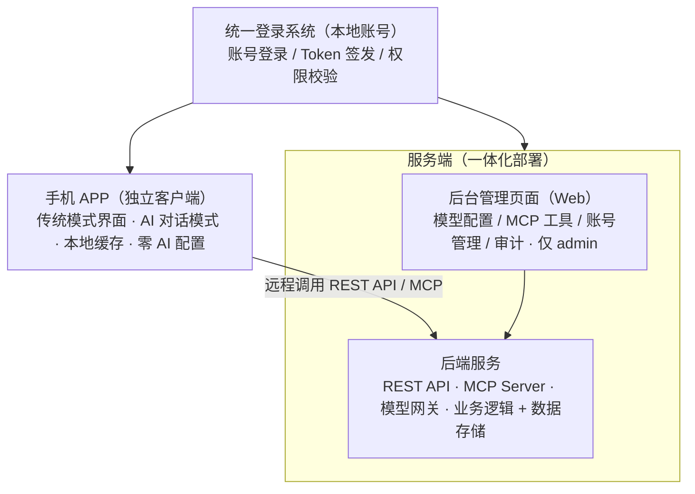
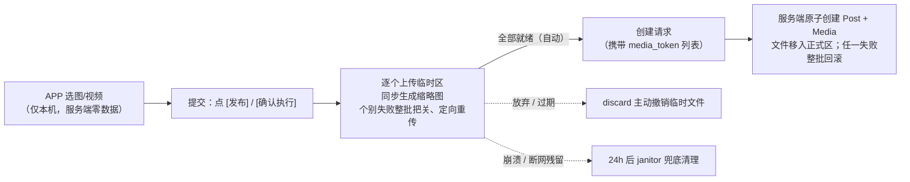
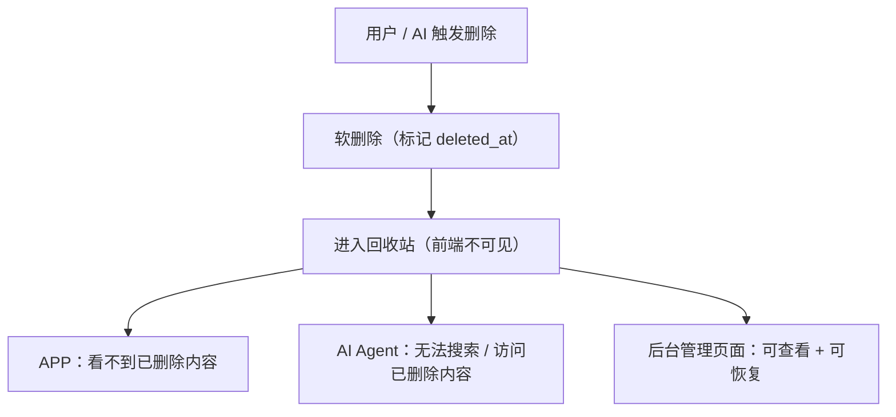
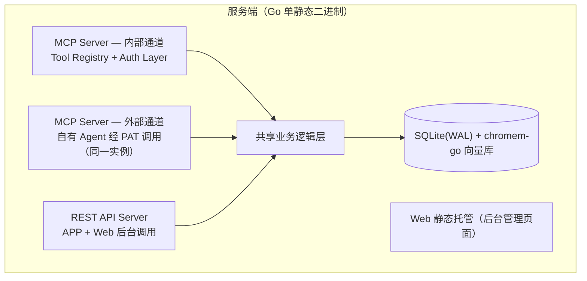

# 跨域技术设计

## 目录

1. [架构总览](#1-架构总览)
2. [统一登录与认证](#2-统一登录与认证)
3. [后端服务架构](#3-后端服务架构)
4. [回收站机制](#4-回收站机制)
5. [后台管理页面实现](#5-后台管理页面实现)
6. [部署架构与技术栈](#6-部署架构与技术栈)
7. [部署与网络](#7-部署与网络)
8. [数据模型](#8-数据模型)
9. [明确不做与已否决项](#9-明确不做与已否决项)

---

## 1. 架构总览

统一登录系统为所有端提供认证：APP 远程调用服务端；Web 后台与后端同机/同集群部署，本地/内网调用。

---

## 2. 统一登录与认证

| 维度 | 方案 |
|:---|:---|
| 人（两端） | JWT + Refresh Token，APP / Web 后台通用 |
| 令牌寿命 | Access Token **1 小时**；Refresh Token **30 天**（`auth/token.go`）——每次刷新顺延，故常用设备无需重登；超过 30 天未使用即失效，需重新登录（需求侧口径见 PRODUCT「角色与账号」）。过期 refresh token 由 janitor 每小时清理（见「定时任务总表」） |
| 外部 Agent | 个人访问令牌 PAT（生成/吊销/档位见 对外集成「对外 MCP 服务能力」；PAT 绑定签发用户，数据以该用户身份隔离） |
| 账号来源 | 部署时环境变量内置 admin；admin 创建 girl/boy；密码重置由 admin 在后台操作 |
| 会话吊销 | 两个入口都会**删该用户的 refresh token 行**：登出（`POST /api/v1/auth/logout` 带 refresh_token，两端退出登录都先调它再清本地）与改密（admin 重置密码成功后连带吊销，否则「怀疑泄露才改密」这一动机落空）。Access Token 服务端不查库、寿命 1 小时，故已签发的 Access Token 最多再用 1 小时、之后无法续期——这是「立即掉线」的可达口径，不引入 token 版本号机制 |
| 权限校验 | admin 拥有系统配置权（模型/MCP/回收站/审计）；情侣用户专注内容操作 |
| 未登录状态 | 所有页面重定向至登录页，无公开匿名访问；后台登录入口仅接受 admin 角色，APP 登录入口仅接受情侣角色 |
| 登录安全 | 登录与令牌签发接口内置限速与失败锁定，防在线爆破（见「网络访问（双通道）」）。口径：**登录**按同一「用户名 + IP」连续失败 **5 次**即锁定 **15 分钟**；**令牌签发（refresh）按来源 IP** 计（key 前缀 `refresh:`，与登录的「用户名\|IP」是各自独立的命名空间，两把锁互不污染——共用会让设备休眠后的正常刷新失败累计把密码登录也锁死）。令牌签发只把「查不到该令牌」计为失败：该接口没有用户名可拼，而「构成失败」恰是「令牌查不到」，那一刻也归属不出用户，故失败计数只能落在 IP 上（能查到归属就不算失败，两者互斥）；持已过期令牌重试属正常生命周期、不计入。单进程内存态，重启清零对本场景可接受 |

---

## 3. 后端服务架构

### 3.1 配置管理入口

| 入口 | 说明 |
|:---|:---|
| 管理后台 | admin 配置全局模型、工具、安全策略 |
| 用户设置页 | 按当前模式分层显示：通用项（模式行与选择浮层 / 外观 / 通用组与退出登录）始终可见，AI 偏好（输出风格）在模式选择浮层选到 AI 时显示；接口仍是一个 `PATCH /api/v1/me`（仅 `ai_style`），与显示分层无关 |
| 客户端 | 零配置，只传用户 Token，后台自动加载对应空间配置 |

### 3.1.1 服务地址解析

APP 不存用户填写的地址，地址由三段决定（顺序固定，前一个不可用即退到下一个）：

| 顺序 | 来源 | 实现 |
|:--:|:--|:--|
| 1 | 绿联中转 | 服务端持凭据完成五步握手换 `ugreen-proxy-token`，`GET /api/v1/uglink/channel` 下发 `{baseURL, cookie, expiresAt}` |
| 2 | 备用地址 | `GET /api/v1/channels/backup` 返回启用列表，APP **并发探活** `GET /api/v1/health`（2s 超时、实测往返毫秒），取延迟最低的一条。**无优先级字段**：固定顺序在切网后立刻过时（家里最快的地址出门可能完全不可达） |
| 3 | 内置地址 | 构建期注入 `__DEFAULT_BASE__`（CI 仓库变量 `APP_DEFAULT_BASE`）；dev 未注入时回落 `localhost:8080` |

**登录前只能靠内置地址**（此时无 token，拿不到通道），因此 CI 对 `APP_DEFAULT_BASE` 做非空校验，缺失即构建失败。

**证书约束**：备用地址与内置地址都须使用系统信任的证书链。APP 的网络请求走 WebView，其 TLS 校验用 Android 系统信任库，且 targetSdk ≥ 24 后**不信任用户安装的 CA**（Android 7 起的安全默认），因此自签名证书会被直接拒绝。要支持自签名需在 Android 工程加 network security config 并声明自定义信任锚，属额外复杂度且降低安全性——已否决，见「明确不做与已否决项」。

绿联通道的会话与失效处理：

- 会话缓存 1 小时；到期前 60 秒由 APP 续期（`expiresAt` 由服务端给出）
- **不能只靠 TTL 判失效**：绿联侧可能提前失效，转发响应若为 302 且 `Location` 指向 `/desktop/#/login/` 即判失效，立即重登并重放一次（仅幂等请求）
- **重登互斥**：进程内一把锁，重登期间其它请求等待；连续失败按 10 / 30 / 60 分钟三级退避，避免撞绿联风控
- 续期成功后响应头带 `X-Channel-Refreshed`，APP 据此丢弃本地 cookie 并重取

凭据（绿联账号密码）经 `crypto.Encrypt` 存 `app_settings`（键 `uglink_credentials`），与模型密钥同一套密钥派生；密码只写不读。

### 3.1.2 应用内更新中转

服务端替 APP 从 GitHub 取回更新信息与安装包，APP 只连自己的服务端（与业务请求同一 base）。

| 接口 | 鉴权 | 说明 |
|:--|:--|:--|
| `GET /api/v1/app/update/latest` | 登录态 | 返回**本地已就绪**的版本 / 说明 / 大小 / 最低可用版本 / 下载路径；无就绪包时返回 `available:false`（APP 视为无需更新，不是错误） |
| `GET /api/v1/app/update/download` | 登录态 | `http.ServeContent` 下发本地文件，支持 Range/206 续传；无就绪包时 404 |
| `GET/PUT /api/v1/admin/appupdate/config` | admin | GitHub 代理地址 + 可选用户名 / 密码（密码加密存储、只写不读）；同时返回缓存与下载任务状态 |
| `POST /api/v1/admin/appupdate/check` | admin | 查 GitHub 最新版本（不下载），返回版本号 / 大小 / 本地是否已就绪 |
| `POST /api/v1/admin/appupdate/download` | admin | **后台下载安装包**（长任务，立即返回；进度由 config 的 `downloading` 反映） |
| `POST /api/v1/admin/appupdate/remove` | admin | 删除已缓存的安装包与元数据 |

实现要点：

- **元数据用 ETag 条件请求**：命中 304 直接复用缓存，不再解析；网络失败但有缓存时退回缓存（更新检查不因抖动失败）
- **只保留最新版本**：`updates/` 下只存当前最新 release 的 APK，检测到新版本时清理旧目录
- **回源不绑请求生命周期**：用独立 context（10 分钟上限），客户端断开只影响那一次下发；下次请求命中已落盘文件
- **慢速链路可续传重试**：`.part` 累积 + `Range` 续传，最多 5 次；慢速代理下 46MB 传输中途 EOF 是常态
- **超时按体积估算**：`体积 / 128KB/s × 2`，下限 5 分钟、上限 60 分钟（慢链路固定 10 分钟会半途而废）。失败时**保留 `.part`**，下次触发从断点继续；只有「大小已达标却仍失败」才丢弃
- **安装包必须已就绪**：APP 只能下载本地已有的包；没有就视为「无需更新」。这条不变量由单测守住——元数据存在但文件缺失时 `ReadyRelease` 必须返回 nil，否则 APP 会看到可更新却下载 404
- **下载由后台手动触发**：慢速链路下 46MB 要十几分钟，放在 APP 请求路径里必然超时；后台下载跑完后再让 APP 看到更新

### 3.2 媒体访问鉴权

| 决策项 | 方案 |
|:---|:---|
| 访问方式 | 后端按需签发**短期签名 URL**（默认 15 分钟有效），客户端 `` / `<video>` 标签直接渲染 |
| 签名校验 | 服务端校验签名与过期时间，过期返回 401，客户端重新请求换取新 URL |
| 客户端一致 | APP / Web 后台均使用签名 URL，无需各自注入凭证 |
| 扩展性 | 媒体走后端统一接口 + 签名 URL，客户端无直连存储的耦合 |
| 签名派生 | `HMAC(secret, "media:{mediaID}:{variant}:{exp}")`，密钥取 TokenManager 的密钥材料并按用途域分隔；**签名主体是媒体行 id**，未落库的临时区文件没有签名 URL 通路 |

### 3.3 通知分发器

| 决策项 | 方案 |
|:---|:---|
| 事件源 | 业务写入瞬间（动态/评论/点赞/收藏/足迹/相册）+ 删除对方发布内容时（仅站内）+ 纪念日提醒检查（每小时，按「当日已发」幂等，故不会重复）。触发口径同 PRODUCT「通知中心」：足迹仅**手动建点 / AI 口语报点**产生（动态带地点自动生成的点位不另发，该次发布已有 `post_created`）；相册由用户**手动建册**产生（AI 代建同；按月分段不产生事件），只通知对方（自建静默）。**按月分段不是事件源**：它是查询视图，不生成、不通知 |
| 事件类型 | 站内 **12** 类：`post_created` / `post_liked` / `post_commented` / `post_favorited` / `map_point_created` / `anniversary_reminder` / `album_created` / `post_deleted` / `comment_deleted` / `album_deleted` / `anniversary_deleted` / `map_point_deleted`。**无 `media_deleted`**：媒体不独立删除（删动态即删其媒体），删除语义由 `post_deleted` 表达（PRODUCT「相册（独立底部 tab）」）。产品侧触发口径见 PRODUCT「通知中心」。**动态带地点自动生成的点位不发 `map_point_created`**：那一点位是发布动作的副产品，该次发布已有 `post_created` |
| 站内通知 | 写入通知表，APP 打开时同步显示红点；通知为**临时消费品**——点击即删，列表只存未消费通知，红点 = 剩余条数；不设站内通知开关 |
| 外部渠道 | 空间级（admin 配置）的**通用 API Webhook**：请求方式 / 服务地址 / 请求头 / 请求体模板（`{{title}}`、`{{content}}`、`{{time}}`、`{{type}}` 占位符）；每渠道按事件订阅过滤（**7 类**：纪念日/新动态/评论/点赞/收藏/足迹/相册上新——相册均指**用户手动建册**，按月分段不产生事件）；内容删除 5 类**仅站内不进外部推送**；Bark / Server酱 / Qmsg / 企业微信为预设模板 |
| 快照字段读法 | `operator` 恒为真实发起人用户名；`via:"ai"` **仅在 AI 代操作时出现**，缺省即发起人本人操作（REST 直连与站内自操作均不带）——接收端据此判别来源；推送正文以「（AI）」后缀区分。**互动三类**（点赞/收藏/评论）另带 `author_id`（目标动态作者）：作者是收件人本人渲染「你的动态」，是操作者本人渲染「自己的动态」（PRODUCT「通知中心」）；外部推送正文同一规则 |
| 操作者口径 | 外部推送与站内**同一触发条件**：站内通知的收件人恒为对方（操作者本人不收，即「自建静默」自动成立），外部推送随之在同样条件下触发；渠道为空间级，推送内容带操作者用户名，「是不是自己的动作」由接收端过滤。**无操作者的事件**（定时任务发的纪念日提醒）不适用「本人不收」，收件人为**情侣双方**（全部非 admin 用户）——admin 不在情侣里、且登录 APP 即 403（「统一登录与认证」），投给它永远无人读 |
| 推送时机 | 站内通知**同步**写库（廉价、失败不影响主流程）；外部 Webhook **异步**发送——`Dispatch` 起 goroutine 并 `context.WithoutCancel` 取请求上下文，自带 30s 总预算。理由：推送是副作用，渠道故障时同步发送会让每次发布多等一个 client 超时（10s）× 渠道数。代价是「写入成功但推送尚未发出」成为常态，单空间自用可接受；要求必达需队列，属新设计 |
| 设计动机 | 规避 Android 后台存活限制（国产 ROM 杀后台）；服务端常驻进程无此问题，实时性优于一切端上方案 |
| 边界 | 通知通道仅两条：站内红点 + 外部 Webhook。不做 APP 本地定时通知（需精确闹钟权限、杀进程后不可靠） |
| 出站依赖 | 出站第三方依赖：模型 API、通知 Webhook、**地图瓦片**（服务端代理转发至公开 XYZ / 天地图上游，地址可配，见「地图服务」）、**GitHub Releases**（服务端为应用内更新取回版本信息与安装包，可配 HTTP(S) 代理，见「应用内更新中转」）；逆地理用本地离线数据；核心数据全部留在自部署服务器。客户端自身不直连任何第三方 |

### 3.4 地图服务

| 决策项 | 方案 |
|:---|:---|
| 瓦片来源 | **服务端瓦片代理**：APP 统一请求 `GET /api/v1/map/tile?z=&x=&y=&exp=&sig=`，后端按配置转发；两类源——①公开 XYZ（URL 模板含 `{z}/{x}/{y}` 占位，admin 可配）；②天地图（admin 配 tk 密钥，加密存储，密钥永不下发 APP）。新增瓦片源 APP 零改动 |
| 配置管理 | `map_sources` 多行表（type / url_template / tianditu_key 加密 / tianditu_layer / enabled，部分唯一索引保证至多一个使用中）；admin `GET/POST /api/v1/admin/map-config`、`DELETE /{id}`、`PUT /{id}/enable`（启用校验：public 需模板非空、tianditu 需已配密钥；使用中的源不可删除；不提供编辑）；APP `GET /api/v1/map/config` 仅下发使用中源的 provider、tile_api 与瓦片短时签名 exp/sig |
| 城市判定 | **写时判定落库**：创建点位时以坐标做 point-in-polygon（`server/internal/geo` 内置地级市边界多边形，DataV.GeoAtlas 简化数据、射线法零外部依赖），未命中回退「名称·」前缀，再未命中留空（留空不进城市列表）；`GET /api/v1/map/points/cities` 按 city 分组计数，不做「城市点亮」视觉 UI |
| 点位生成 | 三来源进同一点位池：动态携带地点时服务端自动创建/同名复用（判定键 = 地点名，坐标以先创建者为准；不做邻近合并）；手动创建（REST）；AI 工具建点（口语报点与 AI 代发带地点动态）。`source` 按发起通道取值 `post` / `manual` / `ai`，见「数据模型」MapPoint |
| 地理编码 | `GET /api/v1/geocode?q=<地名>` 返回候选 `{name, city, lat, lng, display}`；包含匹配（`city` 仅服务端搜索匹配用，候选行不展示，用户可见口径见 PRODUCT「地图」）；无第三方 POI 依赖（mock 与真实后端同源内置同一离线表：`tools/mock/fixtures.mjs` GEOCODE_PLACES / `server/internal/geo/places.go`） |
| 不使用 GPS | 不使用设备定位、不自动建点（选地点为手动地图点选） |
| 转发请求头 | 两类源均设 `Accept: image/png,image/*;q=0.8,*/*;q=0.5`；public 源 UA=`love-life-server/0.1 (…; self-hosted)`（避免 OSM 按 Go 默认 UA 黑名单 403）；天地图源 UA=浏览器 UA（实测其 WAF 对非浏览器 UA 一律 418）。**Referer 统一透传入站页面真实值**：天地图浏览器端 tk 绑定域名白名单，不在白名单 418、完全无 Referer 403；缺时回退 public→项目仓库页、天地图→`https://map.tianditu.gov.cn/`（实现 `api/mapconfig.go applyUpstreamHeaders`） |
| 瓦片鉴权 | 短时签名（与媒体同口径）：config 下发 `exp+sig`，瓦片请求校验失败 401——img 标签无法携带 header，签名即凭证。签名只绑 `exp`（HMAC-SHA256），**一次覆盖全部坐标**：瓦片由 APP 按视口实时算出、数量随拖动变化，逐张签名会不断触发重签；TTL 30 分钟，APP 每 10 分钟静默换签（`mapTiles.startTileGrantRefresh`）。取舍：签名有效期内可被持有者复用，撤销依赖短 TTL 到期 |
| 未配源提示 | config 无启用源时下发 `provider:""`（服务端与 mock 同源）；APP 记住 `provider`，为空时 `MapCanvas` 与 `MiniMapPicker` 覆盖「未配置地图服务」提示（`MapNoSource.vue`）且不再发无源瓦片请求；区分于「有源但个别瓦片/上游抓取失败」（保留瓦片 `@error` 降透明度降级）。`GET /map/tile` 未配源返回 **503**（需 admin 配置），区别于上游抓取失败的 **502** |

### 3.5 媒体上传管线

| 决策项 | 方案 |
|:---|:---|
| 上传时序 | 两段式：**提交（点 [发布] / [确认执行]，传统与 AI 同一规则）时**逐个上传至临时区（`media/tmp/{uuid}`，返回 media_token）；创建请求携带 token 列表，服务端原子创建 Post + Media 并将文件移入正式区。选择阶段服务端零数据（PRODUCT「发布动态」「提交时才上传」）；单文件独立请求、独立重试，失败不影响其他文件 |
| 分片与断点续传 | 上传默认**分片**（片大小 8MiB，`limits/media.json` 的 `uploadChunkBytes`，APP 切片、服务端按 offset 追加）：`X-Upload-Offset`（本片起始偏移）+ `X-Upload-Id`（首片不带、服务端下发）+ `X-Upload-Final`（末片）。四种形态：**首片即末片**（文件 ≤ 一片，最常见——照片/录音/短视频，一次请求走完直接回 media_token）、首片（回 `{upload_id, received}`）、中间片（回同上）、末片（回 `Uploaded`）。`received` 是客户端推进 offset 的**唯一依据**（不是本地累加），故「响应丢失但字节已落盘」能自动纠正；offset 不符回 **409 + `{received}`** 供重同步。**末片幂等**：sidecar 带 `finalized` 标记，已收尾的重发末片直接回同一结果（否则客户端卡在「传完了却拿不到 token」）。**无分片头 = 传统整文件上传**，走原 `SaveTemp`——APP 与服务端独立升级，旧 APP 的行为必须不变。半成品由 `discard` 撤销、24h 无进展由 janitor 兜底清理。**升级顺序：先服务端后 APP**——反序（新 APP + 旧服务端）下旧端不认分片头、会把首片当完整文件收下，故客户端以**回执 `size` 必须等于文件大小**为完整性判据（不符即报错，不静默截断） |
| 整批把关 | 创建请求只在**批次全部就绪后自动发出**（无需二次点击）：个别文件上传失败（**单侧重试**：仅网络异常与 5xx 重试、指数退避；4xx 是确定性失败，直接转手动重传，不白传）不阻塞已成功文件（token 保留不重传）。服务端侧任一 token 失效 / 校验失败 → 整批回滚（已转正文件删除），不产生缺图的半条动态 |
| 主动撤销 | `POST /api/v1/media/discard`（体带 token 列表，幂等）：放弃 / 取消 / 卡片过期 / 把关作废时客户端立即撤销已上传的临时文件；sidecar 记录上传者、服务端校验归属，防跨用户误删。**sidecar 缺失与损坏分别处置**：文件不存在（可能已被 janitor 清理）仍放行删除——否则正常的放弃/重试会留下删不掉的临时文件；存在但解析失败或上传者为空则拒绝并告警（被篡改或写坏的信号） |
| 临时区元数据 | sidecar JSON `media/tmp/{token}.json` 存 kind/宽高/size/duration/taken_at/上传者（discard 归属校验用）+ `finalized`（分片收尾标记，见「分片与断点续传」），让元数据跨重启存活；**临时区阶段不落任何数据库行** |
| 孤儿清理（兜底） | 临时区文件 24h 未被发布引用，由 janitor 的每小时循环删除（见「定时任务总表」）——常规路径由主动撤销清理，此项只兜客户端崩溃 / 断网来不及撤销的残留 |
| 缩略图 | 上传时同步生成：图片等比缩放（最长边 1080px）；视频不抽帧，使用统一播放占位图 + 时长角标——零外部依赖，保持单二进制自包含（不引入 ffmpeg） |
| EXIF | 读取拍摄时间作为 taken_at（缺失回退上传时间），供时间轴与那年今日排序；GPS 坐标忽略；EXIF 原样保留（自部署无外泄面，签名 URL 仅短时有效） |
| 音频时长 | 上传时解析容器头取 duration（mp3/m4a/wav 自实现，不引入 ffmpeg）；解析失败不阻塞上传、duration 留空 |
| 视频时长 | 上传时解析容器头取 duration（mp4/mov 读 `moov/mvhd`，与 m4a 同一个 box；webm 读 `Segment/Info` 的 `Duration` × `TimecodeScale`）；**同样零 ffmpeg**，解析失败不阻塞上传、duration 留空，缩略图上的时长角标随之不显示。解析按容器的声明长度逐 box / 逐元素步进，不全文搜特征字节——媒体数据区里出现同名四字节会把随机数据读成时长 |
| 格式与大小 | 照片 jpg/png/webp；视频 mp4/mov/webm；音频 mp3/m4a/wav；HEIC 首版不支持（上传时明确拒绝并提示）；单文件默认软限 500MB（`MEDIA_MAX_MB` 可配）。**上限在读取阶段生效**：每片请求体先经 `http.MaxBytesReader` 截断（留 8 KiB multipart 信封余量）、追加时再按**累计**字节判限（`AppendChunk`）；超限一律 413（文案见 `media.TooLargeMessage`）且删除半成品、不产生残留 |
| 空文件 | **0 字节一律拒收**（`media.ErrEmptyFile`，400，文案「文件是空的，请重新选择」）：收尾时（`FinalizeUpload`）统一判 `size == 0` 并清理临时区，三类媒体同一处守卫。不能指望各 kind 的解析兜住——照片会因缩略图解码失败偶然被挡，而视频 / 音频按「容器头解析失败不阻塞上传」静默放过，空文件就会落库成 0:00 的假媒体条目、被统计与相册当成正常媒体计数。守卫在 `finalized` 幂等分支**之后**，已收尾的上传重发末片仍能取回结果。**只拒空文件**：非空但容器头损坏的视频 / 音频照旧通过（时长留空），不把「解析失败」升级成拒收 |
| 数量上限的单一数据源 | 「单条最多几个媒体」由服务端与 APP **共用同一份** `server/internal/limits/media.json`（Go `go:embed`、APP 直接 import）——服务端校验与发布页/聊天的选择器提示同源，不会各写一份而漂移（历史上后端 18、前端 9，互不相认） |
| 存储布局 | 数据目录内 `media/{yyyy}/{mm}/{uuid}.{ext}` 主文件 + `thumbs/` 平行缩略图 + `avatars/` 头像 + `updates/{version}/` 应用更新安装包缓存（见「部署形态与产物」）。**文件本体在文件系统，数据库只存相对路径** |
| 无主文件通道 | 头像走独立通道（`SaveAvatar` 直接写 `avatars/{yyyy}/{mm}/`，路径存 `users.avatar_path`），**不进媒体表**——头像无缩略图变体、无相册归属，且是「单用户覆盖」语义，与媒体的追加式记录不同；签名命名空间与媒体隔离（`avatar:<userID>` vs `media:<id>:<variant>`）。后台维护入口见「后台管理页面实现」空间管理 |
| 物理删除 | 回收站永久清除时同步删除主文件与缩略图（规则见「回收站机制」）；`Delete()` 带数据目录越界保护，拒绝删除目录外的文件 |
| 存储形态约束 | **无外部存储后端**：配置项只有监听地址 / 数据目录 / admin 账号 / 单文件大小上限，全部运行状态（SQLite、向量库、媒体、密钥）自包含于数据目录（「部署形态与产物」）；对象存储不在出站依赖白名单内 |
| 对话中的图片 | **与动态发布同一条管线，无 AI 专属路径**——因此**不存在无主媒体行**，`media.post_id` 保持 `NOT NULL`。上传时机、本机预览与取消 / 过期口径见 AI模式设计「图片处理与存储」 |

### 3.6 语义检索

| 项 | 口径 |
|:---|:---|
| 实现 | chromem-go 本地向量库（`<数据目录>/vectors/` + 同级 `.dim` 维度标记），嵌入按**嵌入链**取数：`kind=embedding` 的模型条目按链序（仅 openai-chat 供应商），逐个尝试、失败向下切换 |
| 索引时机 | 动态写入时同步建索引（失败只告警、不阻断落库）；janitor 启动与每小时增量回填 |
| 集合定位 | 集合名 = 嵌入配置（端点 + 模型）指纹。**删除按「本进程实际写入过向量的那个配置」定位集合**：链首失败会下移到后续条目，按链首去删会因指纹不同而把真正存着向量的集合整个换掉（同批其他向量一起消失）。`Has` 则**仍按当前链首**判定——链序/模型一变即返回 false 触发 janitor 重嵌，这是「换模型自动重建」的机制（两者取值不同是有意为之，见 `internal/search`） |
| 回落 | 嵌入链为空 / 链上全部失败 / 无命中 → 回落关键词匹配，不报错 |
| 数据位置 | 向量是**派生数据**：可从动态正文重建，不纳入备份必要项 |
| 出站说明 | 嵌入调用会把动态文本发往所选供应商、向量只存本机；如需零出站，把该供应商 `base_url` 指向本机 OpenAI 兼容服务（如 Ollama）即可，代码路径相同 |

---

## 4. 回收站机制

### 4.1 删除与恢复流程

### 4.2 自动清理规则

- 后台可配置回收站保留期限（取值域与默认值见 PRODUCT「后台管理页面功能范围（admin）」）
- 定时任务：每日凌晨执行（服务启动时先补跑一轮，覆盖 0 点整停机的漏跑；判定幂等）
- 逻辑：`deleted_at + 保留期限 < 当前时间` → 永久删除（恰好到期保留）
- 清理范围：动态连同其评论/点赞/收藏/媒体（含缩略图）物理删除；相册连同 album_items；纪念日与地图点位直接删除；待删媒体若被活跃相册引用，其 AlbumItem 组织项与封面指针一并清理（相册本身保留，回退到其它照片）
- 留痕：每轮有删除时写一条回收站操作日志（operator = 系统定时任务，内容为类型与条数汇总）
### 4.3 定时任务总表

> **只有两个循环**，其余一切清理都挂在这两处；不存在按保留时长清理对话的第三个任务（对话历史不自动过期，见「数据模型」的 `ChatSession`）。

| 频率 | 任务 | 口径 |
|:---|:---|:---|
| **每日本地 0 点**（启动补跑一轮） | 回收站超期永久删除 | 见上一节：`deleted_at + 保留期限 < 当前时间` → 物理删除，留痕 |
| **每小时**（janitor） | 临时区孤儿媒体清理 | `media/tmp/` 中超过 24h 未被发布引用的文件 |
| | 过期 refresh token 清理 | 内部维护 |
| | 纪念日提醒检查 | 站内 + 外部同发；按「当日已发」幂等，故每小时跑不会重复 |
| | 向量索引回填 | 每轮一批（`backfillBatch`）；未配置嵌入模型时跳过。启动时先跑一轮 |

### 4.4 安全约束

| 约束 | 说明 |
|:---|:---|
| 用户不可手动清空回收站 | 防止情绪化操作或误触 |
| AI 不可调用永久删除工具 | 工具清单中不存在 purge_recycle_bin |
| 仅管理员可恢复 | 通过后台管理页面操作 |
| 仅系统可永久删除 | 定时任务自动执行，无人工入口 |
| 回收站操作需审计 | 恢复记录谁在何时恢复了什么；系统永久删除记录类型与条数 |

> 回收站对 AI 工具清单的影响（哪些工具不收录及理由）见 AI模式设计「不收录的工具与理由（负向契约）」。

---

## 5. 后台管理页面实现

导航：扁平 7 项（仪表盘 / 空间管理 / AI 配置 / 外部集成 / 回收站 / 审计日志 / 服务日志）。多段内容的页面用页内 tab 分区，一次只呈现一段：空间管理 3 个 tab、AI 配置 6 个 tab、外部集成 2 个 tab、回收站 2 个 tab；AI 配置与外部集成的 tab 走嵌套路由（`/ai/*`、`/integrations/*`）可直达，空间管理与回收站的 tab 是页内状态（同一路由），旧路径全部 redirect 到新路径（redirect 表见 `admin/src/router/index.ts` 兜底段）。整页 flex 视口锁定，页面不滚动，各数据容器内部滚动——**每屏至多一张 `.card-fill`**（该类 `flex-basis` 为 0，同屏多张会按张数而非内容需要平分高度，长表格被裁且滚不动）。后台是桌面形态（固定侧栏 + 视口锁定外壳），不设窄屏断点。功能范围见 PRODUCT「后台管理页面功能范围（admin）」。

- **仪表盘**：内容统计（单空间部署口径）；AI 调用量 / Token 消耗 / 平均延迟——ai-usage 时序每点含 `avgLatencyMs`，页面按调用量加权汇总；异常告警；最近活动（后台流水 + 内容事件）。后台流水取自回收站操作日志（admin 的恢复、清理任务的系统超期永久删除，均带操作者与摘要）——那是唯一带操作者与摘要的运维流水；AI / PAT 的工具调用归「审计日志」页，不在本卡重复
- **空间管理**（页内 3 个 tab：空间信息 / 情侣成员 / 数据保留，同一路由切换）
  - 空间信息：名称 / 个性签名 / 在一起日期（在一起统计并入信息卡）
  - 空间成员：可创建、可改字段、不可删除等业务规则见 PRODUCT「后台管理页面功能范围（admin）」；此处只定接口与实现约束
  - admin 账号只读展示，由部署环境管理，后台不提供增改
  - 数据保留：**取值域与默认值见 PRODUCT「后台管理页面功能范围（admin）」**；本文件只管读写语义——回收站页只读读自同一数据源，对话历史不设保留期限（见「数据模型」的 User / ChatMessage）
  - 接口：`GET /api/v1/admin/users`、`POST /admin/users/couple`（原子创建）、`PUT /admin/users/{id}`（昵称 + 生日）、`POST /admin/users/{id}/avatar`（头像上传）、`POST /admin/users/{id}/reset-password`、`GET/PUT /space`（**PUT 仅 admin**——空间配置统一由后台维护；GET 对登录用户开放，首页读空间信息）、`GET/PUT /admin/security`
  - **保留策略部分更新**：`/admin/security` 请求体可只含本次变更字段（`recycleRetentionDays`），服务端按字段合并，**不得整体覆盖**；该接口无对话保留字段——对话历史不设保留期限（PRODUCT「会话模型」）
- **AI 配置**（6 tabs，配置语义与拼装规则见 AI模式设计「配置中心与 Prompt 拼装」，此处只列接口）
  - **供应商（/ai/providers）**：模型服务的增删改，Key 只写不读。接口：`GET/POST /api/v1/admin/model-providers`、`PUT/DELETE /{id}`、`PUT /{id}/key`
  - **对话模型链（/ai/chat-chain）** / **嵌入模型链（/ai/embedding-chain）**：两条链各自一屏，同一组件按路由 `meta.kind` 区分链别；模型条目按类型分链（`chat` / `embedding`），链内顺序可调（上移下移），嵌入类型只允许 openai-chat 供应商；`POST /fetch-models` 取模型名候选。接口：`GET/POST /api/v1/admin/models`、`PUT/DELETE /api/v1/admin/models/{id}`、`PUT /api/v1/admin/models/order`（体带 `kind` + 有序 id 数组）
  - **提示词与风格（/ai/prompts）**：全局 System Prompt 模板、输出风格库增删改与默认设置。接口：`GET/PUT /admin/system-prompt`、`GET/POST /admin/styles`、`PUT/DELETE /admin/styles/{id}`、`PUT /admin/styles/default`、`GET /api/v1/styles`（APP 端并集 + 默认标记，仅此接口对 APP 开放）
  - **MCP 工具（/ai/tools）**：内置工具列表（名称 / 描述 / 参数 Schema）+ 启用停用开关；按类别分组展示，新工具复用既有类别无需改页面
  - **访问令牌（/ai/tokens）**：PAT 生成 / 吊销 / 档位 / 绑定用户
- **外部集成**（2 tabs）
  - **通知渠道（/integrations/webhooks）**：渠道 CRUD + `[发送测试]`。接口：`GET/POST /api/v1/admin/webhooks`、`PUT/DELETE /{id}`、`POST /{id}/test`
  - **地图配置（/integrations/map）**：瓦片源卡片网格（等高），末尾固定「添加瓦片源」卡；支持启用（全局至多一个使用中）、删除（两步确认，使用中的源不可删），**不提供编辑**——配置有误删除后重加。接口 `GET/POST /admin/map-config`、`DELETE /{id}`、`PUT /{id}/enable`
- **回收站管理**（页内 2 个 tab：已删除内容 / 操作日志）：列表按删除时间排序、按类型筛选（动态/评论/相册/纪念日/地图点位）、显示删除者（用户/AI）；**照片不单列为类型**——媒体无独立生命周期，随所属动态一并进入回收站、随动态恢复，不做单独恢复（PRODUCT「相册（独立底部 tab）」）；单条与批量恢复（二次确认）；操作日志（恢复 + 系统超期永久删除，不可删除、永久保留）
- **审计日志**：操作者筛选（user/ai/pat）+ 单条耗时列；模型响应延迟与用量报表归仪表盘。**分页读**（`GET /admin/audit?page=&page_size=`，默认 20、上限 100，响应带 `total`）：`audit_logs` 永久保留且每次 AI / PAT 工具调用一条，是全库唯一无界增长的表，全量返回会把几万条记录一次性塞进浏览器；页面用「加载更多」分批取
- **服务日志**：服务端运行日志的实时视图（slog 全量，含 AI 调用失败原因）。数据源是**进程内环形缓冲**（`server/internal/logbuf`，定长 2000 条、满则覆盖最旧），**不落盘**——日志本就进 stdout（容器 `make logs`、裸跑看终端），落盘会与「单一数据目录只存业务数据」冲突，重启丢历史属已知取舍。写入缓冲前按**键名**脱敏（`api_key` / `token` / `password` / `signature` 等替换为 `••••`；`max_tokens`、`prompt_tokens` 等 token **计数**不打码，那是排障与仪表盘指标）。匹配只认整名与下划线后缀，不用子串。页面按 `seq` 增量轮询（2s）；密钥不因此进入浏览器。接口 `GET /api/v1/admin/logs?since=<seq>`（仅 admin）。**5xx 一律落日志**：`api.writeErrorf` 对 `status >= 500` 记 `method` / `path` / `err`，4xx 不记（业务拒绝是常态，记下来会淹掉真正的故障）；`http.Server.ErrorLog` 也指向同一 handler，handler panic 的栈因此同样可见。原始错误只进日志、不进响应体
- **交互约定（实现侧）**：全局反馈统一用 `AppToast`（不用原生 `alert`/`confirm`/`prompt`，避免布局跳动）；危险操作确认用应用内 `ConfirmDialog`。**需要哪些确认、按钮用什么色档**见 PRODUCT「后台管理页面功能范围（admin）」

---

## 6. 部署架构与技术栈

### 6.1 分层与职责

| 层级 | 职责 | 是否持有模型凭证 |
|:---|:---|:---|
| 手机 APP | 纯展示 + 纯交互，零 AI 配置 | 否 |
| Web 后台（服务端部署） | 系统配置 + 审计监控 | 否（仅管理界面，凭证在后端加密存储） |
| 后端服务 | 模型网关 + MCP Server + 业务逻辑 + 数据安全 | 是（加密存储） |
| 对外 MCP 通道 | 自有 Agent 接入（PAT 认证），与内部 MCP 同实例 | 是（服务端托管） |

### 6.2 部署架构

REST API Server 与 MCP Server 常驻**同一 Go 进程**：单二进制即最终形态（共享内存与连接池），不提供独立部署选项；代码按 REST / MCP 分模块组织仅为工程习惯，不为进程拆分做额外设计。

### 6.3 技术决策清单

| 决策项 | 最终方案 |
|:---|:---|
| 客户端分类 | 两类：手机 APP + Web 后台（服务端一体部署） |
| 登录系统 | 部署时内置 admin（环境变量），角色 admin/girl/boy，admin 有系统配置权 |
| 认证方式 | JWT + Refresh Token（人，两端统一）+ PAT（外部 Agent） |
| MCP Server | 统一实例，同时服务内部 Agent（APP）和外部 Agent（PAT） |
| 对外 MCP | 同一实例的外部通道：PAT 认证，只读/读写两档，删除类不开放 |
| 数据存储 | SQLite(WAL) + chromem-go 向量库 + 本地媒体文件（全部位于自包含数据目录，见「部署形态与产物」） |
| 语义检索 | 见「语义检索」 |
| 安全机制 | 发起人确认（限 APP 内部通道，见 对外集成「工具权限分级与确认口径」）+ 操作审计 + 出站依赖白名单（三类） |
| 回收站 | 软删除 + 后台可配保留期限 + 仅系统自动永久删除 |
| 对话历史 | 服务端权威存储，**不自动过期**（用户删会话即硬删）；客户端仅缓存加速 |
| 外部通知 | 通用 API Webhook：请求方式/服务地址/请求头/请求体模板（占位符）；按事件订阅推送 |
| 技术栈 | Go 单静态二进制（REST + MCP Streamable HTTP + Web 静态托管）+ SQLite(WAL) + chromem-go + Tauri v2 APP（Vue 3，Android only）+ Vue 3（后台管理页面） |
| 部署与网络 | 局域网直连或公网域名 + HTTPS；APP 的服务地址由构建期内置与通道下发给定（见「服务地址解析」），TLS/反代、进程管理、备份由部署者自选 |
| 地图服务 | 服务端瓦片代理：公开 XYZ 模板可配 + 天地图密钥可配（加密存储不下发） |
| AI 子系统技术决策 | 模型网关、流式、Agent 预算、工具契约、SSE 协议 → 见 AI模式设计「模型网关与配置中心」「端到端协议：SSE 与消息结构」「Agent 调度与上下文」 |

---

## 7. 部署与网络

### 7.1 部署形态与产物

- 官方发布产物：**服务端单静态二进制**（内嵌 Web 后台静态资源）、**Android APK**、**Docker 镜像**；APK 经 GitHub Releases 分发并由 APP 应用内更新消费（客户端设计「应用内更新」），服务端不内置托管入口
- Android release 签名密钥由仓库维护者生成并离线保管（`scripts/gen-android-keystore.sh`）：Android 要求同一 App 的更新沿用同一密钥，密钥丢失或更换会导致旧包无法覆盖安装；密钥不入版本库，CI 经仓库 secrets 取用
- 运行方式由部署者自选：裸机直跑（systemd 等）或 Docker / 容器编排均可，本文档不指定特定方案
- **最低运行要求：一个监听端口 + 一个可写数据目录**；全部运行状态（SQLite、向量库、媒体文件、配置）自包含于该数据目录，便于用任意工具做快照与迁移
- 向量库是派生数据：可从动态正文重建，不纳入备份必要项——缺失只影响语义检索，由 janitor 回填
- 环境变量：至少包含 admin 初始账号（用户名/密码）、数据目录路径、监听地址

### 7.2 网络访问（双通道）

- **在家：局域网直连**——APP / Web 后台直接访问内网地址或主机名
- **在外：域名 + HTTPS 公网访问**
- APP 不提供地址填写入口：地址由构建期内置与登录后的通道下发自动决定（见「服务地址解析」）；Web 后台随部署地址访问
- TLS 终止与反向代理（Caddy / Nginx / 云 LB 等）由部署者自定，服务端本身只监听 HTTP 端口
- 应用内置安全基线（非部署可选项）：
  - 公网通道必须经 HTTPS 反代暴露，明文访问仅限内网场景
  - 登录与令牌签发接口内置限速与失败锁定，防在线爆破
  - 媒体访问一律走短期签名 URL（见「媒体访问鉴权」）
  - `/api/*` 启用 CORS（Allow-Origin \*）：APP/Tauri WebView 的 origin 与服务端不同域，浏览器直连为必需路径；认证走 Authorization 头无 Cookie，放开 Origin 不引入 CSRF 面
- **明文传输说明**：Android APP 在仅内网 HTTP 部署场景需在 APP 内允许明文传输；公网通道一律经 HTTPS 反代。iOS 端未来另立需求（PWA 或 iOS APP）

### 7.3 备份与迁移

- 平台定位**不内置备份/导出/导入功能**；备份与迁移 = 部署者直接拷贝自包含数据目录（rsync、网盘同步、磁盘快照等，方式自选）
- 建议部署者定期备份数据目录——回忆类数据不可再生
- 向量库可随目录一起拷贝（省一次重建）；缺失也不影响恢复：服务启动后 janitor 自动回填

---

## 8. 数据模型

> **单一权威源**：实体、字段与关系以本章为准（含 AI 子系统的 `chat_*` 表——schema 对应唯一一份建表 SQL，必须单处描述，AI模式设计 只引用不重列）。
>
> 回收站不是独立实体——各内容实体统一 `deleted_at` 软删标记 + 后台视图（规则见「回收站机制」）；仅系统定时任务可永久清除。
>
> **schema 变更规则**：只有 `server/internal/store/migrations/001_init.sql` 一个全量文件。变更直接改写它，不留增量迁移，也不提供存量库原地升级（文件头已定「无历史升级路径」）。`TestFullSchema` 守卫「目录里只有这一个文件」。
>
> **时间口径**：库内时间列一律存 **UTC**（`datetime('now')`）；**用户可见的「日期」按部署者本地时区判定**（进程 TZ，可用 `TZ=Asia/Shanghai` 覆盖；实现 `store/timeutil.go`）。适用：那年今日同月同日匹配、按月分组的归属、另存文件名日期、仪表盘「今天/昨天」。例外：EXIF `taken_at` 是相机墙钟时间、无时区信息，原样存用不参与换算。
>
> **写入形态与历史兼容**：写入一律用 `datetime` 形态（`YYYY-MM-DD HH:MM:SS`，与 `datetime('now')` 同形，实现 `store.FormatDBTime`）——**不得写 RFC3339**：SQL 里的时间比较是**字符串比较**，RFC3339 的第 11 位 `'T'` 大于空格的 `' '`，会让「已过期」恒判为「未过期」（曾致同日过期提案仍算待确认、删会话被误拒 409）。**读侧与比较侧必须容忍存量 RFC3339 行**：解析走 `store.ParseDBTime`（两种形态都接受），涉及这些列的比较用 `datetime(列)` 归一化。历史库升级时执行一次 `server/migrations/fix-time-format.sql` 把存量行归一化（幂等，可重复执行）。
>
> **外键**：连接串启用 `_pragma=foreign_keys(1)`，FK 在库层强制（不是仅应用层约定）。

### 8.1 账号与配置

| 实体 | 关键字段 | 说明 |
|:---|:---|:---|
| User | id, username, password_hash, role(admin/girl/boy), nickname, avatar_path?, birthday, ai_style | 用户级 AI 偏好（**仅输出风格**）内嵌本表，按用户生效；**无 `chat_retention_days`**——对话历史不设保留时长。admin 由部署环境变量内置。`avatar_path` 见「媒体上传管线」无主文件通道；`birthday` 仅后台维护，不下发 APP |
| Space | id, name, signature, love_start_date | 单行表（单空间部署）；`GET /space` 额外返回即时聚合字段 members / days_together / next_anniversary / anniversary_count / album_count（首页「全新部署空态」判定用：无动态 + 无纪念日 + 无相册；用计数而非 `next_anniversary.name`，否则「纪念日存在但日期全部无效」会被误判成空态） |
| ModelProvider | id, api_type(openai-chat/openai-responses/anthropic/gemini), name, base_url, api_key_enc, header_timeout_sec? | admin 域；Key 加密存储，客户端永不接触。`header_timeout_sec` 是等上游响应头（首包）的超时秒数，NULL = 默认 30s（口径见 AI模式设计「模型网关」）。**无 `default_model` / `sort_order`**：用哪个模型、按什么顺序重试，全部由模型条目的链序决定 |
| ProviderModel | id, provider_id, model_id, kind(chat/embedding), max_tokens?, thinking(off/low/medium/high, 默认 off), thinking_levels(默认 off), context_window?, chain_order | 模型条目：`kind` 决定属于哪条链，`chain_order` 是**同类型内的全局链序**（跨供应商，重试即按它依次走）；`(provider_id, kind, model_id)` UNIQUE，删除供应商时级联。嵌入类型只允许 openai-chat 供应商（应用层校验）。`max_tokens` / `context_window` 可空 = 调用不传；后者的用途见 AI模式设计「上下文组装」。`thinking` 与 `thinking_levels` 分别是按模型的思考档位与它声明支持的档位集合，写入时校验档位落在集合内；取值口径、协议映射与「关」的语义见 AI模式设计「模型网关与配置中心」。**无 `temperature`、无视觉能力字段**（理由见「明确不做与已否决项 · AI 能力」） |
| OutputStyle | id, name, prompt, builtin, sort_order? | 输出风格库：内置固化 + 后台自定义；全局默认风格为单行配置（default_style_id，存 AppSetting） |
| AppSetting | key, value | admin 域全局单值配置（default_style_id、system_prompt 等），键值存储，客户端永不接触。**嵌入模型不再走这里**：嵌入链由 `ProviderModel(kind=embedding)` 表达 |
| RefreshToken | id, user_id, token_hash, expires_at, created_at | 仅存 hash；刷新时顺延（30 天），过期行由 janitor 每小时清理（见「定时任务总表」） |

### 8.2 内容

| 实体 | 关键字段 | 说明 |
|:---|:---|:---|
| Post | id, author_id, content, mood?, point_id?, location_name?(快照), created_at, deleted_at, deleted_by, deleted_by_type | 地点 = 外键 + 名称快照：点位被删/合并后时间轴仍显示快照名；发布只采集正文 / 媒体 / 地点 / 心情（PRODUCT「发布动态」），**无标题、无纪念日关联字段** |
| Media | id, post_id, kind(photo/video/audio), file_path, thumb_path, width, height, size, duration?, taken_at?, created_at, deleted_at, deleted_by, deleted_by_type | **`post_id NOT NULL REFERENCES posts(id)`**：媒体随动态发布产生，**不存在无主媒体行**（未确认的选中媒体只在客户端，见 AI模式设计「图片处理与存储」），也没有独立媒体的创建 / 删除入口（PRODUCT「相册（独立底部 tab）」）；kind 含 audio（无缩略图）；taken_at 取 EXIF 拍摄时间 |
| Comment | id, post_id, author_id, content, created_at, deleted_at, deleted_by, deleted_by_type | 记录内容，软删进回收站 |
| Like | (post_id, user_id), created_at | 可撤销关系数据，复合主键，不进回收站 |
| Favorite | (post_id, user_id), created_at | 同上；首版收藏对象仅动态 |
| Album | id, name, description?, cover_media_id?, created_by?, created_at, deleted_at, deleted_by, deleted_by_type | 需求口径见 PRODUCT「相册（独立底部 tab）」。**只有手动相册是实体**：用户建册后从时间轴选入。**按月分段不是实体、不占行**：时间轴视图里的按月分组由客户端按媒体时间现场分组（接口下发 `month_key`，与月度详情查询同一本地时区口径），故本表无 `monthly` 类型、无 `month_key`、无 `is_hidden` |
| AlbumItem | (album_id, media_id), added_by, added_at + **UNIQUE(media_id)** | 相册是媒体池之上的组织视图；UNIQUE(media_id) 承载「一文件一相册」全相册唯一约束 |
| MapPoint | id, name, lat, lng, city?, visit_date?, description?, source(post/manual/ai), created_at, created_by, deleted_at, deleted_by, deleted_by_type | `city` 写时判定落库（见「地图服务」）；同名地点复用同一点位，坐标以先创建者为准；无合并链、无可见性开关。`source` 三值的判据是**发起通道**：REST 发布动态时随地点自动建点为 `post`，REST 手动建点为 `manual`，AI 通道建点（含动态带地点与口语报点）为 `ai` |
| MapSource | id, type(public/tianditu), url_template, tianditu_key?, tianditu_layer?, enabled, created_at | 瓦片源配置（admin 域，无用户归属）：部分唯一索引保证**至多一个使用中**；`tianditu_key` 加密存储、永不下发 APP；机制见「地图服务」 |
| Anniversary | id, name, date, type(solar/lunar), is_leap?, remind_days_before(默认 1), created_at, created_by, deleted_at, deleted_by, deleted_by_type | `date` 一律 `YYYY-MM-DD`，`type` 决定语义——solar=公历；lunar=农历日期（如 `1996-05-15` = 农历 1996 年五月十五）。**不存 lunar_month/lunar_day 冗余**，闰月语义由 `is_leap` 承载；倒计时/排序/下一次公历由服务端即时推算（`internal/lunar`，mock 与后端同一离线算法）；农历换算为 1900–2100 社区表驱动，不引入外部天文数据做「权威校准」；周期表是**单一数据源**（`server/internal/lunar/lunar_table.json`，Go `go:embed`、APP 直接 import 同一份），故两侧不可能漂移，不再需要「双表逐项比对」的测试，改以不变量测试与两语言各自的黄金用例护栏。**闰月只由 `is_leap` 决定**，不做「平月查不到就退到闰月」的兜底——兜底会让同一纪念日一年命中两次（先平月、再闰月），也让 `is_leap` 失去意义 |

### 8.3 通知与回收站

| 实体 | 关键字段 | 说明 |
|:---|:---|:---|
| Notification | id, recipient_id, event_type, target_type?, target_id?, snapshot_json?, created_at | 事件类型清单与推送口径见「通知分发器」；**临时消费品：点击即删，无已读状态**（故无 is_read / read_at）；内容删除事件带文案快照（`name` + `deleted_by`）、无跳转、仅站内；目标已被删时点击提示「内容已删除」 |
| WebhookChannel | id, name, method(GET/POST), url, headers_json, body_template, events_json | 空间级外部通知渠道（admin 配置，无用户归属）；events_json = 订阅的事件类型（7 类） |
| RestoreLog | id, operator, summary, created_at | 回收站操作日志（不可删除、永久保留）：恢复记录谁在何时恢复了什么；系统超期永久删除记 operator=系统定时任务 + 类型与条数汇总 |

### 8.4 对话与提案

| 实体 | 关键字段 | 说明 |
|:---|:---|:---|
| ChatSession | id, user_id→users, title, created_at, updated_at | 会话：懒创建（首条消息送达时建，title=首条消息前 20 字+省略号，纯媒体空文本回退「新的会话」）；updated_at 随消息推进；硬删（会话+消息事务同删，聊天为过程性数据不进回收站）。**不设自动过期**：没有按保留时长清理消息/会话的定时任务，历史只由用户删会话来终结 |
| ChatMessage | id, user_id, session_id, role(user/assistant), parts, card_id?, quoted?, turn_id, created_at | **界面事实源**：一条消息 = 一行，`parts` 是有序 JSON 数组（一轮助手消息的思考、工具步骤、正文、确认卡全在同一行）。part 类型与渲染契约见 AI模式设计「消息 parts 契约」。媒体只存引用与元数据不存 base64（AI模式设计「图片处理与存储」）。`turn_id` 标识同一轮，停止时按轮回滚；**不按时间清理**，仅在用户删会话时随会话硬删 |
| ChatContext | id, user_id, session_id, turn_id, seq, role(system/user/assistant/tool), content, tool_calls_json?, tool_call_id?, tool_name?, tokens, kind, pinned, created_at | **模型事实源**，与 ChatMessage 彻底分离。追加写，组装时按 `seq` 取、按 `tokens` 裁剪（AI模式设计「Agent 调度与上下文」）。`kind` **四分类**（`system` / `dialogue` / `read_result` / `proposal`）定淘汰策略、`pinned` 标记永不淘汰，字段语义见 AI模式设计「上下文组装」 |
| ConfirmAction | id, user_id, tool_name, params_json, preview_json, status(pending/confirmed/cancelled/expired/failed), expires_at, resolved_at, created_at | 提案：`preview_json` 存工具自构造的**目标形态**预览（结构见 AI模式设计「提案契约」），出卡即落库；单次有效；`expires_at` = 生成 + 卡片有效期（见 PRODUCT「卡片体系」）；批量提案的 `params_json` 存展开后的具体 id（提案自包含，不依赖结果集存活）；执行失败回写 `failed` + 原因 |
| ChatResultSet | id, session_id, result_id, kind, ids_json, groups_json, created_at | 读工具命中的 id 列表换回句柄 `r_N`；**用户勾选的子集也落这张表**（kind 同父、ids = 勾选交集，换回 `r_M`）。展开与校验规则见 AI模式设计「结果集句柄与点选优先」 |

### 8.5 审计与令牌

| 实体 | 关键字段 | 说明 |
|:---|:---|:---|
| AuditLog | id, actor_type(user/ai/pat), actor_id, action, params_digest, params, result, latency_ms, created_at | 永久保留；覆盖全部工具调用。`result` 记 `success` / `failed[: 原因]` / `pending` / `cancelled`；入参人类可读摘要放 `params`（`key: value` 逗号分隔、单值超 60 字截断），`params_digest` 保留原始 JSON；`latency_ms` 仅 ai/pat 有值。一次工具调用只记一条（由调用方记账）；提案例外，出卡与裁决各记一条 |
| AIUsageLog | id, provider_id, model, prompt_tokens, completion_tokens, total_tokens, latency_ms, status, created_at | 模型调用用量流水：仪表盘「AI 调用量 / Token 消耗 / 平均延迟」与告警的数据源；时序点含 `avgLatencyMs`，页面按调用量加权汇总 |
| PAT | id, token_hash, name, user_id, tier(readonly/readwrite), status(active/revoked), created_at, last_used_at, revoked_at | 仅存 hash；吊销 = 写入 `revoked_at` 并置 `status=revoked`；无令牌限流（见 对外集成「服务架构」） |

### 8.6 关系要点

- Post → MapPoint 外键 + location_name 快照（点位删除不影响动态显示）；同名地点复用点位，无合并链
- Media 仅随 Post 存在（`post_id` 必填），删除动态即删除其媒体；Album/AlbumItem 仅为组织视图，删相册不动照片、移出相册不动媒体；AlbumItem UNIQUE(media_id) 承载全相册唯一
- 软删除统一 `deleted_at`；点赞/收藏例外（关系数据，撤销即物理失效）
- 聊天侧五张表（会话 / 消息 / 上下文 / 提案 / 结果集）全部随会话硬删同删；**提案不设自动清理任务**——卡片过期只改状态（`expired`），记录随会话一并硬删

---

## 9. 明确不做与已否决项

> **这里记的是「考虑过、决定不要」**，不是产品形态——形态在 PRODUCT。需求文档只写「是什么」，否决记录属设计决策，故集中在此，避免以后被重新提出时无从查证。**要恢复其中任何一项，先在这里划掉并说明理由，再改需求。**

### 9.1 产品形态

| 否决项 | 理由 |
|:---|:---|
| Web 前台 | 用户侧客户端只做手机 APP；Web 只做 admin 后台。移动端优先，双端维护成本不划算 |
| 侧栏二级子菜单 | 同类多段内容用页内 tab 分区，侧栏保持扁平 7 项（按管理对象分组）；层级只在页内编码一次，侧栏再挂一层是重复编码同一套层级 |
| admin 窄屏适配 | 后台是桌面形态（固定 240px 侧栏 + 视口锁定外壳），窄屏下侧栏需要汉堡入口，等于另造一套导航形态；用户侧窄屏由 APP 承担（见「Web 前台」） |
| PC 双栏仪表盘 | 保持 iOS 单栏心智，不为桌面单独设计一套布局 |
| 应用锁 | 设备锁屏已覆盖基础场景 |
| 帮助与反馈 | 自部署无接收方 |
| 数据导出 / 导入 | 备份与迁移由部署者直接拷贝自包含数据目录完成，应用内不重复提供 |
| 草稿 | 发布即发；草稿态会引入「未完成内容」这一新状态与相应清理规则 |
| 站内通知开关 | 站内通知点击即删、不积累，没有开关的必要；外部推送按渠道订阅，两者口径不同故不给站内开关 |
| 多人 / 多空间 | 单情侣、单空间部署；支持多租户会改变数据模型与认证模型 |
| 静默安装（应用内更新） | Android 系统限制：非系统签名的应用最终一步必须用户在系统安装器确认；APP 只做到交接安装器（客户端设计「应用内更新」） |
| 服务端控制版本准入（强更拦截） | 服务端已退出更新链路，逐请求校验版本的准入式强更成本高；强更降为提示级（低于最低可用版本弹不可关弹窗，断网可绕过，见客户端设计「应用内更新」） |
| 城市点亮判定 | 城市列表由点位统计直出，不做「是否点亮」的额外判定与视觉 |
| AI 模式去气泡改 flat 排版 | 参考 Claude / ChatGPT 的 flat 时间流与 iOS 原生 + 情侣 iMessage 心智冲突（PRODUCT「视觉与体验规范」）；保留气泡但克制——AI 泡无描边无阴影、radius 16，过程元素（思考/工具/已裁决确认卡）去气泡壳，分层靠「有无容器」与明度差而非描边（AI模式设计「过程收起」） |

### 9.2 AI 能力

| 否决项 | 理由 |
|:---|:---|
| 视觉能力（看图） | 媒体一律不入模型，详见 AI模式设计「模型网关与配置中心」；附件与「看图」边界见 PRODUCT「图片与「看图」边界」 |
| 采样参数（temperature 等） | 现役模型的思考参数恒开且与它互斥（同传即 400，等于静默丢弃用户配置）；PRODUCT 也未承诺采样参数。模型级参数面收敛为 max_tokens / thinking / thinking_levels / context_window |
| 按模型名判定代际 / 能力 | 供应商别名与改名会让名称匹配落空，退化成 400 或静默失效；能力差异改由配置面声明（`thinking_levels`），adapter 不解析模型名 |
| AI 主动推送 / 主动提醒 | 不做 AI 主动发起；提醒走通知系统，归用户配置 |
| 年度回顾 / 情感洞察 | 属「AI 替用户总结情感」，与「记录工具」定位不符；且需要长期数据积累才有意义 |
| 语音输入 | 首版不做 |
| 写封信 / 许个愿 | 现有动态 + 纪念日已覆盖该场景，不另立仪式型功能 |
| 跨模式跳转 | AI 模式内直接展示结果，不在两个模式间跳来跳去 |
| 相册合并 | 低频操作，收益不足 |
| 随机回忆 | 首页已有回忆精选常驻卡，AI 侧重复建设 |
| AI 查询范围开关 | 两人共享空间，数据本就互相可见，没有需要保护的对象 |

### 9.3 实现取向

| 否决项 | 理由 |
|:---|:---|
| 新增 `files` / `file_refs` 抽象 | 复用 `media` 表即可（详见 AI模式设计「图片处理与存储」） |
| 让临时区 token 长期充当附件载体 | 文件会永远停在临时区、没有签名 URL 通路，还要另造一套按 token 的签名与清理规则，语义错位 |
| 外部对象存储 / Storage 抽象层 | 运行状态自包含于数据目录，出站白名单不含对象存储 |
| 第四套文件存放路径 | 已有 media / 临时区 / 头像三条；不再新增 |
| 反查「提案 id 是否来自本会话」 | 提案自包含（出卡时已展开 id），不需要额外约束 |
| 与 AI 操作绑定的补集操作 | 勾选即范围，补集需取消勾选后分两轮说 |
| 把 `audit_logs` 当作仪表盘「最近活动」的后台操作来源 | 它只记 AI / PAT 的工具调用（`actor_type` 无 `user` 写入路径），显示出来就是「审计日志」页的内容，两处重复；后台流水改取回收站操作日志（见「后台管理页面实现」仪表盘） |
| 相册软删时保留 `album_items`（「恢复后成员还在」） | **实测会引入静默失败**：`album_items` 有全表唯一索引 `UNIQUE(media_id)`，而 `AddAlbumItems` 的跨相册预检只看活跃相册——保留的 items 占着唯一位，插入被 `INSERT OR IGNORE` 静默吞掉（err=nil、实插 0 行），用户以为照片已加入新相册。软删即释放归属是既定语义（客户端设计「删除交互统一规范」：照片回到未归属状态）；恢复后成员为空不是缺陷 |
| 为「读工具并行」引入 `errgroup` | `golang.org/x/sync` 不在 require 中，新增会把并行能力绑在一个可下载性不稳的第三方模块上；文档要求的实质是「读工具并行、写工具串行、出提案即止」，标准库 `sync.WaitGroup` 即足（见 AI模式设计「预算与并行」） |
| 服务日志落盘 / 写审计表 | 日志已进 stdout（容器 `make logs`、裸跑看终端），「服务日志」页只是把它同时留一份在内存里供管理员直看（见「后台管理页面实现」服务日志）。落盘要另定轮转与清理规则、并让数据目录兼存业务数据与运行日志；写进 `audit_logs` 则会扩大该表「AI / PAT 工具调用」的口径（同上一行）。重启丢历史是有意取舍 |
| 图标块内对比度单独加深 | PRODUCT「色彩体系（iOS 风格）」的「≥3:1 图标」注记与自定配色本就矛盾（图标强调色压页面底 ≈2.74:1、导航图标 ≈2:1，全站从未达标）；设置页图标块紧邻行文字（≥4.5:1），图标属辅助冗余不承载独立信息。裁定接受现状（设置页重设计双轴审查后）；要达标须全站色板治理，另立任务 |
| 通道抽象（`type` 字段 + 适配器接口） | 绿联与备用地址的共同点只有「输出一个 baseURL」，而绿联的复杂度全在服务端代理（五步握手、会话续期、header 改写、风控退避）。抽象层盖不住这些，新通道仍要写全套适配器——只增加空壳与「实现接口即可」的误导。故两者独立实现：绿联是子系统，备用地址是纯数据，APP 侧用三段降级串联 |
| 支持自签名证书 | 需要给 Android 工程加 network security config 并声明自定义信任锚（把证书打包进 APK，或信任用户安装的 CA）。前者换证书要重新发版，后者等于信任设备上任何用户 CA、降低安全性。自部署场景有更简单的正路：用 Let's Encrypt（内网域名走 DNS 校验）或反代到已有公网域名 |
| 把模型报错原文透给客户端 | 原文含上游地址与 Go 术语（如 `Post "http://内网/…": net/http: timeout awaiting response headers`），情侣用户读不懂、内网拓扑也不该出到聊天界面；面向用户只给分类可读文案，原始错误进服务端日志与「服务日志」页（见「后台管理页面实现」服务日志） |
