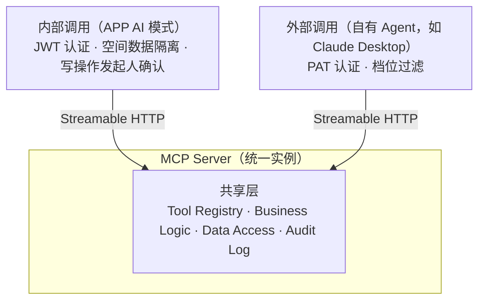

# 对外集成与 MCP 服务

## 目录

1. [MCP 调用模型](#1-mcp-调用模型)
2. [对外 MCP 服务能力](#2-对外-mcp-服务能力)

---

## 1. MCP 调用模型

### 1.1 调用方总览

MCP Server 是**单一服务实例**，同时服务于两类调用方：

- **内部调用（APP AI 模式）**：认证用用户 JWT；权限基于情侣空间的数据隔离；写操作由发起人在客户端确认（服务端确认卡）
- **外部调用（自有 Agent）**：认证用 PAT；按令牌档位过滤工具（只读 / 读写）；确认由外部客户端负责（见「工具权限分级与确认口径」）
- **共享层**：同一套工具定义、业务逻辑、数据访问层与审计日志（区分调用来源）

### 1.2 REST API vs MCP Tools

| 维度 | REST API | MCP Tools |
|:---|:---|:---|
| 调用方 | 传统模式前端（APP）+ 后台管理页面 | AI Agent（内部 + 外部） |
| 协议 | HTTP/JSON | JSON-RPC over Streamable HTTP |
| 粒度 | 细粒度 CRUD | 语义化高层操作 |
| 认证 | JWT + Refresh Token | JWT（内部）/ PAT（外部） |
| 错误处理 | HTTP Status Code | MCP Error Result |

> **关键点**：MCP Tools 不是 REST API 的简单包装，而是**面向 AI 意图的高层抽象**。例如 `find_media` 的 `group_by` 把「按日期地点把未归档照片分桶」收进一个查询，而不是让模型自己搬 id。

---

## 2. 对外 MCP 服务能力

### 2.1 概述

后台服务除了为自有 APP 提供内部 MCP 能力外，还**对外暴露 MCP 服务**，允许自己的 Agent（如 Claude Desktop 等桌面 AI 助手）通过标准 MCP 协议访问情侣空间的数据与功能。面向个人自用，不设第三方接入审批流程。

**这条通道与 APP 的 AI 模式是两回事**：AI 模式是 APP 内的一个界面（走 JWT + 服务端确认卡），本章是外部 Agent 的接入口（走 PAT + 客户端自行确认）。两者共享工具定义，但鉴权、确认责任方、事件协议都不同。

### 2.2 服务架构

- **认证与授权**：PAT（后台手动生成/吊销）；仅绑定情侣用户（girl/boy；admin 不签发 PAT），数据以该用户身份隔离（如 `find_posts(favorited=true)` 只返回绑定用户的收藏）；权限档位只读 / 读写
- **工具暴露**：与内部通道共享同一套工具定义；按令牌档位过滤；**删除类工具不对任何令牌开放**
- **速率与用量**：不设令牌限流（2 用户自用无滥用对象；外部工具执行不产生服务端模型费用——模型运行在 Agent 侧），PAT 泄露兜底为吊销 + 审计日志
- **数据安全**：操作审计（来源标记为对应令牌）+ 数据访问日志
- **工具自描述**：Schema 与说明随 MCP 协议自动下发（`tools/list`），无需单独维护接入文档与 SDK

### 2.3 工具权限分级与确认口径

| 档位 | 可用工具 | 说明 |
|:---|:---|:---|
| 只读 | 全部读工具（清单见 AI模式设计「工具契约」） | 查询与统计类，无副作用 |
| 读写 | 只读全部 + 全部提案工具 | 可写入，不可删除；外部通道直接执行，不走服务端确认卡 |
| 不对令牌开放 | 删除类 | 仅 APP 内部使用 |

**外部通道的确认口径（依 MCP 规范「User Interaction Model」）**：外部通道的写工具确认由**客户端**（外部 Agent）负责——服务端通过 `tools/list` 下发的 `annotations`（`readOnlyHint` / `destructiveHint` / `openWorldHint`）声明风险属性，客户端据此决定是否向用户呈现确认提示。服务端不 gated 执行、不持有待确认状态。这与 APP 内部 AI 模式的**服务端确认卡**是两条不同的 UX 面：前者「客户端确认」（MCP 规范标准模型），后者「服务端确认」（APP 自控 UX）。两条面「写操作须经人确认」的精神一致，差异仅在确认由谁发起。

配套约束：每次写调用落审计（`actor_type=pat`，含人类可读参数与耗时）；后台可随时吊销 PAT 即时生效；只读档位不见写工具。

工具注解派生规则（基于 `IsWrite` / `AppOnly` 三分类——两者的语义与判定见 AI模式设计「执行模式」）：

| 类别 | 判定 | `readOnlyHint` | `destructiveHint` | `openWorldHint` |
|:--|:--|:--|:--|:--|
| 读工具 | `!IsWrite` | `true` | `false` | `false` |
| 写工具（创建 / 可撤销） | `IsWrite && !AppOnly` | `false` | `false` | `false` |
| 删除类（不可逆） | `IsWrite && AppOnly` | `false` | `true` | `false` |

`openWorldHint` 对全部工具固定 `false`（本服务全部操作本地封闭数据集，不与外部世界实体交互）。删除类工具不对 PAT 开放，其注解仍按删除类标注以保持注册表一致性。

### 2.4 接入流程

1. 在后台管理页面生成 PAT，设置绑定用户（girl/boy）并选择权限档位（只读 / 读写）
2. 在自己的 Agent（如 Claude Desktop）中配置 MCP Server 地址 + PAT
3. Agent 通过 MCP 协议调用工具
4. 所有调用记录在审计日志中（来源标记为对应令牌）

### 2.5 协议支持

| 传输方式 | 说明 |
|:---|:---|
| Streamable HTTP | 唯一传输（规范推荐）：客户端 POST JSON-RPC 请求，服务端以 `application/json` 返回单个响应（规范允许的可选简化，不启用 SSE 流 / 会话 / 断线恢复——均为规范 MAY 项，单实例自部署场景不需要） |

> 注：MCP 旧版 HTTP+SSE 传输已被官方废弃；Streamable HTTP 的 SSE 流、`Mcp-Session-Id`、断线恢复均为规范可选特性，本实现采用 JSON 单响应模式，合规且适配单实例自部署。不引入 WebSocket——全部通信为客户端发起的请求 / 响应。

- 端点：`POST /api/v1/mcp`，鉴权用 `Authorization: Bearer <PAT>`（与内部通道的 JWT 相互独立）
- 方法：`initialize` / `tools/list` / `tools/call` / `ping`；通知类消息（无 `id`）按 JSON-RPC 约定不返回响应体
- 工具可见范围按 PAT 档位过滤，删除类工具不对任何令牌开放；后台停用的工具在两个通道同时不可见、不可调用
- 审计按令牌维度记录（`actor_type=pat`、`actor_id=令牌 ID`），`tools/call` 记人类可读参数与调用耗时
