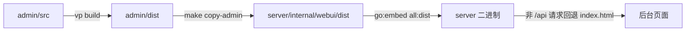

# 后台管理台（admin/）

SoybeanAdmin 模板 + 本仓业务页：Vue 3.5 / naive-ui 2.45 / UnoCSS / pnpm 11；构建产物 `admin/dist` 拷入 `server/internal/webui/dist` 后 `go:embed` 进二进制，随服务端同源发布，不单独部署。

> 本文是后台的实现契约：结构、页面清单、组件、视觉令牌、样式守卫与构建链。证据列路径相对 `admin/src/`，其它位置写仓库根相对路径。

| 事实 | 值 | 证据 |
|:--|:--|:--|
| 框架 / UI 库 | Vue 3.5.43 + naive-ui 2.45.3 / vue-router 5.4.0 / pinia 4.0.3 | `admin/package.json:32-38` |
| 构建器 | `vp`（vite-plus），`dev` 与 `build` 都 `--mode prod` | `admin/package.json:9-10` |
| 包管理 | pnpm 11.28.6 + workspace 子包 `admin/packages/*` | `admin/package.json:7`、`admin/pnpm-workspace.yaml:1-2` |
| 路由模式 | 静态路由（无动态取路由分支；首页 `dashboard`） | `admin/src/router/routes/index.ts:11-16` |
| 入口 | `setupApp()`：插件 → createApp + 错误处理 → store → router → i18n → 挂载 | `admin/src/main.ts:17-45` |
| 根组件 | `NConfigProvider`（明暗主题 / locale / 水印）+ `RouterView` | `admin/src/App.vue:50-63` |

## 1. 结构与落点

| 目录 / 文件 | 职责 | 证据 |
|:--|:--|:--|
| `src/api/` | 业务接口层，17 个模块，每模块 = 类型 + 函数，全部经 `lib/http` | `admin/src/api/index.ts:1-13` |
| `src/lib/` | 业务基建：`http`（请求）/`env`/`toast`/`confirm`/`lucide-map` | `admin/src/lib/*.ts` |
| `src/service/` | 认证适配层：`api/auth.ts` 转调 `@/api/auth`，供模板 auth store 用（无独立 request 客户端） | `admin/src/service/api/auth.ts:1-8` |
| `src/components/` | `common/`（模板通用件）、`custom/`（模板定制件）；根级 3 个业务组件 | 见 §3 |
| `src/layouts/` | `base-layout`（侧栏+头+页签+主题抽屉）、`blank-layout`（登录/错误页） | `admin/src/layouts/base-layout/index.vue:1-13`、`layouts/blank-layout/index.vue:1-6` |
| `src/router/` | `elegant/`（按目录生成的常量路由）、`routes/`（分组/菜单/地址别名）、`guard/`（进度 / 鉴权 / 标题） | `admin/src/router/guard/index.ts:11-15` |
| `src/store/` | 5 个 pinia store：`app`（布局与语言）、`auth`、`route`、`tab`、`theme` | `admin/src/store/modules/*` |
| `src/views/` | 18 个业务页 + 4 个内建页（登录 / 403 / 404 / 500） | 见 §2 |
| `src/styles/` + `src/theme/` | 全局 css/scss；主题设置 `settings.ts`、CSS 变量→UnoCSS 映射 `vars.ts`、4 个预设 JSON | `admin/src/styles/css/global.css:1-3,18,26`、`vite.config.ts:34-36`、`admin/src/theme/*` |
| `src/tokens.ts` | 业务视觉令牌唯一来源（明暗两套 + `buildCssVars` / `injectCssVars`） | `admin/src/tokens.ts:117-168` |
| `src/hooks/` `constants/` `enum/` `locales/` `plugins/` `typings/` `utils/` | 表单/图标/路由钩子、常量、store id 枚举、中英 i18n、启动插件、类型、工具 | `admin/src/*` |

## 2. 页面清单（按侧栏分组）

分组图标 / 顺序 / 入口页在 `admin/src/router/routes/index.ts:11-16`；子页顺序 `:25-42`，顶级页顺序 `:44-51`。路径与视图由 elegant-router 按 `views/` 目录生成（`admin/src/router/elegant/routes.ts:8-260`）。

| 侧栏分组 | 路径 | 页面 | 视图 | 接口模块 |
|:--|:--|:--|:--|:--|
| 仪表盘（1） | `/dashboard` | 仪表盘 | `views/dashboard/index.vue` | `api/dashboard.ts` |
| 空间管理（2） | `/space/info` | 空间信息 | `views/space/info/index.vue` | `api/space.ts` |
| | `/space/members` | 情侣成员 | `views/space/members/index.vue` | `api/users.ts` |
| AI 配置（3） | `/ai/providers` | 供应商 | `views/ai/providers/index.vue` | `api/providers.ts` |
| | `/ai/chat-chain` | 对话模型链 | `views/ai/chat-chain/index.vue` → `components/custom/model-chain.vue` | `api/providers.ts`（`model-chain.vue:20`） |
| | `/ai/embedding-chain` | 嵌入模型链 | 同上（`meta.kind=embedding`） | 同上（`router/routes/index.ts:66`） |
| | `/ai/prompts` | 提示词与风格 | `views/ai/prompts/index.vue` | `api/providers.ts` + `api/styles.ts` |
| | `/ai/tools` | MCP 工具 | `views/ai/tools/index.vue` | `api/tools.ts` |
| | `/ai/tokens` | 访问令牌 | `views/ai/tokens/index.vue` | `api/tokens.ts` + `api/users.ts` |
| 外部集成（4） | `/integrations/webhooks` | 通知渠道 | `views/integrations/webhooks/index.vue` | `api/webhooks.ts` |
| | `/integrations/map` | 地图配置 | `views/integrations/map/index.vue` | `api/map.ts` |
| | `/integrations/remote` | 远程访问 | `views/integrations/remote/index.vue` + `hooks/business/remote-channels.ts`（数据与操作 composable） | `api/uglink.ts` + `api/backupaddr.ts` |
| | `/integrations/proxy` | HTTP 代理 | `views/integrations/proxy/index.vue` | `api/appupdate.ts` |
| | `/integrations/appupdate` | 应用更新 | `views/integrations/appupdate/index.vue` | `api/appupdate.ts` |
| 回收站（5） | `/recycle` | 回收站 | `views/recycle/index.vue` | `api/recycle.ts` + `api/security.ts` |
| 日志（6） | `/logs/audit` | 审计日志 | `views/logs/audit/index.vue` | `api/audit.ts` |
| | `/logs/operations` | 操作日志 | `views/logs/operations/index.vue` | `api/recycle.ts`（restore-log） |
| | `/logs/service` | 服务日志 | `views/logs/service/index.vue` | `api/logs.ts` |

分组前缀（`/space`、`/ai`、`/integrations`、`/logs`）本身是 `layout.base` 父路由，`redirect` 到组内第一页（`admin/src/router/routes/index.ts:53-81`）。

内建页（`constant: true`、不在菜单）：

| 路径 | 用途 | 视图 |
|:--|:--|:--|
| `/login/:module`（仅 `pwd-login`） | 登录 | `views/_builtin/login/index.vue` + `modules/pwd-login.vue` |
| `/403`、`/404`、`/500` | 错误页 | `views/_builtin/{403,404,500}/index.vue` |

路由只来自 `generatedRoutes`（elegant-router 按 `views/` 目录生成）：不在菜单里的页面也必须先有视图文件，没有「只做地址映射」的别名路由。

## 3. 组件与依赖

| 依赖 | 版本 | 用在哪 | 证据 |
|:--|:--|:--|:--|
| `naive-ui` | 2.45.3 | 全部页面组件（`NDataTable`/`NCard`/`NModal`/`NForm`…） | `admin/package.json:32` |
| `vue-router` / `pinia` | 5.4.0 / 4.0.3 | 静态路由 + 守卫 / 五个 store | `:38`、`:34` |
| `lucide-vue-next` | ^1.0.0 | 业务页图标（统一 Lucide）；服务端下发图标名经 `lib/lucide-map.ts` 转组件 | `:31` |
| `@iconify/vue` | 5.0.3 | 菜单 / 模板图标（`mdi:*`） | `:22` |
| `unocss` | ^66.10.5 | 原子类，`presetWind3({dark:'class'})` + `presetSoybeanAdmin` | `admin/uno.config.ts:25` |
| `@iconify/utils` | 3.1.7 | `build/plugins/unocss.ts` 的图标集合生成 | `admin/package.json:43` |
| `vite`（catalog） | 1.4.0（`@voidzero-dev/vite-plus-core`） | `build/plugins/*` 的插件类型与 `vite.config.ts` | `admin/package.json:61` |
| `vue-i18n` | 11.4.13 | 中英双语；页面标题键在 `locales/langs/zh-cn.ts:222-250` | `:37` |
| `@vueuse/core` / `dayjs` | 15.0.0 / 1.11.23 | 尺寸断点、日期格式化 | `:27`、`:29` |
| `@better-scroll/core` | 2.5.1 | `custom/better-scroll.vue` | `:21` |

工作区子包 `@sa/{color,hooks,materials,scripts,uno-preset,utils}` 均 2.3.0（`admin/packages/*/package.json`）。`src/` 引用行数：`@sa/hooks` 10、`@sa/materials` 11、`@sa/color` 7、`@sa/utils` 2；`@sa/uno-preset` 只在 `uno.config.ts:2`，`@sa/scripts` 只提供 `sa` CLI。

可复用组件（业务页真实引用）：

| 组件 | 用途 | 引用数 | 证据 |
|:--|:--|:--|:--|
| `components/SectionHeader.vue` | 页面区块头（标题 + 右侧动作），页面唯一一级标题槽位 | 9 | `admin/src/components/SectionHeader.vue:2-5` |
| `components/ConfirmDialog.vue` | 危险操作确认弹窗（Esc / 焦点圈定 / 滚动锁） | 8 | `admin/src/components/ConfirmDialog.vue:2-5` |
| `components/StatCard.vue` | 统计卡（图标 + 标签 + 数值 + tone） | 1（仪表盘，按数据条数渲染） | `admin/src/components/StatCard.vue:2-5` |
| `components/custom/model-chain.vue` | 对话/嵌入模型链共用视图，链别由 `route.meta.kind` 决定 | 2 | `admin/src/components/custom/model-chain.vue:30` |
| `components/common/app-provider.vue` | 注册 `window.$message/$dialog/$notification/$loadingBar` | 全局 | `admin/src/components/common/app-provider.vue:13-16` |
| `custom/` 与 `common/` 的其余件 | 模板自带：`custom/{button-icon,svg-icon,wave-bg,better-scroll}` 与 `common/*` 只由模板壳层（`layouts/`、`global-tab`、`theme-drawer`）使用，`views/` 内 0 引用 | 0（views 内） | `admin/src/components/**` |

`lib/` 的五个契约：

| 文件 | 契约 | 证据 |
|:--|:--|:--|
| `lib/http.ts` | 唯一请求入口：拼 base、注入 Bearer、401 时单飞 refresh 后重放一次，仍 401 清凭证并 `window.location.replace(BASE_URL+'login')`；`ApiError` 带 status | `admin/src/lib/http.ts:95-126`、`:62-87` |
| `lib/env.ts` | `VITE_API_BASE_URL` 为空 → 相对路径 `/api`（同源部署形态） | `admin/src/lib/env.ts:6-7` |
| `lib/toast.ts` | 统一轻提示，走 `window.$message`；四个方法 success / error / info / warning | `admin/src/lib/toast.ts:1-5` |
| `lib/confirm.ts` | 「确认弹窗 + 执行 + 错误 toast」通用流，视图只填文案与请求 | `admin/src/lib/confirm.ts:5-9` |
| `lib/lucide-map.ts` | 服务端下发的 lucide 名 → 组件，未知回退 `FileText` | `admin/src/lib/lucide-map.ts:1-4` |

## 4. 视觉令牌（`admin/src/tokens.ts`）

| 类别 | 令牌 | 实际值 | 证据 |
|:--|:--|:--|:--|
| 表面 / 文字（明） | `canvas` `subtle` `border` `ink` `inkSecondary` `inkTertiary` | `#ffffff` `#f3f1ed` `#e7e4de` `#1f2328` `#5b6167` `#9aa0a6` | `admin/src/tokens.ts:14-20` |
| 品牌 | `primary` `primaryHover` `primaryContrast` | `#b23a6f` `#c45082` `#ffffff`（浆果红，与 APP 品牌粉同源） | `:21-23` |
| 语义 + 底色 | `success`/`successBg`、`warning`/`warningBg`、`error`/`errorBg`、`info`/`infoBg` | `#18a058`/`#e8f7ef`、`#f59e0b`/`#fdf3e1`、`#e5484d`/`#fdebec`、`#2e90fa`/`#e9f4fe` | `:24-31` |
| 表面 / 文字（暗） | 同 17 个颜色键 | `canvas #1c1c1e`、`subtle #26262a`、`border #3a3a3f`、`ink #e8e6e3`、`primary #d4558f` | `:88-107` |
| 间距 / 圆角 / 字号 | `space-1..8` / `radius-xs..xl` / `text-xs..2xl` | 4·8·12·16·20·24·32·40 px / 4·8·8·12·16 px / 11·12·13·14·16·20·28 px（正文 13，标题 ≤20） | `:35-64` |
| 行高 | `lineHeight` | 1.25 · 1.5 · 1.7 | `:66-70` |
| 阴影 / 过渡 | `shadow-sm` `shadow-md` / `transition` | `0 1px 2px rgba(0,0,0,.04)`、`0 8px 24px rgba(0,0,0,.08)` / `150ms ease`（单节奏，无弹性动效） | `:72-80` |
| 布局尺寸 | `controlSm` `controlMd` | 160px / 220px | `:82-86` |
| 字体 | `font-sans` / `font-mono` | Inter 优先 + PingFang SC；系统等宽 | `:108-115` |

机制：`buildCssVars(dark)` 产出 39 个 `--*` 键，`injectCssVars` 写入 `:root`（`admin/src/tokens.ts:117-168`）；启动时由 `App.vue` 的 `watchEffect` 按 `themeStore.darkMode` 注入，明暗切换时重注入并挂 `darkTheme`（`admin/src/App.vue:19-23`）。

- **明暗两套都有**：色彩是 `color` / `colorDark` 双份；非色彩令牌（间距、字号、圆角等）只一份，明暗共用。
- **预设是部分覆盖**：`default` / `dark` 各 21 键，`compact` 9 键、`azir` 11 键；`applyPreset` 用 `defu(preset, themeSettings)` 以默认值补齐，缺键不是数据缺失（`admin/src/theme/preset/*.json`、`admin/src/layouts/modules/theme-drawer/modules/preset/modules/theme-preset.vue:84`）。
- 主色两处定义：令牌 `primary #b23a6f` 与主题抽屉 `settings.themeColor` 同为 `#b23a6f`，改主色需同步（`admin/src/theme/settings.ts:7`）。

`theme/` 与 naive-ui 的映射：

| 文件 | 作用 | 证据 |
|:--|:--|:--|
| `theme/settings.ts` | 模板主题默认值：主色 `#b23a6f`、圆角 8、侧栏宽 220、`tokens.light/dark` 的容器与布局底色 | `admin/src/theme/settings.ts:2-89` |
| `theme/vars.ts` | CSS 变量 → UnoCSS theme 键（`colors.primary` = `rgb(var(--primary-color))`…） | `admin/src/theme/vars.ts:21-34`；被 `uno.config.ts:12` 展开 |
| `store/modules/theme/shared.ts` | `getNaiveTheme()` 生成 naive-ui `GlobalThemeOverrides`（common 色板 + `borderRadius = themeRadius`） | `admin/src/store/modules/theme/shared.ts:243-266` |
| `theme/preset/*.json` | 4 个预设（default / dark / compact / azir），只覆盖主题抽屉的设置项 | `admin/src/theme/preset/` |

## 5. 样式与质量守卫

`admin/package.json:8-19` 的脚本即全部质量入口：

| 脚本 | 命令 | 说明 |
|:--|:--|:--|
| `typecheck` | `vue-tsc --noEmit --skipLibCheck` | `strict: true`（`admin/tsconfig.json:15`） |
| `lint:gate` | `eslint src --max-warnings=0` | 零告警门禁；`lint` 才是 `--fix` 版本 |
| `guard` | `node scripts/guard-styles.mjs` | 样式守卫 |
| `verify` | `typecheck && lint:gate && guard` | 三条串行 |
| `fmt` / `gen-route` | `vp fmt` / `pnpm sa gen-route` | 格式化 / 重新生成 elegant 路由 |

`make verify-admin` 实际做的事：`cd admin && pnpm run verify`，即上表的 `verify`（`Makefile:87-88`）。CI 经 `make -k verify` 与后端、APP 一起跑（`.github/workflows/ci.yml:41-42`）。

样式守卫（`admin/scripts/guard-styles.mjs`）扫 `src/api`、`src/lib`、`src/views`、`src/components/{custom,SectionHeader,StatCard,ConfirmDialog}`、`src/service/api/auth.ts`、`src/store/modules/auth/*`（`:23-34`），四条规则：

| 规则 | 判据 | 证据 |
|:--|:--|:--|
| 颜色 | `<style>` 与静态内联禁裸 hex / `rgb()` / `hsl()`，只允许 `var(--…)` | `:79-81,85-86` |
| 字号 | `font-size` 禁裸 px，必须 `var(--text-*)`；组件几何尺寸允许 px | `:57-58,87` |
| 令牌白名单 | `var(--x)` 的 `x` 必须出现在 `tokens.ts` 的 `buildCssVars` 键里；键数必须与函数体字面量一致，结构变动即报错 | `:36-48,88-91` |
| 死令牌 | 每个声明令牌至少被一处 `var(--x)` 引用，否则失败 | `:120-127` |
| 原生弹窗 | 禁 `window.confirm/alert/prompt`，统一确认弹窗 + toast | `:60,75-77` |

未覆盖：动态 `:style` 绑定与 UnoCSS 原子类里的方括号色值不拦（脚本注释明示，靠评审）。

其余约束：eslint 用 `@soybeanjs/eslint-config-vue`，只额外加「组件名 PascalCase（`icon-*` 除外）」一条 warn（`admin/eslint.config.mjs:3-13`）；`.editorconfig` 定 2 空格、LF、去尾空格；UnoCSS 只留一个 shortcut `card-wrapper`（`admin/uno.config.ts:21-23`）。

**没有单元测试 / e2e**：`package.json` 无 `test` 脚本，无 vitest/jest 依赖，仓库内无 `*.test.ts`、`*.spec.ts`、`vitest.config.*`。质量闸门只有类型检查 + eslint + 样式守卫，界面靠浏览器实测。

## 6. 构建链

| 环节 | 事实 | 证据 |
|:--|:--|:--|
| vite 配置 | `defineConfig` 来自 `vite-plus`；`base = VITE_BASE_URL`（`/`）；scss `additionalData` 自动 `@use "@/styles/scss/global.scss"` | `admin/vite.config.ts:13,30-36` |
| dev / preview | dev `:5173`（`host 0.0.0.0`，`/api` 代理到 `API_PROXY ?? http://localhost:8080`）；preview `:9725` | `admin/vite.config.ts:42-53` |
| build | 产物默认 `admin/dist`（未改 `outDir`）；`sourcemap` 由 `VITE_SOURCE_MAP=Y` 控制，当前 `N` | `admin/vite.config.ts:54-58`、`admin/.env.prod:26` |
| 环境变量 | 构建与运行共用 `.env.prod`；本地覆盖用不入库的 `.env.local`；`VITE_API_BASE_URL=` 留空 = 同源 `/api` | `admin/.env.prod:1,39`、`admin/.env.example` |
| 构建命令 | `make build-admin` = `pnpm install --frozen-lockfile && pnpm run build` | `Makefile:102-103` |
| 新鲜度判断 | `ensure-admin-dist`：`dist/index.html` 不存在，或 `src/` + `index.html` + `package.json` 比它新 → 重建；否则跳过（Docker 阶段无 src 时自动跳过） | `Makefile:108-118` |
| 拷入内嵌目录 | `copy-admin` 依赖 `ensure-admin-dist`，清空 `server/internal/webui/dist`（保留 `.gitkeep`）后整目录覆盖 | `Makefile:121-125` |
| 内嵌 | `//go:embed all:dist`，`FS()` 返回以 `dist` 为根的文件系统 | `server/internal/webui/embed.go:10-16` |
| 托管 | `mux.Handle("/", spaHandler(webuiDist))`，非 `/api` 路径回退 `index.html` | `server/internal/api/router.go:265`、`:316-332` |
| 顺序强制 | `build-server` 依赖 `copy-admin`：先刷产物再编译，避免把上一次的后台页面打进二进制 | `Makefile:129-131`（注释 `:126-128`） |
| Docker | stage1 `node:22-alpine` + `corepack prepare pnpm@11` 跑 `make build-admin`；stage2 `COPY --from` 后 `make build-server`（GOOS/GOARCH 由 buildx 注入） | `Dockerfile:9-17,20-36` |

日常链路：`make admin-dev`（`:5173` 连 `:8080`）→ `make serve`（先 `copy-admin` 再 `go run`，改后端即生效）；只有出二进制 / 镜像才走 `make build`。

## 7. 坑与守卫

改到 `src/` 先跑 `pnpm run verify`；四条样式规则由 `scripts/guard-styles.mjs` 自动执行。

| 约束（不许改坏） | 守卫 |
|:--|:--|
| 颜色只允许 `var(--token)`：`<style>` 与静态内联禁裸 hex / `rgb()` / `hsl()` | `scripts/guard-styles.mjs:79-81,85-86` |
| `font-size` 必须走 `var(--text-*)`；组件几何尺寸允许 px | `scripts/guard-styles.mjs:57-58,87` |
| `var(--x)` 的 x 必须在 `tokens.ts` 的 `buildCssVars` 键里；键数与函数体字面量必须一致 | `scripts/guard-styles.mjs:36-48,88-91` |
| 声明了但没人用的令牌同样失败（死令牌反向检查） | `scripts/guard-styles.mjs:120-127` |
| 禁原生 `window.confirm/alert/prompt`，统一确认弹窗 + toast | `scripts/guard-styles.mjs:60,75-77` |
| 类型严格（`strict: true`），不允许 any 逃逸 | `pnpm run typecheck`（vue-tsc） |
| eslint 零告警 | `pnpm run lint:gate`（`--max-warnings=0`） |
| 仪表盘四块数据 `allSettled` 分块降级；空态必须区分「加载中 / 加载失败 / 确实为空」（失败不许说成「暂无」） | **无自动测试**：浏览器断网或改错接口地址后逐块看文案 |
| 回收站保留期读失败：toast 提示 + 输入与保存禁用，不许静默禁用 | **无自动测试**：拦一次 `/admin/security` 请求看提示 |
| 服务日志首载失败即停轮询：跟随按钮显示暂停时不许仍有定时器 | **无自动测试**：拦 `/admin/logs` 后看「跟随」状态与 Network 请求 |
| 页面交互与视觉呈现 | **无自动测试**：浏览器逐页实测（元素、控制台、网络请求） |
