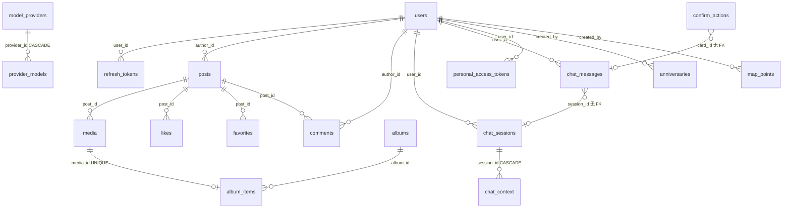

# 架构

**结论**：三端一个发布物。服务端是唯一后端（HTTP + SQLite + 媒体 + AI 编排），admin 页面构建期内嵌进同一个静态二进制，APP 只连这个服务端；全部状态落在 `DATA_DIR`。`Makefile:129-131`、`server/internal/webui/embed.go:10-15`、`server/internal/config/config.go:12-18`

## 1. 三端组成与职责边界

| 端 | 目录 | 职责 | 入口 |
|:--|:--|:--|:--|
| 服务端 | `server/` | 唯一后端：`/api/v1/*`、SQLite、媒体管线、AI 对话与 MCP、定时任务 | `server/cmd/server/main.go:106-203` |
| APP | `app/` | 情侣用户客户端（Android 原生 Compose），读写业务数据 | `app/app/src/main/java/com/bookandmusic/lovelife/appnative/MainActivity.kt:34` |
| 后台 | `admin/` | 管理员配置台（Vue3），只调 `/api/v1/admin/*`、`/api/v1/auth/*` 与 `GET /api/v1/space` | `admin/src/main.ts:11-30`、`admin/src/api/*.ts` |

边界三条，均由代码约束：

1. **角色隔离**：admin 只进后台，girl/boy 只进 APP；登录入口判一次，路由中间件再拦一次。`server/internal/auth/service.go:166-182`、`server/internal/api/admin.go:414-439`
2. **后台不单独部署**：静态资源由 `go:embed` 进二进制，非 `/api` 路径回退 `index.html`。`server/internal/api/router.go:265`、`:316-332`
3. **APP 不直连第三方**：更新包、地图瓦片都经服务端中转。`app/app/src/main/java/com/bookandmusic/lovelife/appnative/data/AppUpdate.kt:47`、`server/internal/api/router.go:154-164`

## 2. 认证与会话

| 决定 | 证据 |
|:--|:--|
| 无 Cookie：认证只走 `Authorization: Bearer`，因此没有 CSRF 面；CORS 只对 `/api/*` 放开 | `server/internal/api/router.go:292-313` |
| 会话 = JWT access + 可轮换 refresh：access 不查库（吊销 refresh 后仍在有效期内可用），刷新即换新行 | `server/internal/auth/token.go:16-25`、`auth/service.go:239-257` |
| 凭证三种作用域：用户会话（JWT）、外部 MCP（PAT，库内只存哈希）、媒体与瓦片（按用途分域的签名 URL） | `server/internal/store/pat.go:13-22`、`server/internal/media/media.go:568-581`、`server/internal/api/mapconfig.go:355-364` |
| 两把密钥分离：`jwt_secret` 管签名与 HMAC，`crypto_key` 管静态加密，轮换前者不影响已存密文 | `server/internal/crypto/keyfile.go:19-38`、`server/cmd/server/main.go:141-148` |
| 口令 bcrypt；登录失败按「用户名 \| IP」限速，状态在进程内存，重启清零 | `server/internal/auth/password.go:5-12`、`auth/limiter.go:9-16` |
| 入口按 `client` 绑定角色（admin 只进后台、girl/boy 只进 APP），进路由前中间件再拦一次 | `server/internal/auth/service.go:166-182`、`server/internal/api/admin.go:414-439` |

## 3. 数据模型

机制：SQLite 单库 `DATA_DIR/love-life.db`（WAL、busy_timeout 5s、外键开启），启动时按文件名顺序执行内嵌迁移并记入 `schema_migrations`；`001_init.sql` 一次建出全量库，不提供增量迁移。`server/internal/store/db.go:36-39`、`server/internal/store/migrate.go:12-58`、`server/internal/store/migrations/001_init.sql:16`

> 下表「证据」中的 `001_init.sql` 均指 `server/internal/store/migrations/001_init.sql`。

| 表 | 用途 | 关键约束 / 索引 | 证据（`001_init.sql`） |
|:--|:--|:--|:--|
| `users` | 账号（admin / girl / boy） | `username UNIQUE`；`role CHECK`；`ai_style` 默认「文艺」 | `001_init.sql:17-28` |
| `refresh_tokens` | 会话刷新行 | `token_hash UNIQUE`；`idx_refresh_tokens_user(user_id)`；FK users | `001_init.sql:29-38` |
| `posts` | 动态 | 软删三件套 `deleted_at`/`deleted_by`/`deleted_by_type`；`idx_posts_created(created_at DESC)`、`idx_posts_author` | `001_init.sql:39-54` |
| `media` | 媒体（photo/video/audio） | `post_id` FK；`kind CHECK`；尺寸/时长/缩略图；`idx_media_post` | `001_init.sql:55-72` |
| `likes` | 点赞 | PK `(post_id, user_id)`；双向 FK | `001_init.sql:73-79` |
| `favorites` | 收藏 | PK `(post_id, user_id)`；双向 FK | `001_init.sql:80-86` |
| `comments` | 评论 | 软删三件套；`idx_comments_post(post_id, id DESC)` | `001_init.sql:87-100` |
| `albums` | 相册（只有手动相册） | `cover_media_id`；软删三件套 | `001_init.sql:101-112` |
| `album_items` | 相册-媒体 | PK `(album_id, media_id)`；`UNIQUE(media_id)` 一文件一相册 | `001_init.sql:113-121` |
| `map_points` | 地图点位 | `source CHECK(post/manual/ai)`；`idx_map_points_name`、`idx_map_points_deleted` | `001_init.sql:122-139` |
| `anniversaries` | 纪念日 | `type CHECK(solar/lunar)`；`is_leap`；`remind_days_before` | `001_init.sql:140-155` |
| `webhook_channels` | 外部通知渠道 | `method CHECK(GET/POST)`；`headers_json`/`body_template`/`events_json`；空间级无用户归属 | `001_init.sql:156-166` |
| `notifications` | 站内通知 | `idx(recipient_id, created_at DESC)`；无已读位（点击即删） | `001_init.sql:167-180` |
| `chat_sessions` | AI 会话 | 懒创建；`pinned`；`idx(user_id, pinned DESC, updated_at DESC)` | `001_init.sql:228-237` |
| `chat_messages` | 对话展示消息 | `role CHECK(user/assistant)`；`parts` 有序 JSON；`turn_id` 整轮回滚；`session_id` 无 FK（0 兜底） | `001_init.sql:181-206` |
| `chat_context` | 模型上下文（与展示存储分离） | `kind` 四分类 + `pinned`；`seq`；`session_id` FK `ON DELETE CASCADE` | `001_init.sql:207-227` |
| `chat_result_sets` | 读工具结果集句柄 | `result_id`、`ids_json`、`groups_json`；无 FK（随会话硬删同删） | `001_init.sql:257-268` |
| `confirm_actions` | 提案卡 | `status CHECK(pending/confirmed/cancelled/expired/failed)`；`expires_at`；`preview_json` | `001_init.sql:238-256` |
| `audit_logs` | 审计 | `actor_type CHECK(user/ai/pat)`；`params`/`result`/`latency_ms`；`idx(created_at DESC)` | `001_init.sql:269-285` |
| `personal_access_tokens` | PAT | `tier CHECK(readonly/readwrite)`；`status CHECK`；`token_hash UNIQUE` | `001_init.sql:286-299` |
| `ai_usage_logs` | 模型调用用量 | `provider_id`（无 FK）；tokens；`status CHECK`；`idx(created_at DESC)` | `001_init.sql:300-313` |
| `restore_logs` | 回收站恢复日志 | 不可删、永久保留；`idx(created_at DESC)` | `001_init.sql:314-322` |
| `space` | 情侣空间 | 单行 `CHECK (id = 1)`；`name`/`signature`/`love_start_date` | `001_init.sql:323-330` |
| `map_sources` | 地图源 | `type CHECK(public/tianditu)`；`enabled=1` 部分唯一索引 | `001_init.sql:331-344` |
| `model_providers` | 模型供应商 | `api_type` 四值；`api_key_enc` 加密存储；`header_timeout_sec` 可空 | `001_init.sql:345-361` |
| `provider_models` | 模型条目（两条链） | `kind CHECK(chat/embedding)`；`chain_order` 全局链序；`UNIQUE(provider_id, kind, model_id)`；FK CASCADE | `001_init.sql:362-383` |
| `output_styles` | 输出风格 | `name UNIQUE`；`builtin`；种子 3 行（文艺/幽默/简洁） | `001_init.sql:384-399` |
| `app_settings` | 全局单值配置 | `key` 主键；`default_style_id`、`recycle_retention_days` | `001_init.sql:400-404` |

其余表（`webhook_channels`、`notifications`、`chat_result_sets`、`audit_logs`、`ai_usage_logs`、`restore_logs`、`space`、`map_sources`、`output_styles`、`app_settings`）无外键或仅单向外键（如 `notifications.recipient_id`），故不画出。

口径三条：

- **软删 + 回收站**：可回收内容共六张表（动态 / 评论 / 照片 / 相册 / 纪念日 / 地图点位），`deleted_at` 软删、`deleted_by`/`deleted_by_type` 记删除者；每日本地 0 点按保留期（7~365 天，默认 30）永久删除并写 `restore_logs`。`server/internal/store/recycle.go:61-66`、`:18-24`、`server/cmd/server/main.go:63-104`
- **时间列**：库内一律 UTC 的 `datetime` 文本，用户可见日期按进程本地时区。`server/internal/store/timeutil.go:8-24`
- **向量是派生数据**：落在 `DATA_DIR/vectors`，可从正文重建，不进备份语义；打不开时检索回落关键词。`server/internal/search/search.go:1-4`、`server/cmd/server/main.go:153-156`

## 4. 部署形态

| 环节 | 事实 | 证据 |
|:--|:--|:--|
| 发布物 | 单个静态 Linux 二进制，admin 页面内嵌：`make build` = build-admin → copy-admin → build-server，`CGO_ENABLED=0` + `-trimpath -ldflags="-s -w"` | `Makefile:100-133`、`server/internal/webui/embed.go:10-15` |
| 镜像 | 三阶段：node22 构建 admin → golang1.25 编译 Go → alpine3.22 运行时（ca-certificates/tzdata/su-exec/ffmpeg） | `Dockerfile:7-54` |
| 镜像内权限 | 入口脚本以 root 修正数据目录属主后 `su-exec` 降权到 `app` 运行 | `docker-entrypoint.sh:8-26`、`Dockerfile:44-48` |
| 数据与依赖 | 状态全在 `DATA_DIR`；无外部依赖（外部数据库、缓存、对象存储、队列都不用） | `server/internal/config/config.go:12-18`、`server/internal/store/db.go:36-51` |
| TLS | 服务端只监听明文 HTTP，TLS 由部署侧反代终结 | `server/cmd/server/main.go:174-190`、`docker-compose.yml:6` |
| `.env` | 两个消费者：`make android-keystore` / `android-sign-env` 的三项签名配置，与 docker compose 的变量代入（`ADMIN_USER` / `ADMIN_PASS`）；服务端进程不读文件配置 | `.gitignore:16`、`Makefile:156-172`、`docker-compose.yml:16-18`、`server/internal/config/config.go:12,15` |
| 不入库 | `server/data*/` 与 `bin/` 被 git 忽略 | `.gitignore:7,9-10` |

## 5. CI

| Workflow | 触发 | 做什么 |
|:--|:--|:--|
| `ci.yml` | push `main` / tag `v*`、任意 PR、手动 | Go 1.25 + Node 22 + pnpm 11；`make deps`；`make -k verify` = 文档/注释门禁（`Makefile:71-72`）+ 后端 build+vet+test+gofmt（`Makefile:74-79`）+ admin typecheck/eslint/样式守卫（`Makefile:87-88`） |
| `app-ci.yml` | push `main`/`feat/app*`、PR，且改动 `app/**`、`server/internal/limits/**`、`Makefile` 或本 workflow；可手动 | JDK 25 + Android SDK；`make verify-app`（资源/编译 + `:app`/`:core:designsystem` 单测 + Lint），并归档 Lint 报告 |
| `android-build.yml` | push tag `v*` | 先 `make verify-app` 再出包；版本号取 tag；注入 `APP_DEFAULT_BASE`；签名 release APK；`aapt2` 回读产物核对版本；发 GitHub Release |
| `docker-publish.yml` | push tag `v*` | 先 `make -k verify`（独立 job，失败即不发布）；buildx 多架构（linux/amd64、linux/arm64）构建并推送 GHCR；tag 规则 semver + `sha-<短SHA>`，并把 `latest` 指向最新发布（`docker-compose.yml` 用的就是它） |

注：`make verify` 含文档门禁、后端与 admin；APP 由 `app-ci.yml` 单独跑（`Makefile:68`、`.github/workflows/app-ci.yml:1-25`）。

## 6. 明确不做与已否决

只列代码能反推的事实（缺位、CHECK 约束、注释里的约束说明）。

| 事项 | 代码依据 |
|:--|:--|
| 自助注册 / 找回密码 | 认证路由只有 login / refresh / logout / me（`server/internal/api/router.go:31-34`）；账号由 admin 建（`router.go:40`）或首启 env bootstrap（`server/cmd/server/main.go:318-341`）；无 register 处理函数 |
| 多空间 / 多租户 | `space` 表 `CHECK (id = 1)` 单行（`001_init.sql:323-330`），全部业务表无 `space_id` 列 |
| Cookie 会话 / CSRF 面 | 认证只走 `Authorization` 头，CORS 注释明确「无 Cookie」（`server/internal/api/router.go:292-296`） |
| 服务端 TLS | 只用 `srv.ListenAndServe`（`server/cmd/server/main.go:174-190`），配置项无证书字段（`server/internal/config/config.go:13-20`） |
| 后台前端单独部署 | `admin/dist` 不入库、构建时拷入 `go:embed`（`Makefile:121-131`、`server/internal/webui/embed.go:10-15`），请求由 `spaHandler` 兜底（`server/internal/api/router.go:316`） |
| APP 直连第三方 | APP 无第三方业务请求（唯一外链是 GitHub 仓库页，交系统浏览器：`app/app/src/main/java/com/bookandmusic/lovelife/appnative/ui/AboutScreen.kt:115-119`）；更新走 `/api/v1/app/update/*`（`app/app/src/main/java/com/bookandmusic/lovelife/appnative/data/AppUpdate.kt:47`、`server/internal/api/router.go:154-156`）；瓦片走服务端代理（`app/app/src/main/java/com/bookandmusic/lovelife/appnative/ui/MapCanvas.kt:215`、`server/internal/api/router.go:163-164`）；模型/搜索/地图密钥只在服务端 |
| 对话保留期 / 自动清理对话 | 安全设置只有 `recycle_retention_days` 一项，无 `chat_retention_days`（`server/internal/store/recycle.go:13-21`、`server/internal/api/security.go:41-44`） |
| ORM 与迁移框架 | 内嵌 20 行迁移实现 + `schema_migrations`（`server/internal/store/migrate.go:12-58`），直接 `database/sql`（`server/internal/store/db.go:36-50`） |
| CGO / 外部数据库 | `CGO_ENABLED=0`（`Makefile:131`）；SQLite 用纯 Go 驱动（`server/internal/store/db.go:9`、`server/go.mod:10`），无 Postgres/Redis/队列依赖 |
| 通知已读位 | `notifications` 无 `is_read`/`read_at`，点击即删（`001_init.sql:14,167-180`；`server/internal/api/router.go:230-231`） |
| 月度相册实体行 | 按月分组不落行：时间轴每行带 `month_key`，APP 按它分组（无月度详情端点，`001_init.sql:99-100`） |
| `temperature` 参数 | 模型参数面不含温度：现役模型思考恒开，且与 anthropic 的 temperature 互斥（`001_init.sql:360-361`） |
| 删除类工具对外 / admin 持令牌 | `AppOnly` 不对任何令牌开放（`server/internal/tools/registry.go:8`、`server/internal/mcp/service.go:6`）；PAT 不给 admin 签发（`server/internal/store/pat.go:15-19`） |
| HEIC 等格式 | 照片仅 jpg/png/webp（`server/internal/media/media.go:34`），无 HEIC 解码路径 |
| 后台登录页的注册/重置入口 | 登录只有密码模式；无注册/重置视图（`admin/src/views/_builtin/login/index.vue:26-30`），服务端也无对应路由（`server/internal/api/router.go:31-34`） |
